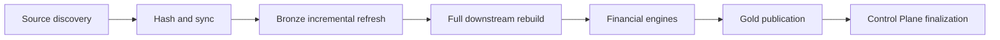

# Performance, workload, and benchmarking

I optimize for a local financial workload with repeated source snapshots and frequent daily execution. I distinguish measured operational observations from reproducible benchmark guarantees.

## Performance model



The pipeline combines artifact-level incremental ingestion with downstream analytical reconstruction. Cached and fresh runs therefore differ in source synchronization work, but both can still execute substantial transformation and financial processing.
## Observed workload

My maintained workload has been reported at **1,629 source artifacts**, with approximately **20 seconds for a cached run** and **40 seconds for a fresh run**. These are maintainer-observed operating figures, not a standardized cross-machine benchmark. They should be refreshed when workload or environment materially changes.
## Measurement dimensions

| Dimension | Why I track it |
|---|---|
| Artifact count | workload scale and source growth |
| Cache state | changed versus unchanged artifact processing |
| Stage duration | locate extraction, transform, engine or publication cost |
| Filesystem and disk | local I/O can dominate runtime |
| DuckDB / SQLite version | engine implementation can affect throughput |
| Run outcome | failed runs are not successful performance samples |
## Instrumentation source

**Implementation:** `backend/pipeline/etl_pipeline.py` near line 248.

```python
    def run(self) -> None:
        self.cfg.validate_config()

        validate_registry()

        start_time = time.perf_counter()

        run_id = None
        cp = None
        log_file_path = self.db_manager.db_path.replace(".duckdb", ".log")

        try:
            add_queue_handler(cast("multiprocessing.Queue[Any]", self.status_queue))
```

**Implementation:** `backend/load/control_plane/run_repo.py` near line 33.

```python
    def start_run(self, cfg_json: str | None = None, rules_json: str | None = None) -> str:
        run_id = str(uuid.uuid4())
        now = datetime.now().isoformat(timespec="seconds")
        settings_id: str | None = None
        rules_id: str | None = None
        with self.db.atomic():
            for payload, prefix, table in (
                (cfg_json, "snap_set_", "cp_settings_snapshots"),
                (rules_json, "snap_rule_", "cp_rules_snapshots"),
            ):
                if not payload:
                    continue
```

I associate performance observations with run identity and stage boundaries rather than presenting a single stopwatch figure as an unconditional SLA.
## Benchmark protocol

To compare revisions, I keep the source artifact set, machine, disk state, rules, configuration, and cache condition consistent. I run multiple repetitions and report distribution, not only a best case. I do not call a cached run fully incremental when Silver and Gold are rebuilt.
## Optimization trade-offs

I prioritize deterministic accounting, traceability, and predictable local execution before squeezing every millisecond. A 20-second cached run may be an excellent daily operating experience without implying a universal 20-second runtime.
