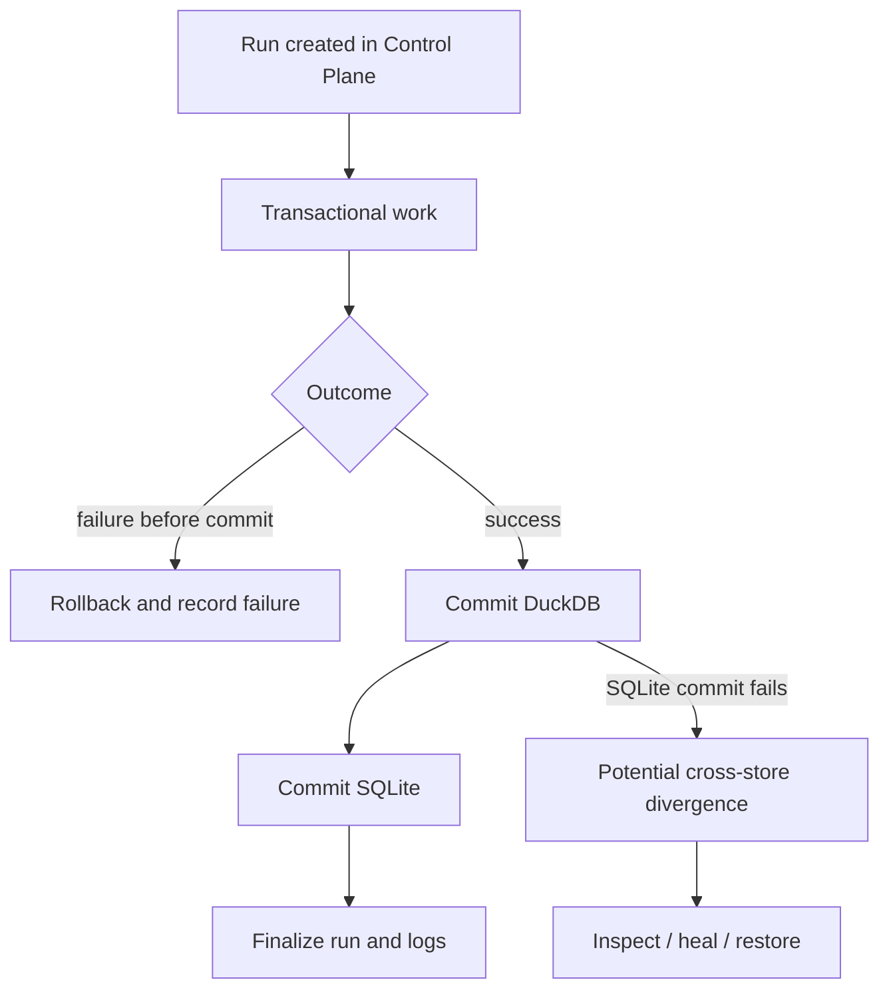

# Reliability and recovery model

I design reliability around durable run identity, explicit transaction boundaries, retained source evidence, and validated snapshots. My reliability model must reflect the implementation: I can roll back work within a database, but I cannot claim atomic commits across SQLite and DuckDB.

## Reliability architecture



I register run identity before the main analytical transaction so failures can still have an operational record. I keep rollback, healing, and snapshot restoration conceptually separate.
## Durable run state

**Implementation:** `backend/load/control_plane/run_repo.py` near line 33.

```python
    def start_run(self, cfg_json: str | None = None, rules_json: str | None = None) -> str:
        run_id = str(uuid.uuid4())
        now = datetime.now().isoformat(timespec="seconds")
        settings_id: str | None = None
        rules_id: str | None = None
        with self.db.atomic():
            for payload, prefix, table in (
                (cfg_json, "snap_set_", "cp_settings_snapshots"),
                (rules_json, "snap_rule_", "cp_rules_snapshots"),
            ):
                if not payload:
                    continue
                canonical = self._canonical_json(payload)
                digest = hashlib.sha256(canonical.encode("utf-8")).hexdigest()
                snapshot_id = f"{prefix}{digest}"
                self.db.conn.execute(
```

**Implementation:** `backend/load/control_plane/run_repo.py` near line 100.

```python
    def finish_run(self, run_id: str, status: str) -> None:
        normalized_status = status.strip().upper()
        if not normalized_status:
            raise ValueError("Run status must be a non-empty string.")
        now = datetime.now().isoformat(timespec="seconds")
        with self.db.atomic():
            cursor = self.db.conn.execute(
                "UPDATE cp_runs SET status = ?, finished_at = ? WHERE run_id = ?",
                (normalized_status, now, run_id),
            )
            if cursor.rowcount != 1:
                raise KeyError(f"Cannot finish unknown run ID: {run_id}")
```

I persist lifecycle state in SQLite. A run record and compressed execution log provide diagnostic evidence even when the analytical transaction fails.
## Artifact and configuration evidence

I preserve content-addressed configuration snapshots and artifact lineage through the Control Plane. These records help reconstruct the inputs and policies associated with a run, but they do not by themselves prove full numerical correctness. See [Configuration provenance](../control-plane/configuration-provenance.md) and [Artifact identity](../control-plane/artifact-identity-and-lineage.md).
## Transaction limits

DuckDB commits before SQLite. If SQLite subsequently fails, the system can be temporarily inconsistent across stores. I do not describe this as an all-or-nothing distributed transaction. See [Transaction boundaries](transaction-boundaries.md).
## Recovery options

I use idempotent reprocessing and artifact synchronization for known state reconciliation, and coordinated snapshot restoration when a known-good database state is needed. See [Backup and restore](backup-and-restore.md) and [Failure scenarios](failure-scenarios.md).
## Verification philosophy

I distinguish code-enforced checks (such as registered output keys), operational observations (daily paise-to-paise reconciliation), and edge cases that require isolated regression fixtures. I do not replace precise limitations with generic disclaimers.
