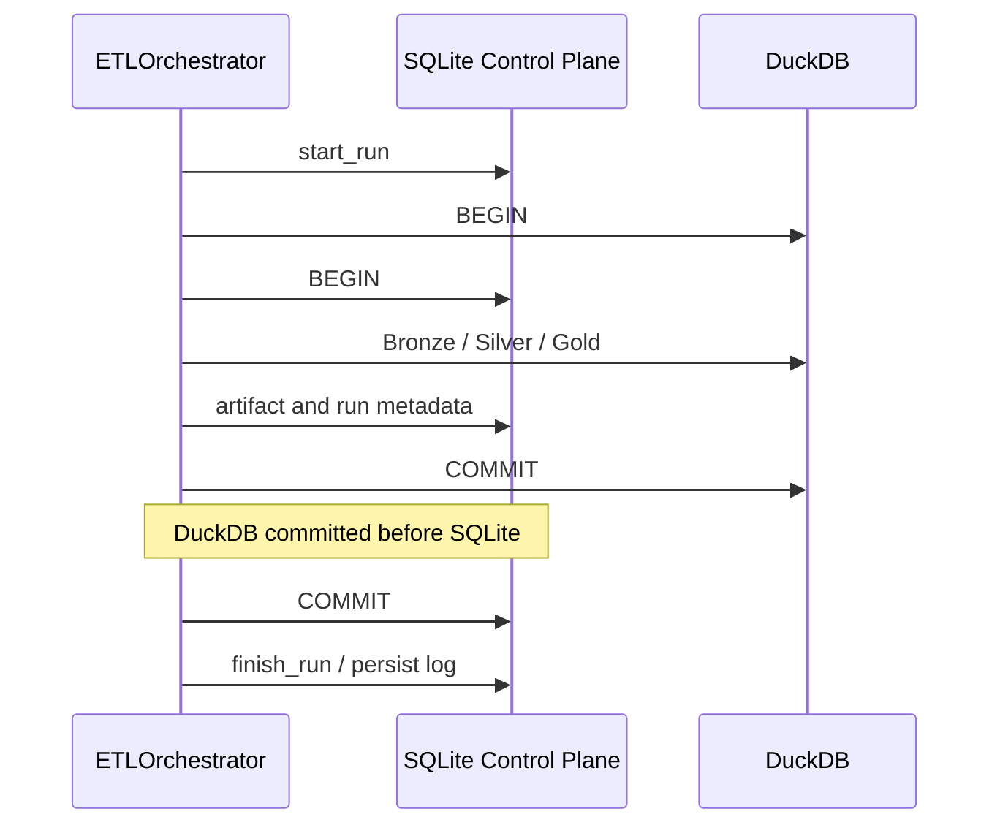

# Cross-database transaction boundaries

I use SQLite for the operational Control Plane and DuckDB for analytical materialization. I deliberately document their commit boundary rather than claim a distributed transaction that does not exist.

## Execution sequence



I establish the run identity before the main transactional work and then operate two local databases. A single database rollback cannot reverse a successful commit in the other database.
## Orchestrator authority

**Implementation:** `backend/pipeline/etl_pipeline.py` near line 248.

```python
    def run(self) -> None:
        self.cfg.validate_config()

        validate_registry()

        start_time = time.perf_counter()

        run_id = None
        cp = None
        log_file_path = self.db_manager.db_path.replace(".duckdb", ".log")

        try:
            add_queue_handler(cast("multiprocessing.Queue[Any]", self.status_queue))
            add_file_handler(log_file_path)

            logger.debug("=== ETL CONFIGURATION DUMP ===")
            if hasattr(self.cfg, "model_dump_json"):
```

The main `run()` method owns the lifecycle, including validation, connection setup, publication, commit ordering, and error handling. I avoid inferring atomicity from the presence of two `BEGIN` statements.
## Commit and exception boundary

The code commits DuckDB before SQLite. A failure after the first commit may leave materialized analytical state ahead of Control Plane state. The next run can reconcile selected state, but that is not an automatic rollback of the first commit.
## Recovery invariants

I distinguish three things: **transactional rollback** inside one database, **subsequent healing** of known artifact state, and **restoration** from a validated backup. They solve different failure modes. I do not promise cross-store atomicity, automatic restoration of arbitrary corruption, or exactly-once semantics for every external input.
## Related specifications

See [Run lifecycle](../control-plane/run-lifecycle.md), [Synchronization and healing](../control-plane/synchronization-and-healing.md), and [Failure scenarios](failure-scenarios.md).
