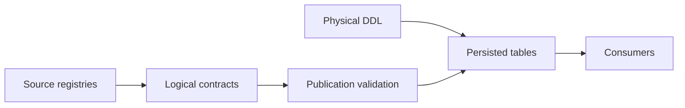

# Reference: contracts, schemas, and interfaces

I keep exact physical names, column definitions, declared grains, typed configuration fields, and callable entry points here. This is the lookup layer for my technical documentation, not a second narrative copy of Architecture, Finance, or Control Plane.

## Canonical surface

| Layer | Registered contracts or tables | Source of authority |
|---|---:|---|
| Bronze | 0 | `backend/load/registry.py` |
| Silver | 0 | `backend/load/registry.py` |
| Gold | 0 | `backend/load/registry.py` |
| DuckDB Meta | 6 | `backend/load/schema/meta.py` |
| SQLite Control Plane | 8 | `backend/load/schema/control_plane.py` |

## Reference index

- [Bronze source contracts and physical columns](bronze-data-contracts.md)
- [Silver analytical contracts and physical columns](silver-data-contracts.md)
- [Gold decision marts and physical columns](gold-data-contracts.md)
- [DuckDB Meta projection schema](meta-data-contracts.md)
- [SQLite Control Plane tables and relationships](control-plane-schema.md)
- [Canonical deterministic financial identities](identity-contracts.md)
- [Typed configuration models and fields](configuration-schema-reference.md)
- [Application facade and CLI entry points](api-and-cli-reference.md)
- [Project terminology](glossary.md)

## Reference interpretation

I distinguish a registry-declared grain from a physically enforced unique key, and a registered producer label from a runtime producer trace. The executable schema and implementation are authoritative whenever the two differ.

[← Documentation home](../README.md)
