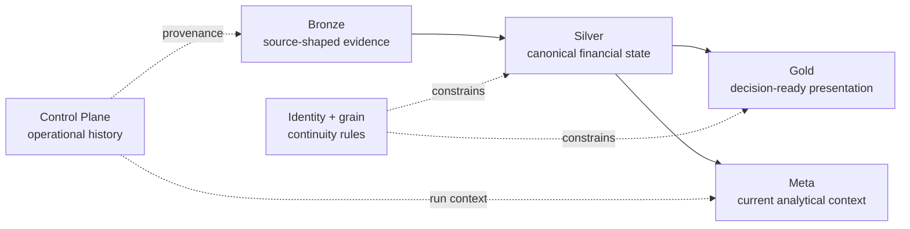

<div class="pf-overview-intro">
  <div class="pf-overview-eyebrow">REFERENCE</div>
  <h1>Contracts</h1>
  <p>The exact physical contracts, grain, identity and ownership rules behind the analytical system.</p>
</div>

<div class="pf-overview-routes">
  <a class="pf-overview-card" href="bronze-data-contracts/"><strong>Bronze</strong><span>Source-shaped evidence contracts. →</span></a>
  <a class="pf-overview-card" href="silver-data-contracts/"><strong>Silver</strong><span>Canonical analytical state. →</span></a>
  <a class="pf-overview-card" href="gold-data-contracts/"><strong>Gold</strong><span>Decision-ready marts. →</span></a>
  <a class="pf-overview-card" href="identity-and-grain-contracts/"><strong>Identity & Grain</strong><span>Keys, grain and deterministic identity. →</span></a>
</div>

The reference section is the place to verify **what physically exists**.

Architecture explains ownership. Finance explains economic meaning. Developer documentation explains how to change the system safely. Reference documentation answers the lower-level question that eventually arrives in every serious debugging session:

> **What exactly is the contract?**

This catalog is generated and verified against the current warehouse registry, declarative DDL, Control Plane DDL, and deterministic identity implementation. It is intentionally less conversational than the narrative specifications. A schema reference that develops a personality disorder halfway through a foreign-key lookup is not helping anyone.

## The contract ladder



The layers intentionally answer different questions:

| Layer | Reference question |
|---|---|
| Bronze | What source-shaped evidence was synchronized into DuckDB? |
| Silver | What canonical financial datasets exist, at what grain? |
| Gold | What analytical presentation datasets are published? |
| Meta | What current analytical context is mirrored for convenience? |
| Control Plane | What operational evidence and history are durable in SQLite? |
| Identity & Grain | What makes a row/entity the same financial thing across rebuilds? |

## Current catalog

| Surface | Count | Authority |
|---|---:|---|
| Bronze contracts | **20** | `infrastructure/warehouse/registry.py` |
| Silver contracts | **24** | registry + `schema/silver.py` |
| Gold contracts | **22** | registry + `schema/gold.py` |
| Meta tables | **6** | `schema/meta.py` |
| Control Plane tables | **10** | `infrastructure/control_plane/schema.py` |
| Explicit identity namespaces | **8** | `domain/common/identity.py` |

## Read in this order

1. [Bronze Data Contracts](bronze-data-contracts.md)
2. [Silver Data Contracts](silver-data-contracts.md)
3. [Gold Data Contracts](gold-data-contracts.md)
4. [Meta Data Contracts](meta-data-contracts.md)
5. [Control Plane Data Contracts](control-plane-data-contracts.md)
6. [Identity & Grain Contracts](identity-and-grain-contracts.md)
7. [Glossary](glossary.md)

The order follows evidence as it becomes canonical state, analytical presentation, operational provenance, and finally identity vocabulary.

## Source authorities

```text
src/personal_finance_etl/infrastructure/warehouse/registry.py
src/personal_finance_etl/infrastructure/warehouse/schema/bronze.py
src/personal_finance_etl/infrastructure/warehouse/schema/silver.py
src/personal_finance_etl/infrastructure/warehouse/schema/gold.py
src/personal_finance_etl/infrastructure/warehouse/schema/meta.py
src/personal_finance_etl/infrastructure/control_plane/schema.py
src/personal_finance_etl/domain/common/identity.py
```

## Related specifications

- [Data Model](../architecture/data-model.md)
- [Warehouse Architecture](../architecture/warehouse-architecture.md)
- [Control Plane & Artifact Lifecycle](../architecture/control-plane-artifact-lifecycle.md)
- [Deterministic Identity & Replay](../architecture/deterministic-identity-and-replay.md)
- [Data Contract & Schema Evolution](../developer/data-contract-and-schema-evolution.md)
