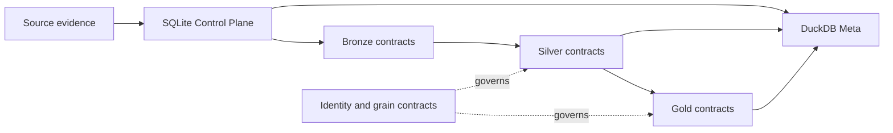

# Reference

The Reference section is the physical contract layer of Personal Finance ETL. Architecture explains why the system is shaped the way it is; Finance explains what the numbers mean. Reference answers the less philosophical question that eventually arrives during every serious data-engineering session: **what exactly is stored here?**

The contracts below are reconstructed directly from the current registry and schema authorities. They describe physical table names, publication ownership, grains, synchronization modes, columns, identities, and the boundaries between operational history and analytical state. Where a layer is intentionally dynamic, the documentation says so rather than inventing a fixed schema for aesthetic comfort.




## Need the concepts before the contracts?

Reference answers **exactly what the physical contract is**. The Wiki explains why those contracts exist and how they interact. Start with [Follow the Data](https://github.com/tks18/personal-finance-etl/wiki/03-Follow-the-Data), [Evidence, Identity & Reconciliation](https://github.com/tks18/personal-finance-etl/wiki/05-Evidence-Identity-and-Reconciliation), or [Warehouse & Power BI](https://github.com/tks18/personal-finance-etl/wiki/11-Warehouse-and-Power-BI) before returning here for exact schemas, grains, identities, and ownership.

## Contract inventory

| Contract surface | Count | Authority | Primary role |
|---|---:|---|---|
| Bronze | 20 | `BRONZE_CONTRACT_REGISTRY` + extracted frame schema | Persistent raw synchronization |
| Silver | 24 | `DATA_CONTRACT_REGISTRY` + `SILVER_DDL` | Canonical analytical facts and dimensions |
| Gold | 22 | `DATA_CONTRACT_REGISTRY` + `GOLD_DDL` | BI-facing analytical presentation |
| DuckDB Meta | 6 tables | `META_DDL` | Current analytical context |
| SQLite Control Plane | 8 tables | `RAW_DDL` | Historical operational provenance |

The 66 registered Bronze/Silver/Gold contracts are not interchangeable with the Meta and Control Plane tables. The former define the analytical publication surface; the latter describe the machinery that makes those publications observable and recoverable. Counting them together would produce a larger number and a smaller amount of understanding.

## How to use this section

- Use [Bronze Data Contracts](bronze-data-contracts.md) when tracing source ingestion or synchronization behavior.
- Use [Silver Data Contracts](silver-data-contracts.md) when consuming canonical financial facts.
- Use [Gold Data Contracts](gold-data-contracts.md) when integrating BI or presentation workloads.
- Use [Meta Data Contracts](meta-data-contracts.md) for DuckDB's current-state metadata projection.
- Use [Control Plane Data Contracts](control-plane-data-contracts.md) for historical runs, artifacts, snapshots, failures, and simulation provenance.
- Use [Identity and Grain Contracts](identity-and-grain-contracts.md) when a join, deduplication rule, or deterministic identifier needs to be understood before touching code.
- Use the [Glossary](glossary.md) when terminology is doing its usual engineering trick of looking obvious until two subsystems use the same word differently.

## Source authorities

```text
src/personal_finance_etl/backend/load/registry.py
src/personal_finance_etl/backend/load/schema/bronze.py
src/personal_finance_etl/backend/load/schema/silver.py
src/personal_finance_etl/backend/load/schema/gold.py
src/personal_finance_etl/backend/load/schema/meta.py
src/personal_finance_etl/backend/load/schema/control_plane.py
```

The registry supplies ownership, grain, producer, publication order, synchronization category, and replacement mode. The DDL modules supply the fixed physical schemas where fixed DDL exists. Producer code remains authoritative for semantic derivation.

## Related specifications

- [System Architecture](../architecture/system-architecture.md)
- [Warehouse Architecture](../architecture/warehouse-architecture.md)
- [Data Model](../architecture/data-model.md)
- [Data Contract and Schema Evolution](../developer/data-contract-and-schema-evolution.md)
