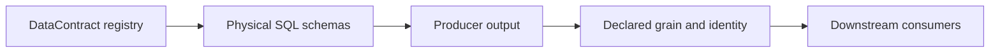

# Reference

I use this section as the physical and semantic contract catalog for my financial platform. Each page links registry ownership to real SQL schemas, producer identity, declared grain and downstream interpretation.

## Contract surfaces

| Surface | Current inventory | Source of truth |
| --- | ---: | --- |
| Bronze | 20 | `BRONZE_CONTRACT_REGISTRY` |
| Silver | 24 | `DATA_CONTRACT_REGISTRY` |
| Gold | 22 | `DATA_CONTRACT_REGISTRY` |
| Control Plane and Meta | Schema-defined | `schema/control_plane.py`, `schema/meta.py` |

## Reference guides

| Guide | Scope |
| --- | --- |
| [Bronze contracts](bronze-data-contracts.md) | Extraction categories, replacement policies and source-shaped tables |
| [Silver contracts](silver-data-contracts.md) | Canonical financial dimensions, transactions, FX, FIFO and tax events |
| [Gold contracts](gold-data-contracts.md) | Analytical marts, grains, tax summaries and financial presentation |
| [Meta and Control Plane](meta-data-contracts.md) | Historical operational authority and current metadata projection |
| [Identity and grain](identity-and-grain-contracts.md) | Financial entity identity, row grain, additivity and lineage |
| [Glossary](glossary.md) | Consistent architecture and finance terminology |

The registry is the inventory authority. I do not hardcode table counts into implementation logic; this index is a snapshot of the currently registered contracts.

[← Documentation home](../README.md)
