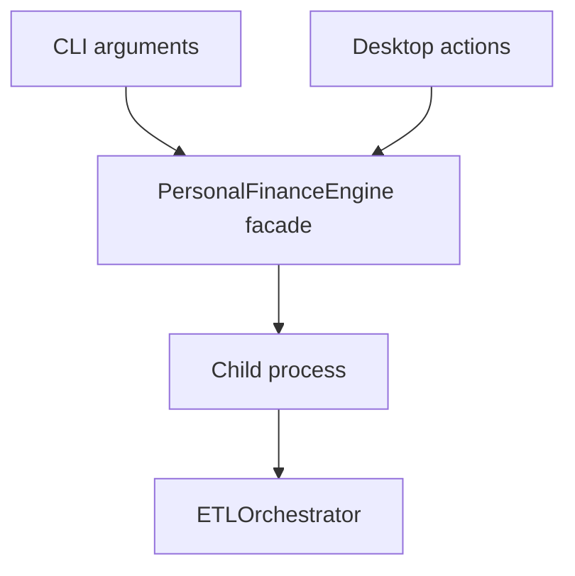

# Application facade and CLI reference

I expose the same backend execution machinery through the CLI and desktop interface. This reference lists source-declared public callable surfaces without promising that every Python method is a stable external API.



## engine.py

Source: `src/personal_finance_etl/backend/api/engine.py`

| Callable | Signature | Line |
|---|---|---:|
| `get_recent_configs` | `self` | 21 |
| `get_recent_rules` | `self` | 24 |
| `add_recent_rules` | `self, path` | 27 |
| `validate_config` | `self, path` | 30 |
| `snapshot_database` | `self, config_path` | 39 |
| `restore_database` | `self, config_path, backup_zip_path` | 52 |
| `run_pipeline_async` | `self, config_path, rules_path, on_status` | 71 |

Source: `src/personal_finance_etl/backend/api/engine.py`

```python
class PersonalFinanceEngine:
    """Unified Facade for the entire Personal Finance Backend."""

    def __init__(self) -> None:
        self._prefs = PreferencesManager()

    # --- Configuration Management ---

    def get_recent_configs(self) -> list[str]:
        return self._prefs.get_recent_configs()

    def get_recent_rules(self) -> list[str]:
        return self._prefs.get_recent_rules()

    def add_recent_rules(self, path: str) -> None:
```

## app.py

Source: `src/personal_finance_etl/frontend/cli/app.py`

| Callable | Signature | Line |
|---|---|---:|
| `print_bootloader` | `` | 55 |
| `get_file_interactive` | `prompt_text, recents` | 71 |
| `main_cli` | `args` | 96 |
| `on_status` | `status, progress, main_task, completion_event` | 198 |

Source: `src/personal_finance_etl/frontend/cli/app.py`

```python
def main_cli(args: argparse.Namespace) -> None:
    docs_mode = getattr(args, "docs", False)

    if docs_mode:
        console.print("[bold cyan]Initializing Documentation Engine...[/bold cyan]")
        show_guides_window()
        sys.exit(0)

    print_bootloader()

    engine = PersonalFinanceEngine()

    config_path = args.config
    rules_path = args.rules
    auto_mode = getattr(args, "auto", False)
```

## Unattended execution and error reporting

I distinguish a one-shot unattended CLI option from an operating-system scheduler. I also avoid promising that the CLI exit status reliably reports every child-process failure without a regression fixture. For process and progress semantics see [Interfaces](../interfaces/README.md).
