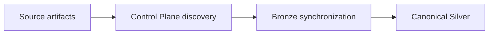
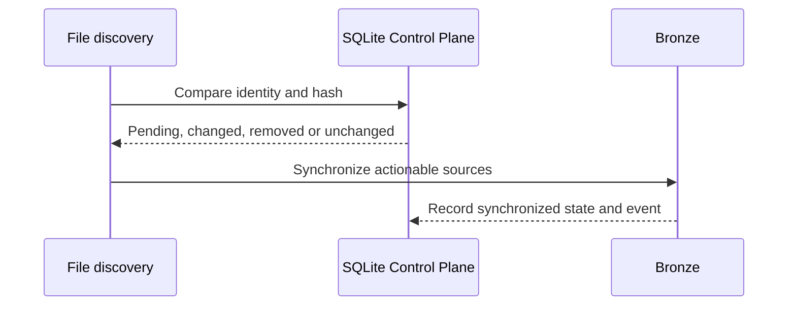

# Bronze Data Contracts

I use Bronze to retain source-shaped evidence and synchronize it under explicit ingestion policies. Bronze identity is defined by the extraction registry, while the SQLite Control Plane owns artifact history.



## Registry authority and synchronization policies

### Implementation anchor: Bronze registry

Source: `src/personal_finance_etl/backend/load/registry.py`

```python


BRONZE_CONTRACT_REGISTRY: list[BronzeDataContract] = [
    BronzeDataContract("zcategory", "sqlite_source", "bronze.r_SQLite_ZCategory", True),
    BronzeDataContract("assetgroup", "sqlite_source", "bronze.r_SQLite_AssetGroup", True),
    BronzeDataContract("assets", "sqlite_source", "bronze.r_SQLite_Assets", True),
    BronzeDataContract("currency", "sqlite_source", "bronze.r_SQLite_Currency", True),
    BronzeDataContract("inoutcome", "sqlite_source", "bronze.r_SQLite_InOutcome", True),
    BronzeDataContract("stg_mf_isin_mapping", "mf_isin", "bronze.r_MF_ISIN_Mapping", True),
    BronzeDataContract(
        "stg_benchmark_mapping", "benchmark_mapping", "bronze.r_Benchmark_Mapping", True
    ),
    BronzeDataContract(
        "raw_opening_balances", "opening_balances", "bronze.r_Opening_Balances", True
    ),
    BronzeDataContract(
        "raw_benchmark_master", "benchmark_master", "bronze.r_Benchmark_Master", True
    ),
    BronzeDataContract(
        "raw_macro_parameters", "macro_parameters", "bronze.r_Macro_Parameters", True
    ),
    BronzeDataContract("column_master", "column_master", "bronze.r_Column_Master", True),
    BronzeDataContract("mf_market_data_raw", "mf_holdings", "bronze.r_MF_Market_Data", False),
    BronzeDataContract(
```

The `is_full_replace` flag is a synchronization policy, not an instruction to erase historical Control Plane events. File-owned sources and full-replace sources have different deletion/reconciliation semantics.

## Complete Bronze contract inventory

| Extraction attribute | Sync category | Physical table | Full replace |
| --- | --- | --- | --- |
| `zcategory` | `sqlite_source` | `bronze.r_SQLite_ZCategory` | Yes |
| `assetgroup` | `sqlite_source` | `bronze.r_SQLite_AssetGroup` | Yes |
| `assets` | `sqlite_source` | `bronze.r_SQLite_Assets` | Yes |
| `currency` | `sqlite_source` | `bronze.r_SQLite_Currency` | Yes |
| `inoutcome` | `sqlite_source` | `bronze.r_SQLite_InOutcome` | Yes |
| `stg_mf_isin_mapping` | `mf_isin` | `bronze.r_MF_ISIN_Mapping` | Yes |
| `stg_benchmark_mapping` | `benchmark_mapping` | `bronze.r_Benchmark_Mapping` | Yes |
| `raw_opening_balances` | `opening_balances` | `bronze.r_Opening_Balances` | Yes |
| `raw_benchmark_master` | `benchmark_master` | `bronze.r_Benchmark_Master` | Yes |
| `raw_macro_parameters` | `macro_parameters` | `bronze.r_Macro_Parameters` | Yes |
| `column_master` | `column_master` | `bronze.r_Column_Master` | Yes |
| `mf_market_data_raw` | `mf_holdings` | `bronze.r_MF_Market_Data` | No |
| `us_stock_transactions_raw` | `us_stock_transactions` | `bronze.r_US_Stock_Transactions` | No |
| `currency_mapping_raw` | `currency_mapping` | `bronze.r_Currency_Mapping` | Yes |
| `currency_fx_raw` | `currency_history` | `bronze.r_Currency_FX_Data` | No |
| `mf_transactions_raw` | `mf_orders` | `bronze.r_MF_Transactions` | No |
| `stock_market_data_raw` | `stock_pl` | `bronze.r_Stock_Market_Data` | No |
| `stock_transactions_raw` | `stock_orders` | `bronze.r_Stock_Transactions` | No |
| `benchmark_history_raw` | `benchmark_history` | `bronze.r_Benchmark_Data` | No |
| `us_stock_market_data_raw` | `us_stock_market` | `bronze.r_US_Stock_Prices` | No |

## Source-family contracts

### `bronze.r_SQLite_ZCategory`

- **Extractor attribute:** `zcategory`
- **Synchronization category:** `sqlite_source`
- **Replacement policy:** full replacement of the category snapshot
- **Authority:** Bronze holds normalized source-shaped data; the Control Plane retains the artifact lifecycle and hashes.

### `bronze.r_SQLite_AssetGroup`

- **Extractor attribute:** `assetgroup`
- **Synchronization category:** `sqlite_source`
- **Replacement policy:** full replacement of the category snapshot
- **Authority:** Bronze holds normalized source-shaped data; the Control Plane retains the artifact lifecycle and hashes.

### `bronze.r_SQLite_Assets`

- **Extractor attribute:** `assets`
- **Synchronization category:** `sqlite_source`
- **Replacement policy:** full replacement of the category snapshot
- **Authority:** Bronze holds normalized source-shaped data; the Control Plane retains the artifact lifecycle and hashes.

### `bronze.r_SQLite_Currency`

- **Extractor attribute:** `currency`
- **Synchronization category:** `sqlite_source`
- **Replacement policy:** full replacement of the category snapshot
- **Authority:** Bronze holds normalized source-shaped data; the Control Plane retains the artifact lifecycle and hashes.

### `bronze.r_SQLite_InOutcome`

- **Extractor attribute:** `inoutcome`
- **Synchronization category:** `sqlite_source`
- **Replacement policy:** full replacement of the category snapshot
- **Authority:** Bronze holds normalized source-shaped data; the Control Plane retains the artifact lifecycle and hashes.

### `bronze.r_MF_ISIN_Mapping`

- **Extractor attribute:** `stg_mf_isin_mapping`
- **Synchronization category:** `mf_isin`
- **Replacement policy:** full replacement of the category snapshot
- **Authority:** Bronze holds normalized source-shaped data; the Control Plane retains the artifact lifecycle and hashes.

### `bronze.r_Benchmark_Mapping`

- **Extractor attribute:** `stg_benchmark_mapping`
- **Synchronization category:** `benchmark_mapping`
- **Replacement policy:** full replacement of the category snapshot
- **Authority:** Bronze holds normalized source-shaped data; the Control Plane retains the artifact lifecycle and hashes.

### `bronze.r_Opening_Balances`

- **Extractor attribute:** `raw_opening_balances`
- **Synchronization category:** `opening_balances`
- **Replacement policy:** full replacement of the category snapshot
- **Authority:** Bronze holds normalized source-shaped data; the Control Plane retains the artifact lifecycle and hashes.

### `bronze.r_Benchmark_Master`

- **Extractor attribute:** `raw_benchmark_master`
- **Synchronization category:** `benchmark_master`
- **Replacement policy:** full replacement of the category snapshot
- **Authority:** Bronze holds normalized source-shaped data; the Control Plane retains the artifact lifecycle and hashes.

### `bronze.r_Macro_Parameters`

- **Extractor attribute:** `raw_macro_parameters`
- **Synchronization category:** `macro_parameters`
- **Replacement policy:** full replacement of the category snapshot
- **Authority:** Bronze holds normalized source-shaped data; the Control Plane retains the artifact lifecycle and hashes.

### `bronze.r_Column_Master`

- **Extractor attribute:** `column_master`
- **Synchronization category:** `column_master`
- **Replacement policy:** full replacement of the category snapshot
- **Authority:** Bronze holds normalized source-shaped data; the Control Plane retains the artifact lifecycle and hashes.

### `bronze.r_MF_Market_Data`

- **Extractor attribute:** `mf_market_data_raw`
- **Synchronization category:** `mf_holdings`
- **Replacement policy:** file-owned historical synchronization
- **Authority:** Bronze holds normalized source-shaped data; the Control Plane retains the artifact lifecycle and hashes.

### `bronze.r_US_Stock_Transactions`

- **Extractor attribute:** `us_stock_transactions_raw`
- **Synchronization category:** `us_stock_transactions`
- **Replacement policy:** file-owned historical synchronization
- **Authority:** Bronze holds normalized source-shaped data; the Control Plane retains the artifact lifecycle and hashes.

### `bronze.r_Currency_Mapping`

- **Extractor attribute:** `currency_mapping_raw`
- **Synchronization category:** `currency_mapping`
- **Replacement policy:** full replacement of the category snapshot
- **Authority:** Bronze holds normalized source-shaped data; the Control Plane retains the artifact lifecycle and hashes.

### `bronze.r_Currency_FX_Data`

- **Extractor attribute:** `currency_fx_raw`
- **Synchronization category:** `currency_history`
- **Replacement policy:** file-owned historical synchronization
- **Authority:** Bronze holds normalized source-shaped data; the Control Plane retains the artifact lifecycle and hashes.

### `bronze.r_MF_Transactions`

- **Extractor attribute:** `mf_transactions_raw`
- **Synchronization category:** `mf_orders`
- **Replacement policy:** file-owned historical synchronization
- **Authority:** Bronze holds normalized source-shaped data; the Control Plane retains the artifact lifecycle and hashes.

### `bronze.r_Stock_Market_Data`

- **Extractor attribute:** `stock_market_data_raw`
- **Synchronization category:** `stock_pl`
- **Replacement policy:** file-owned historical synchronization
- **Authority:** Bronze holds normalized source-shaped data; the Control Plane retains the artifact lifecycle and hashes.

### `bronze.r_Stock_Transactions`

- **Extractor attribute:** `stock_transactions_raw`
- **Synchronization category:** `stock_orders`
- **Replacement policy:** file-owned historical synchronization
- **Authority:** Bronze holds normalized source-shaped data; the Control Plane retains the artifact lifecycle and hashes.

### `bronze.r_Benchmark_Data`

- **Extractor attribute:** `benchmark_history_raw`
- **Synchronization category:** `benchmark_history`
- **Replacement policy:** file-owned historical synchronization
- **Authority:** Bronze holds normalized source-shaped data; the Control Plane retains the artifact lifecycle and hashes.

### `bronze.r_US_Stock_Prices`

- **Extractor attribute:** `us_stock_market_data_raw`
- **Synchronization category:** `us_stock_market`
- **Replacement policy:** file-owned historical synchronization
- **Authority:** Bronze holds normalized source-shaped data; the Control Plane retains the artifact lifecycle and hashes.

## Artifact synchronization and recovery boundaries



A rename is not automatically a financial transaction correction. Likewise, historical event retention is not proof that the original binary payload remains retained forever. See [artifact lifecycle](../architecture/control-plane-artifact-lifecycle.md).

### Implementation anchor: Registry validation

Source: `src/personal_finance_etl/backend/load/registry.py`

```python
            gold_count += 1

    bronze_tables: set[str] = set()
    for contract in BRONZE_CONTRACT_REGISTRY:
        if not contract.extraction_attribute:
            raise ValueError("Bronze extraction_attribute cannot be empty.")
        if not contract.sync_category:
            raise ValueError(f"Bronze sync_category empty for {contract.extraction_attribute}")
        if not contract.physical_table:
            raise ValueError(f"Bronze physical_table empty for {contract.extraction_attribute}")
        if not contract.physical_table.startswith("bronze."):
            raise ValueError(f"Bronze table must start with 'bronze.': {contract.physical_table}")

        if contract.physical_table in bronze_tables:
            raise ValueError(f"Duplicate Bronze table mapping: {contract.physical_table}")
        bronze_tables.add(contract.physical_table)
```

## Operational invariants

- I keep one physical table mapping per Bronze contract.
- A source change must be evaluated through the Control Plane, not inferred from a Gold aggregate.
- Full replacement and file-owned synchronization must remain distinct.
- A successful analytical rebuild is not proof that all historical payload bytes remain recoverable.

[← Reference index](README.md)
