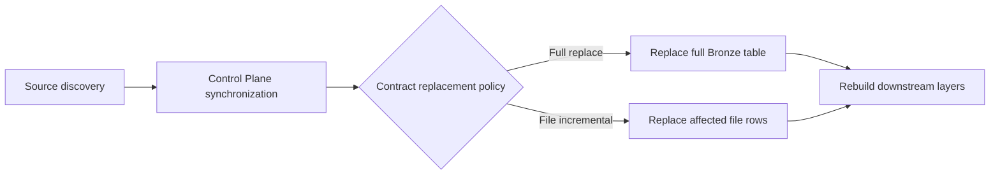

# Bronze data contracts

I treat Bronze as the physical landing layer for registered source categories. I keep extraction attribute, Control Plane synchronization category, destination table, and replacement policy explicit in the source registry. The exact physical columns below come from the DDL, not from assumptions about source Excel files.



## Registry and synchronization policy

| Extraction attribute | Sync category | Physical table | Policy |
|---|---|---|---|

Source: `src/personal_finance_etl/backend/load/registry.py`

```python
BRONZE_CONTRACT_REGISTRY: list[BronzeDataContract] = [
    BronzeDataContract("zcategory", "sqlite_source", "bronze.r_SQLite_ZCategory", True),
    BronzeDataContract("assetgroup", "sqlite_source", "bronze.r_SQLite_AssetGroup", True),
    BronzeDataContract("assets", "sqlite_source", "bronze.r_SQLite_Assets", True),
    BronzeDataContract("currency", "sqlite_source", "bronze.r_SQLite_Currency", True),
    BronzeDataContract("inoutcome", "sqlite_source", "bronze.r_SQLite_InOutcome", True),
    BronzeDataContract("stg_mf_isin_mapping", "mf_isin", "bronze.r_MF_ISIN_Mapping", True),
    BronzeDataContract(
        "stg_benchmark_mapping", "benchmark_mapping", "bronze.r_Benchmark_Mapping", True
    ),
    BronzeDataContract(
        "raw_opening_balances", "opening_balances", "bronze.r_Opening_Balances", True
    ),
    BronzeDataContract(
        "raw_benchmark_master", "benchmark_master", "bronze.r_Benchmark_Master", True
```

## Interpretation and limitations

I do not call the entire pipeline incremental: downstream Silver and Gold are reconstructed. File-incremental replacement uses source-file name metadata; unique basenames and upstream source normalization therefore matter. I use [Data Engineering](../data-engineering/README.md) for processing semantics and [Control Plane](../control-plane/README.md) for file identity and healing.
