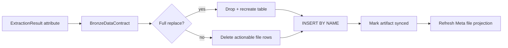
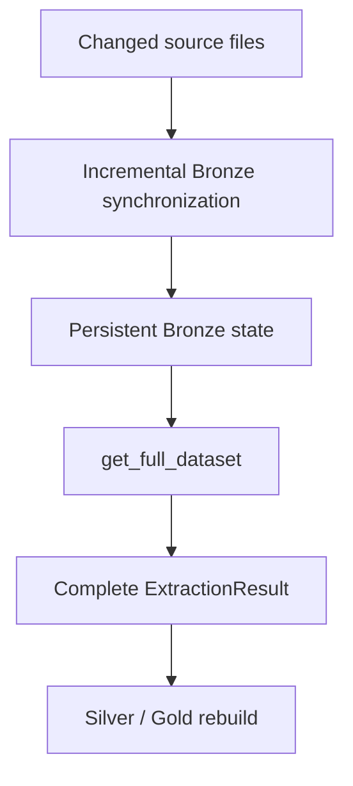

# Bronze Data Contracts

Bronze is the persistent raw analytical boundary between source extraction and canonical transformation. Its contracts are intentionally different from Silver and Gold: the registry fixes **which extracted dataset maps to which physical table and how that table synchronizes**, while the table columns are created from the extracted frame schema at runtime. There is no giant static Bronze DDL pretending every vendor/source shape is immutable.

## Contract authority

```python
@dataclass
class BronzeDataContract:
    extraction_attribute: str
    sync_category: str
    physical_table: str
    is_full_replace: bool
```

The loader consumes these contracts in `BronzeLayer.load()`. Full-replace datasets drop and recreate their physical table from the current empty frame schema. Incremental datasets create the table if necessary, delete rows for actionable `__file_name__` values, then insert the refreshed rows by name.



## Registered Bronze contracts

| # | Extraction attribute | Sync category | Physical table | Mode |
|---:|---|---|---|---|
| 1 | `zcategory` | `sqlite_source` | `bronze.r_SQLite_ZCategory` | Full replace |
| 2 | `assetgroup` | `sqlite_source` | `bronze.r_SQLite_AssetGroup` | Full replace |
| 3 | `assets` | `sqlite_source` | `bronze.r_SQLite_Assets` | Full replace |
| 4 | `currency` | `sqlite_source` | `bronze.r_SQLite_Currency` | Full replace |
| 5 | `inoutcome` | `sqlite_source` | `bronze.r_SQLite_InOutcome` | Full replace |
| 6 | `stg_mf_isin_mapping` | `mf_isin` | `bronze.r_MF_ISIN_Mapping` | Full replace |
| 7 | `stg_benchmark_mapping` | `benchmark_mapping` | `bronze.r_Benchmark_Mapping` | Full replace |
| 8 | `raw_opening_balances` | `opening_balances` | `bronze.r_Opening_Balances` | Full replace |
| 9 | `raw_benchmark_master` | `benchmark_master` | `bronze.r_Benchmark_Master` | Full replace |
| 10 | `raw_macro_parameters` | `macro_parameters` | `bronze.r_Macro_Parameters` | Full replace |
| 11 | `column_master` | `column_master` | `bronze.r_Column_Master` | Full replace |
| 12 | `mf_market_data_raw` | `mf_holdings` | `bronze.r_MF_Market_Data` | Incremental |
| 13 | `us_stock_transactions_raw` | `us_stock_transactions` | `bronze.r_US_Stock_Transactions` | Incremental |
| 14 | `currency_mapping_raw` | `currency_mapping` | `bronze.r_Currency_Mapping` | Full replace |
| 15 | `currency_fx_raw` | `currency_history` | `bronze.r_Currency_FX_Data` | Incremental |
| 16 | `mf_transactions_raw` | `mf_orders` | `bronze.r_MF_Transactions` | Incremental |
| 17 | `stock_market_data_raw` | `stock_pl` | `bronze.r_Stock_Market_Data` | Incremental |
| 18 | `stock_transactions_raw` | `stock_orders` | `bronze.r_Stock_Transactions` | Incremental |
| 19 | `benchmark_history_raw` | `benchmark_history` | `bronze.r_Benchmark_Data` | Incremental |
| 20 | `us_stock_market_data_raw` | `us_stock_market` | `bronze.r_US_Stock_Prices` | Incremental |

## Synchronization semantics

### Full-replace contracts

A full-replace contract treats the actionable source as the complete current representation for that dataset. `BronzeLayer.upsert_table()` drops the physical table and recreates it from `df.head(0)` before inserting the current rows. The loader also clears old `meta.m_File_Registry` entries for that synchronization category so the DuckDB projection does not accumulate obsolete source identities.

### Incremental contracts

Incremental contracts preserve rows belonging to files that are not actionable. For each run, the loader filters the extracted frame to actionable basenames, deletes existing rows whose `__file_name__` matches those basenames, and inserts the refreshed rows. This is file-level replacement, not row-level merge-by-business-key.

```python
filenames = [os.path.basename(f) for f in actionable_files]
df_filtered = df.filter(pl.col("__file_name__").is_in(filenames))

delete_query = f"DELETE FROM {table_name} WHERE __file_name__ IN ({placeholders})"
self.db_manager.conn.execute(delete_query, filenames)

self.db_manager.conn.execute(
    f"INSERT INTO {table_name} BY NAME SELECT * FROM temp_df"
)
```

## Provenance and identity columns

Bronze schemas inherit provenance fields emitted by extractors, most importantly `__file_name__` where file-backed synchronization is required. That column is operationally significant: incremental replacement and rename migration use it to locate the rows associated with an artifact. Because Bronze is intentionally source-near, additional columns depend on the extractor/source contract rather than one centralized SQL declaration.

## Rename migration

A successful artifact rename does not require financial rows to be re-ingested merely to change their source filename. `BronzeLayer.migrate_identity()` updates `__file_name__` from the old basename to the new basename in the registered table for the artifact category. Missing-column/table cases are deliberately tolerated because not every Bronze source has identical provenance shape.

## Complete-state readback

`BronzeLayer.get_full_dataset()` reconstructs an `ExtractionResult` from the persisted Bronze tables after synchronization. Downstream transformations therefore operate over complete Bronze state, not only the files that happened to change in the current run. This is the bridge between incremental ingestion and full analytical rebuilds.



## Contract invariants

- Every Bronze registry entry maps one `ExtractionResult` attribute to one synchronization category and one physical DuckDB table.
- `is_full_replace` determines replacement semantics; downstream code should not infer it from table names.
- Incremental replacement is scoped by actionable source filename, not financial business identity.
- Successful Bronze synchronization is reflected back into the Control Plane through `mark_synced()`.
- Bronze table schemas are source/extractor-derived. Schema evolution therefore begins at the extractor and must remain compatible with downstream canonical transformations.
- Rename migration changes source identity metadata without manufacturing a new financial observation.

## Failure semantics

If insertion or synchronization fails inside the enclosing ETL transaction, DuckDB work is rolled back where possible and the Control Plane remains capable of marking the artifact actionable on a later run. Cross-database commit failure is handled by the broader healing strategy described in Reliability and Recovery; Bronze does not claim distributed atomicity on its own.

## Design trade-off

The design deliberately spends more compute on rebuilding canonical analytics in exchange for simpler correctness semantics downstream. Bronze remembers source state incrementally; Silver and Gold do not have to remember yesterday’s derived mistakes. For a local financial workload, that is a very favorable trade.

## Related specifications

- [Data Lifecycle](../architecture/data-lifecycle.md)
- [Warehouse Architecture](../architecture/warehouse-architecture.md)
- [Control Plane Artifact Lifecycle](../architecture/control-plane-artifact-lifecycle.md)
- [Silver Data Contracts](silver-data-contracts.md)
- [Data Contract and Schema Evolution](../developer/data-contract-and-schema-evolution.md)
