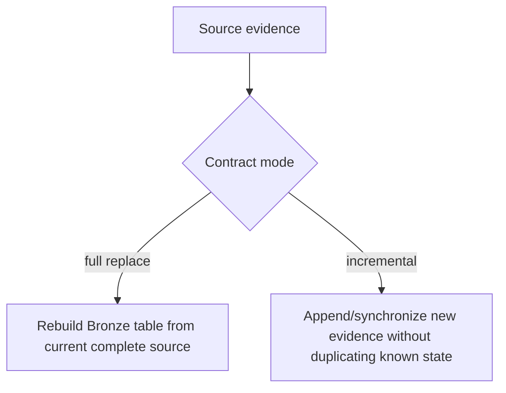

# Bronze Data Contracts

Bronze is the warehouse evidence layer. Its contract is intentionally different from Silver and Gold: Bronze stays close to source shape and preserves enough provenance for synchronization, replay, and forensic inspection.

Bronze physical tables are created dynamically by `BronzeLayer`; the stable catalog is therefore the **registry mapping** between extraction attributes, synchronization categories, physical tables, and replacement semantics.

## Contract authority

```python
@dataclass
class BronzeDataContract:
    extraction_attribute: str
    sync_category: str
    physical_table: str
    is_full_replace: bool
```

Source: `src/personal_finance_etl/infrastructure/warehouse/registry.py`

Unlike Silver/Gold, Bronze does not have one giant static DDL catalog. `schema/bronze.py` explicitly states that tables are created dynamically as evidence is synchronized.

## Registered Bronze contracts

| Extraction attribute | Sync category | Physical table | Mode |
|---|---|---|---|
| `zcategory` | `sqlite_source` | `bronze.r_SQLite_ZCategory` | full replace |
| `assetgroup` | `sqlite_source` | `bronze.r_SQLite_AssetGroup` | full replace |
| `assets` | `sqlite_source` | `bronze.r_SQLite_Assets` | full replace |
| `currency` | `sqlite_source` | `bronze.r_SQLite_Currency` | full replace |
| `inoutcome` | `sqlite_source` | `bronze.r_SQLite_InOutcome` | full replace |
| `stg_mf_isin_mapping` | `mf_isin` | `bronze.r_MF_ISIN_Mapping` | full replace |
| `stg_benchmark_mapping` | `benchmark_mapping` | `bronze.r_Benchmark_Mapping` | full replace |
| `raw_opening_balances` | `opening_balances` | `bronze.r_Opening_Balances` | full replace |
| `raw_benchmark_master` | `benchmark_master` | `bronze.r_Benchmark_Master` | full replace |
| `raw_macro_parameters` | `macro_parameters` | `bronze.r_Macro_Parameters` | full replace |
| `column_master` | `column_master` | `bronze.r_Column_Master` | full replace |
| `mf_market_data_raw` | `mf_holdings` | `bronze.r_MF_Market_Data` | incremental |
| `us_stock_transactions_raw` | `us_stock_transactions` | `bronze.r_US_Stock_Transactions` | incremental |
| `currency_mapping_raw` | `currency_mapping` | `bronze.r_Currency_Mapping` | full replace |
| `currency_fx_raw` | `currency_history` | `bronze.r_Currency_FX_Data` | incremental |
| `mf_transactions_raw` | `mf_orders` | `bronze.r_MF_Transactions` | incremental |
| `stock_market_data_raw` | `stock_pl` | `bronze.r_Stock_Market_Data` | incremental |
| `stock_transactions_raw` | `stock_orders` | `bronze.r_Stock_Transactions` | incremental |
| `benchmark_history_raw` | `benchmark_history` | `bronze.r_Benchmark_Data` | incremental |
| `us_stock_market_data_raw` | `us_stock_market` | `bronze.r_US_Stock_Prices` | incremental |


## Replacement semantics

### Full replace

A full-replace contract says the synchronized source represents the current complete state for that category. The Bronze table can therefore be replaced from the current authoritative evidence set.

### Incremental

Incremental contracts preserve accumulated evidence across source artifacts. Synchronization must avoid duplicating already-known content while still admitting genuinely new artifacts.

The registry exposes this distinction explicitly because the two modes have different failure and replay semantics.



## Provenance columns

Bronze synchronization decorates source rows with provenance where required so downstream inspection can answer which source artifact contributed the row. The exact dynamic physical columns depend on the source shape; the stable contract is therefore **source columns + synchronization provenance**, not a universal fixed Bronze schema.

## Registry invariants

`validate_registry()` enforces that every Bronze contract has:

- a non-empty extraction attribute;
- a non-empty synchronization category;
- a non-empty physical table;
- a table name beginning with `bronze.`;
- no duplicate physical table mapping.

That means Bronze catalog integrity fails before publication if two extraction paths accidentally claim the same table.

## Authority boundary

Bronze answers:

> What evidence was synchronized into the analytical warehouse?

It does **not** answer:

> What is the canonical financial meaning of that evidence?

That responsibility begins in Silver/domain transformations.

## Related specifications

- [Data Lifecycle](../architecture/data-lifecycle.md)
- [Control Plane & Artifact Lifecycle](../architecture/control-plane-artifact-lifecycle.md)
- [Silver Data Contracts](silver-data-contracts.md)
- [Adding Data Sources](../developer/adding-data-sources.md)
