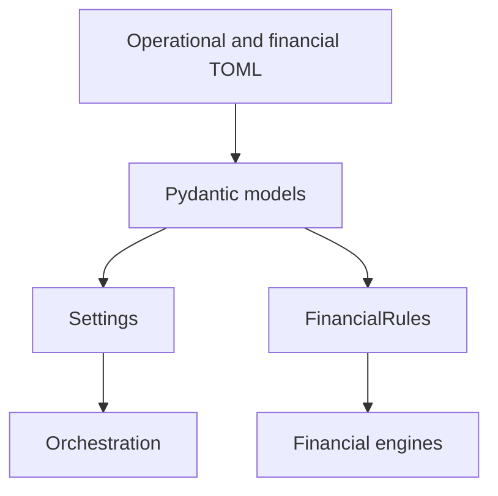

# Configuration schema reference

I maintain typed operational Settings and financial FinancialRules as separate Pydantic models. This page is an inspectable map of their classes and field declarations; configuration lifecycle, defaults, and validation behavior are explained in the Configuration domain.



## settings.py

Source: `src/personal_finance_etl/backend/config/settings.py`

| Model | Declared fields |
|---|---|
| `FileHashPolicy` | `csv`, `excel`, `sqlite` |
| `Settings` | `SOURCE_DB_FOLDER`, `TARGET_DB_BASE_PATH`, `TARGET_DB_NAME`, `DISABLE_FILE_DISCOVERER`, `RAW_DOCUMENT_STORE_NAME`, `COLUMN_MASTER_PATH`, `MF_ISIN_CSV_PATH`, `BENCHMARK_MAPPING_CSV_PATH`, `BENCHMARK_MASTER_CSV_PATH`, `MACRO_PARAMETERS_CSV_PATH`, `OPENING_BALANCE_CSV_PATH`, `CURRENCY_MAPPING_CSV_PATH`, `STATEMENTS_FOLDER`, `FILE_HASH_POLICY` |

Source: `src/personal_finance_etl/backend/config/settings.py`

```python
class Settings(BaseModel):
    SOURCE_DB_FOLDER: str = ""
    TARGET_DB_BASE_PATH: str = ""
    TARGET_DB_NAME: str = "Personal_Finance_DB.duckdb"

    # Raw Store Config
    DISABLE_FILE_DISCOVERER: bool = False
    RAW_DOCUMENT_STORE_NAME: str = "Personal_Finance_DB_Raw_Store.sqlite"

    # Dependencies
    COLUMN_MASTER_PATH: str = ""
    MF_ISIN_CSV_PATH: str = ""
    BENCHMARK_MAPPING_CSV_PATH: str = ""
    BENCHMARK_MASTER_CSV_PATH: str = ""
    MACRO_PARAMETERS_CSV_PATH: str = ""
```

## financial_rules.py

Source: `src/personal_finance_etl/backend/config/financial_rules.py`

| Model | Declared fields |
|---|---|
| `ActiveIncomeRules` | `category_ids`, `sub_category_ids` |
| `DividendIncomeRules` | `category_ids`, `sub_category_ids` |
| `InterestIncomeRules` | `category_ids`, `sub_category_ids` |
| `NonCashIncomeRules` | `category_ids`, `sub_category_ids` |
| `IncomeRules` | `active`, `dividends`, `interest`, `non_cash` |
| `CoreExpenseRules` | `category_ids`, `sub_category_ids` |
| `ExpenseRules` | `core` |
| `IncomeAllocationRules` | `core_expense_pct`, `non_core_expense_pct`, `investment_pct` |
| `BudgetAlerts` | `overspend_alert_threshold`, `emergency_fund_target_months` |
| `BudgetSmoothing` | `income_smoothing_months` |
| `BudgetRules` | `income_allocation`, `alerts`, `smoothing` |
| `IlliquidAssetRules` | `category_ids`, `sub_category_ids` |
| `CashflowAssetRules` | `cash_pools`, `non_cash_pnl_sources`, `working_capital_conduits`, `investing_activities`, `financing_liabilities` |
| `DigitalAssetRules` | `category_ids` |
| `AssetRules` | `illiquid`, `cashflow`, `digital` |
| `InvestmentInstrumentRules` | `category_ids`, `sub_category_ids` |
| `MacroAssumptions` | `default_trading_days`, `fallback_inflation_rate`, `fallback_risk_free_rate`, `fallback_ordinary_income_rate` |
| `FireAssumptions` | `swr_multiplier`, `coast_fi_real_return`, `coast_fi_years`, `lean_fi_ratio`, `fallback_trailing_return`, `cape_swr_floor`, `cape_swr_ceiling`, `cape_swr_base`, `human_capital_max_age`, `human_capital_discount_rate` |
| `MarkovRegimeConfig` | `transition_matrix`, `state_bull`, `state_bear`, `state_stag` |
| `HumanCapitalConfig` | `shock_probability`, `shock_duration_min`, `shock_duration_max`, `unemployment_benefit_coverage_pct` |
| `GlidePathConfig` | `derisk_start_months_prior`, `post_fi_re_risk_months`, `base_equity_weight`, `fi_target_equity_weight`, `debt_real_return`, `debt_volatility`, `dynamic_debt_drawdown_first` |
| `JumpDiffusionConfig` | `jump_probability_annual`, `jump_magnitude`, `expense_ratio_drag` |
| `GuytonKlingerConfig` | `withdrawal_upper_threshold`, `withdrawal_lower_threshold`, `lifestyle_cut_multiplier`, `lifestyle_raise_multiplier` |
| `InflationModelConfig` | `mean_reversion_speed`, `volatility_annual`, `max_inflation_cap`, `min_deflation_floor` |
| `MonteCarloAssumptions` | `iterations`, `max_months`, `annual_volatility`, `real_return_floor`, `sorr_cagr_window_months`, `desired_target_age`, `date_of_birth`, `markov_regime`, `human_capital`, `glide_path`, `jump_diffusion`, `guyton_klinger`, `inflation_model` |
| `TaxRates` | `equity_ltcg`, `equity_stcg`, `foreign_equity_ltcg`, `foreign_equity_stcg`, `debt_ltcg`, `debt_stcg`, `gold_ltcg`, `gold_stcg` |
| `TaxSubHeadConfig` | `display_name`, `cat_ids`, `sub_cat_ids`, `tax_credit_sub_cat_ids`, `taxability`, `tax_method` |
| `TaxHeadConfig` | `sub_heads` |
| `InvestmentExclusionsConfig` | `stcg_sub_cat_ids`, `ltcg_sub_cat_ids` |
| `TaxAssumptions` | `debt_mf_cutoff_date`, `harvest_wait_days_threshold`, `ltcg_threshold_months`, `fallback_equity_ltcg_exemption`, `rates`, `heads_of_income`, `residual_income`, `exempt_income`, `investment_exclusions` |
| `CMAAssumptions` | `expected_real_return`, `fat_tail_multiplier` |
| `AssumptionsRules` | `macro`, `fire`, `monte_carlo`, `tax`, `cma`, `target_allocations` |
| `PortfolioManagementRules` | `rebalance_tolerance_pct_points` |
| `FinancialRules` | `income`, `expense`, `assets`, `investments`, `assumptions`, `budget`, `portfolio_management`, `DEFAULT_CURRENCY_ID`, `MF_SCHEME_MAPPINGS` |

Source: `src/personal_finance_etl/backend/config/financial_rules.py`

```python
class FinancialRules(BaseModel):
    income: IncomeRules = Field(default_factory=lambda: IncomeRules())
    expense: ExpenseRules = Field(default_factory=lambda: ExpenseRules())
    assets: AssetRules = Field(default_factory=lambda: AssetRules())
    investments: dict[str, InvestmentInstrumentRules] = Field(default_factory=dict)
    assumptions: AssumptionsRules = Field(...)
    budget: BudgetRules = Field(default_factory=BudgetRules)
    portfolio_management: PortfolioManagementRules = Field(default_factory=PortfolioManagementRules)

    # Transactional rules
    DEFAULT_CURRENCY_ID: str = "INR_INR"
    MF_SCHEME_MAPPINGS: dict[str, str] = Field(default_factory=dict)

    def validate_investment_exclusion_uids(self, df_subcategory: Any) -> None:
        """Validate configured investment exclusions against the actual subcategory dimension.
```

## Validation boundary

I do not infer an allowed numeric range from a field name alone. Explicit Pydantic validators, Field constraints, and later dimension-aware checks determine what is enforced. See [Configuration](../configuration/README.md) for the behavioral specification.
