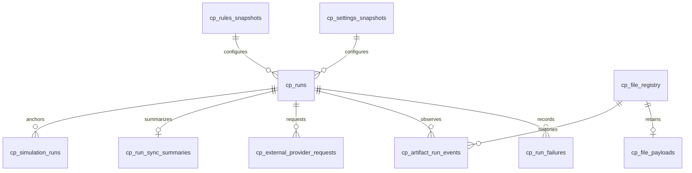

# Control Plane Data Contracts

The Control Plane is the durable operational ledger for runs, artifacts, retained payloads, configuration/rules snapshots, failures, provider requests, synchronization summaries, and simulation provenance.

Unlike Meta, this schema is designed to answer historical operational questions: **what happened, to which evidence, under which settings/rules, and what state did the run ultimately reach?**

## Physical inventory

| Table | Primary responsibility |
|---|---|
| `cp_file_registry` | Stable artifact identity and latest observed/sync state |
| `cp_file_payloads` | Retained source bytes keyed by artifact identity |
| `cp_settings_snapshots` | Content-addressed settings snapshots |
| `cp_rules_snapshots` | Content-addressed financial-rules snapshots |
| `cp_runs` | Run lifecycle and commit state |
| `cp_run_failures` | Structured run failure history |
| `cp_artifact_run_events` | Artifact lifecycle/event history |
| `cp_external_provider_requests` | External provider request provenance |
| `cp_run_sync_summaries` | Per-run Bronze synchronization outcome |
| `cp_simulation_runs` | FIRE/simulation provenance and fingerprints |

## `cp_file_registry`

| Column | Physical type / constraint | Role |
|---|---|---|
| `file_id` | `TEXT PRIMARY KEY` | Field |
| `file_name` | `TEXT NOT NULL` | Field |
| `relative_path` | `TEXT NOT NULL UNIQUE` | Field |
| `file_category` | `TEXT NOT NULL` | Field |
| `file_type` | `TEXT` | Field |
| `file_hash` | `TEXT NOT NULL` | Field |
| `file_size_bytes` | `BIGINT` | Field |
| `sync_status` | `TEXT DEFAULT 'PENDING_BRONZE'` | Field |
| `first_seen_run_id` | `TEXT` | Field |
| `first_seen_at` | `TIMESTAMP NOT NULL` | Field |
| `last_seen_run_id` | `TEXT` | Field |
| `last_seen_at` | `TIMESTAMP NOT NULL` | Field |
| `last_changed_run_id` | `TEXT` | Field |
| `last_changed_at` | `TIMESTAMP` | Field |
| `last_synced_run_id` | `TEXT` | Field |
| `last_synced_at` | `TIMESTAMP` | Field |

**Table constraints**

- `FOREIGN KEY(first_seen_run_id) REFERENCES cp_runs(run_id)`
- `FOREIGN KEY(last_seen_run_id) REFERENCES cp_runs(run_id)`
- `FOREIGN KEY(last_changed_run_id) REFERENCES cp_runs(run_id)`
- `FOREIGN KEY(last_synced_run_id) REFERENCES cp_runs(run_id)`

## `cp_file_payloads`

| Column | Physical type / constraint | Role |
|---|---|---|
| `file_id` | `TEXT PRIMARY KEY` | Field |
| `file_bytes` | `BLOB` | Field |

**Table constraints**

- `FOREIGN KEY(file_id) REFERENCES cp_file_registry(file_id) ON DELETE CASCADE`

## `cp_settings_snapshots`

| Column | Physical type / constraint | Role |
|---|---|---|
| `snapshot_id` | `TEXT PRIMARY KEY` | Field |
| `content_hash` | `TEXT NOT NULL` | Field |
| `canonical_payload` | `TEXT NOT NULL` | Field |
| `created_at` | `TIMESTAMP NOT NULL` | Field |

## `cp_rules_snapshots`

| Column | Physical type / constraint | Role |
|---|---|---|
| `snapshot_id` | `TEXT PRIMARY KEY` | Field |
| `content_hash` | `TEXT NOT NULL` | Field |
| `canonical_payload` | `TEXT NOT NULL` | Field |
| `created_at` | `TIMESTAMP NOT NULL` | Field |

## `cp_runs`

| Column | Physical type / constraint | Role |
|---|---|---|
| `run_id` | `TEXT PRIMARY KEY` | Field |
| `started_at` | `TIMESTAMP NOT NULL` | Field |
| `finished_at` | `TIMESTAMP` | Field |
| `status` | `TEXT` | Field |
| `commit_state` | `TEXT NOT NULL DEFAULT 'NOT_STARTED'` | Field |
| `application_version` | `TEXT` | Field |
| `schema_version` | `TEXT` | Field |
| `settings_snapshot_id` | `TEXT` | Field |
| `rules_snapshot_id` | `TEXT` | Field |
| `execution_log` | `BLOB` | Field |

**Table constraints**

- `FOREIGN KEY(settings_snapshot_id) REFERENCES cp_settings_snapshots(snapshot_id)`
- `FOREIGN KEY(rules_snapshot_id) REFERENCES cp_rules_snapshots(snapshot_id)`

## `cp_run_failures`

| Column | Physical type / constraint | Role |
|---|---|---|
| `id` | `INTEGER PRIMARY KEY AUTOINCREMENT` | Field |
| `run_id` | `TEXT NOT NULL` | Field |
| `failed_isin` | `TEXT` | Field |
| `stage` | `TEXT` | Field |
| `error_type` | `TEXT` | Field |
| `error_message` | `TEXT` | Field |
| `traceback_log` | `TEXT` | Field |
| `failure_domain` | `TEXT NOT NULL DEFAULT 'UNKNOWN'` | Field |
| `created_at` | `TIMESTAMP NOT NULL` | Field |

**Table constraints**

- `FOREIGN KEY(run_id) REFERENCES cp_runs(run_id)`

## `cp_artifact_run_events`

| Column | Physical type / constraint | Role |
|---|---|---|
| `event_id` | `TEXT PRIMARY KEY` | Field |
| `run_id` | `TEXT NOT NULL` | Field |
| `file_id` | `TEXT NOT NULL` | Field |
| `event_type` | `TEXT NOT NULL` | Field |
| `event_at` | `TIMESTAMP NOT NULL` | Field |
| `observed_path` | `TEXT` | Field |
| `content_hash` | `TEXT` | Field |
| `previous_status` | `TEXT` | Field |
| `new_status` | `TEXT` | Field |
| `event_reason` | `TEXT` | Field |
| `affected_table` | `TEXT` | Field |
| `detecting_run_id` | `TEXT` | Field |
| `replay_run_id` | `TEXT` | Field |
| `convergence_result` | `TEXT` | Field |

**Table constraints**

- `FOREIGN KEY(run_id) REFERENCES cp_runs(run_id)`
- `FOREIGN KEY(file_id) REFERENCES cp_file_registry(file_id)`

## `cp_external_provider_requests`

| Column | Physical type / constraint | Role |
|---|---|---|
| `request_id` | `TEXT PRIMARY KEY` | Field |
| `run_id` | `TEXT NOT NULL` | Field |
| `provider` | `TEXT NOT NULL` | Field |
| `entity` | `TEXT NOT NULL` | Field |
| `requested_start` | `DATE` | Field |
| `requested_end` | `DATE` | Field |
| `attempt_count` | `INTEGER NOT NULL DEFAULT 1` | Field |
| `status` | `TEXT NOT NULL` | Field |
| `failure_class` | `TEXT` | Field |
| `final_error` | `TEXT` | Field |
| `created_at` | `TIMESTAMP NOT NULL` | Field |

**Table constraints**

- `FOREIGN KEY(run_id) REFERENCES cp_runs(run_id)`

## `cp_run_sync_summaries`

| Column | Physical type / constraint | Role |
|---|---|---|
| `run_id` | `TEXT PRIMARY KEY` | Field |
| `actionable_count` | `INTEGER NOT NULL` | Field |
| `synced_count` | `INTEGER NOT NULL` | Field |
| `healed_count` | `INTEGER NOT NULL` | Field |
| `failed_count` | `INTEGER NOT NULL` | Field |
| `deferred_count` | `INTEGER NOT NULL` | Field |
| `sync_status` | `TEXT NOT NULL` | Field |
| `created_at` | `TIMESTAMP NOT NULL` | Field |

**Table constraints**

- `FOREIGN KEY(run_id) REFERENCES cp_runs(run_id)`

## `cp_simulation_runs`

| Column | Physical type / constraint | Role |
|---|---|---|
| `simulation_id` | `TEXT PRIMARY KEY` | Field |
| `run_id` | `TEXT NOT NULL` | Field |
| `created_at` | `TIMESTAMP NOT NULL` | Field |
| `root_seed` | `TEXT NOT NULL` | Field |
| `iterations` | `INTEGER` | Field |
| `horizon` | `INTEGER` | Field |
| `input_as_of_date` | `DATE` | Field |
| `settings_snapshot_id` | `TEXT` | Field |
| `rules_snapshot_id` | `TEXT` | Field |
| `input_fingerprint` | `TEXT` | Field |
| `model_fingerprint` | `TEXT` | Field |
| `model_implementation_version` | `TEXT` | Field |
| `status` | `TEXT` | Field |
| `result_fingerprint` | `TEXT` | Field |

**Table constraints**

- `FOREIGN KEY(run_id) REFERENCES cp_runs(run_id)`
- `FOREIGN KEY(settings_snapshot_id) REFERENCES cp_settings_snapshots(snapshot_id)`
- `FOREIGN KEY(rules_snapshot_id) REFERENCES cp_rules_snapshots(snapshot_id)`


## Relationship model



## Run truth and commit state

`cp_runs.commit_state` exists because the application coordinates more than one durable store. Run status alone cannot truthfully describe whether DuckDB and SQLite both committed, one committed, rollback occurred, or recovery is required.

That state is deliberately structured rather than inferred from logs.

## Artifact history

`cp_artifact_run_events` records lifecycle events separately from `cp_file_registry` current state. This preserves the difference between:

```text
what the artifact is now
vs
what happened to the artifact across runs
```

The event record can retain observed path, content hash, previous/new status, affected table, replay run, and convergence result.

## Configuration provenance

Settings and financial rules are stored as canonical payload + content hash snapshots. Runs reference those snapshot IDs, allowing later investigation to recover the exact policy context rather than only the latest config file.

## Simulation provenance

`cp_simulation_runs` extends ordinary run provenance with:

- root seed;
- iteration count and horizon;
- as-of date;
- settings/rules snapshot IDs;
- input fingerprint;
- model fingerprint;
- implementation marker;
- result fingerprint.

This separates deterministic pipeline replay from stochastic-model reproducibility.

## Contract invariants

- `relative_path` is unique in the current artifact registry.
- payload rows are one-to-one with registered artifacts.
- run failures preserve failure domain instead of only error text.
- event history never substitutes for the current artifact row; both are required.
- synchronization summary is one row per run.
- simulation history is append-oriented and anchored to a run.
- snapshot IDs link operational history to exact settings/rules payloads.

## Related specifications

- [Control Plane & Artifact Lifecycle](../architecture/control-plane-artifact-lifecycle.md)
- [Reliability & Recovery](../architecture/reliability-and-recovery.md)
- [Meta Data Contracts](meta-data-contracts.md)
