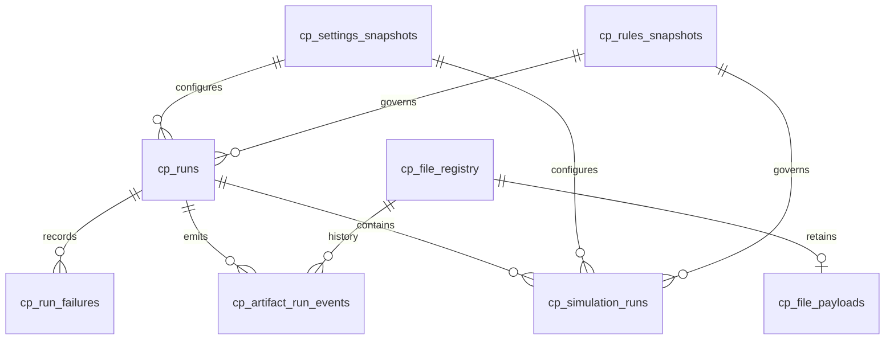
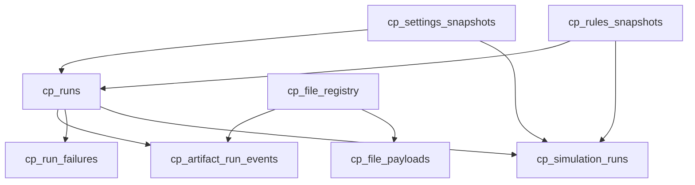

# Control Plane Data Contracts

The SQLite Control Plane is the historical operational authority for Personal Finance ETL. Its schema records run lifecycle, immutable configuration/rules snapshots, artifact identity and payloads, artifact-run events, failures, and simulation provenance. Unlike DuckDB Meta, these tables are designed to answer **what happened, under which context, and to which artifact/run**.

## Physical inventory

The current Control Plane DDL defines **8 tables**.

## `cp_file_registry`

Current artifact identity and synchronization state. `relative_path` is unique, while `file_id` is the stable registry identity used by payload/event relationships.

| Column | Physical type / constraint |
|---|---|
| `file_id` | `TEXT PRIMARY KEY` |
| `file_name` | `TEXT NOT NULL` |
| `relative_path` | `TEXT NOT NULL UNIQUE` |
| `file_category` | `TEXT NOT NULL` |
| `file_type` | `TEXT` |
| `file_hash` | `TEXT NOT NULL` |
| `file_size_bytes` | `BIGINT` |
| `sync_status` | `TEXT DEFAULT 'PENDING_BRONZE'` |
| `first_seen_run_id` | `TEXT` |
| `first_seen_at` | `TIMESTAMP NOT NULL` |
| `last_seen_run_id` | `TEXT` |
| `last_seen_at` | `TIMESTAMP NOT NULL` |
| `last_changed_run_id` | `TEXT` |
| `last_changed_at` | `TIMESTAMP` |
| `last_synced_run_id` | `TEXT` |
| `last_synced_at` | `TIMESTAMP` |

## `cp_file_payloads`

Optional retained binary evidence keyed one-to-one by artifact identity. Registry history and payload retention are intentionally separate concepts.

| Column | Physical type / constraint |
|---|---|
| `file_id` | `TEXT PRIMARY KEY` |
| `file_bytes` | `BLOB` |

## `cp_settings_snapshots`

Content-addressed canonical settings snapshots used to bind runs to operational configuration.

| Column | Physical type / constraint |
|---|---|
| `snapshot_id` | `TEXT PRIMARY KEY` |
| `content_hash` | `TEXT NOT NULL` |
| `canonical_payload` | `TEXT NOT NULL` |
| `created_at` | `TIMESTAMP NOT NULL` |

## `cp_rules_snapshots`

Content-addressed canonical FinancialRules snapshots used to bind runs/simulations to financial semantics.

| Column | Physical type / constraint |
|---|---|
| `snapshot_id` | `TEXT PRIMARY KEY` |
| `content_hash` | `TEXT NOT NULL` |
| `canonical_payload` | `TEXT NOT NULL` |
| `created_at` | `TIMESTAMP NOT NULL` |

## `cp_runs`

Run lifecycle authority, including status, timestamps, application/schema context, snapshot references, and compressed execution log payload.

| Column | Physical type / constraint |
|---|---|
| `run_id` | `TEXT PRIMARY KEY` |
| `started_at` | `TIMESTAMP NOT NULL` |
| `finished_at` | `TIMESTAMP` |
| `status` | `TEXT` |
| `application_version` | `TEXT` |
| `schema_version` | `TEXT` |
| `settings_snapshot_id` | `TEXT` |
| `rules_snapshot_id` | `TEXT` |
| `execution_log` | `BLOB` |

## `cp_run_failures`

Structured failure evidence with stage, optional ISIN context, exception type/message, traceback, and timestamp.

| Column | Physical type / constraint |
|---|---|
| `id` | `INTEGER PRIMARY KEY AUTOINCREMENT` |
| `run_id` | `TEXT NOT NULL` |
| `failed_isin` | `TEXT` |
| `stage` | `TEXT` |
| `error_type` | `TEXT` |
| `error_message` | `TEXT` |
| `traceback_log` | `TEXT` |
| `created_at` | `TIMESTAMP NOT NULL` |

## `cp_artifact_run_events`

Append-style artifact lifecycle evidence. Events preserve run, artifact, event type/time, observed path/hash, previous/new sync state, and reason.

| Column | Physical type / constraint |
|---|---|
| `event_id` | `TEXT PRIMARY KEY` |
| `run_id` | `TEXT NOT NULL` |
| `file_id` | `TEXT NOT NULL` |
| `event_type` | `TEXT NOT NULL` |
| `event_at` | `TIMESTAMP NOT NULL` |
| `observed_path` | `TEXT` |
| `content_hash` | `TEXT` |
| `previous_status` | `TEXT` |
| `new_status` | `TEXT` |
| `event_reason` | `TEXT` |

## `cp_simulation_runs`

Stochastic-run provenance: seed, horizon/iterations, input date, configuration snapshots, fingerprints, implementation version, status, and result fingerprint.

| Column | Physical type / constraint |
|---|---|
| `simulation_id` | `TEXT PRIMARY KEY` |
| `run_id` | `TEXT NOT NULL` |
| `created_at` | `TIMESTAMP NOT NULL` |
| `root_seed` | `TEXT NOT NULL` |
| `iterations` | `INTEGER` |
| `horizon` | `INTEGER` |
| `input_as_of_date` | `DATE` |
| `settings_snapshot_id` | `TEXT` |
| `rules_snapshot_id` | `TEXT` |
| `input_fingerprint` | `TEXT` |
| `model_fingerprint` | `TEXT` |
| `model_implementation_version` | `TEXT` |
| `status` | `TEXT` |
| `result_fingerprint` | `TEXT` |

## Run and artifact relationship

## Savepoint semantics

Repository operations can use SQLite savepoints to create scoped atomic units inside the broader Control Plane transaction. Savepoints protect SQLite-local multi-step mutations; they do **not** create distributed atomicity with DuckDB. The cross-store commit boundary is documented separately because pretending otherwise would be the database equivalent of optimism-driven accounting.

## Retention semantics

- Run and event rows preserve historical operational provenance.
- Snapshot rows preserve canonical configuration/rules payloads referenced by runs.
- Artifact registry rows preserve current identity/state plus first/last lifecycle references.
- Payload rows preserve binary bytes only where the application retains them; event history must not be interpreted as a promise that every historical external file byte is permanently available.
- Simulation rows preserve execution provenance, not the entire numerical runtime environment.

## Contract invariants

- Foreign keys are enabled for the Control Plane connection/schema.
- Run-bound records reference a real `cp_runs.run_id`.
- Artifact events reference both the run and registered artifact identity.
- Settings/rules snapshots are content-addressed and reusable across runs with identical canonical payloads.
- Simulation provenance references the run and the snapshots under which the simulation was executed.

## Related specifications

- [Control Plane Artifact Lifecycle](../architecture/control-plane-artifact-lifecycle.md)
- [Reliability and Recovery](../architecture/reliability-and-recovery.md)
- [Deterministic Identity and Replay](../architecture/deterministic-identity-and-replay.md)
- [Meta Data Contracts](meta-data-contracts.md)
