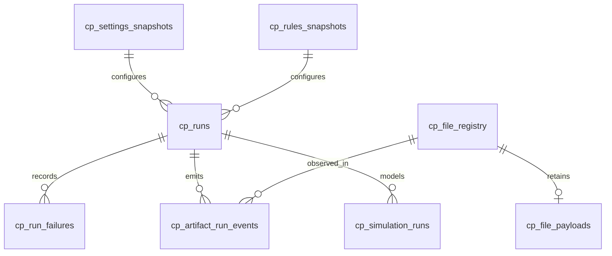

# SQLite Control Plane physical schema

I persist operational history separately from analytical DuckDB data. This reference enumerates the actual SQLite tables and their declared columns, primary keys, and foreign keys. For event semantics and lifecycle transitions I use the Control Plane domain specifications.



## `cp_file_registry`

| Column | Type | Declared key |
|---|---|---|
| `file_id` | `TEXT` | PRIMARY KEY |
| `file_name` | `TEXT` |  |
| `relative_path` | `TEXT` |  |
| `file_category` | `TEXT` |  |
| `file_type` | `TEXT` |  |
| `file_hash` | `TEXT` |  |
| `file_size_bytes` | `BIGINT` |  |
| `sync_status` | `TEXT` |  |
| `first_seen_run_id` | `TEXT` |  |
| `first_seen_at` | `TIMESTAMP` |  |
| `last_seen_run_id` | `TEXT` |  |
| `last_seen_at` | `TIMESTAMP` |  |
| `last_changed_run_id` | `TEXT` |  |
| `last_changed_at` | `TIMESTAMP` |  |
| `last_synced_run_id` | `TEXT` |  |
| `last_synced_at` | `TIMESTAMP` |  |

## `cp_file_payloads`

| Column | Type | Declared key |
|---|---|---|
| `file_id` | `TEXT` | PRIMARY KEY |
| `file_bytes` | `BLOB` |  |

## `cp_settings_snapshots`

| Column | Type | Declared key |
|---|---|---|
| `snapshot_id` | `TEXT` | PRIMARY KEY |
| `content_hash` | `TEXT` |  |
| `canonical_payload` | `TEXT` |  |
| `created_at` | `TIMESTAMP` |  |

## `cp_rules_snapshots`

| Column | Type | Declared key |
|---|---|---|
| `snapshot_id` | `TEXT` | PRIMARY KEY |
| `content_hash` | `TEXT` |  |
| `canonical_payload` | `TEXT` |  |
| `created_at` | `TIMESTAMP` |  |

## `cp_runs`

| Column | Type | Declared key |
|---|---|---|
| `run_id` | `TEXT` | PRIMARY KEY |
| `started_at` | `TIMESTAMP` |  |
| `finished_at` | `TIMESTAMP` |  |
| `status` | `TEXT` |  |
| `application_version` | `TEXT` |  |
| `schema_version` | `TEXT` |  |
| `settings_snapshot_id` | `TEXT` |  |
| `rules_snapshot_id` | `TEXT` |  |
| `execution_log` | `BLOB` |  |

## `cp_run_failures`

| Column | Type | Declared key |
|---|---|---|
| `id` | `INTEGER` | PRIMARY KEY |
| `run_id` | `TEXT` |  |
| `failed_isin` | `TEXT` |  |
| `stage` | `TEXT` |  |
| `error_type` | `TEXT` |  |
| `error_message` | `TEXT` |  |
| `traceback_log` | `TEXT` |  |
| `created_at` | `TIMESTAMP` |  |

## `cp_artifact_run_events`

| Column | Type | Declared key |
|---|---|---|
| `event_id` | `TEXT` | PRIMARY KEY |
| `run_id` | `TEXT` |  |
| `file_id` | `TEXT` |  |
| `event_type` | `TEXT` |  |
| `event_at` | `TIMESTAMP` |  |
| `observed_path` | `TEXT` |  |
| `content_hash` | `TEXT` |  |
| `previous_status` | `TEXT` |  |
| `new_status` | `TEXT` |  |
| `event_reason` | `TEXT` |  |

## `cp_simulation_runs`

| Column | Type | Declared key |
|---|---|---|
| `simulation_id` | `TEXT` | PRIMARY KEY |
| `run_id` | `TEXT` |  |
| `created_at` | `TIMESTAMP` |  |
| `root_seed` | `TEXT` |  |
| `iterations` | `INTEGER` |  |
| `horizon` | `INTEGER` |  |
| `input_as_of_date` | `DATE` |  |
| `settings_snapshot_id` | `TEXT` |  |
| `rules_snapshot_id` | `TEXT` |  |
| `input_fingerprint` | `TEXT` |  |
| `model_fingerprint` | `TEXT` |  |
| `model_implementation_version` | `TEXT` |  |
| `status` | `TEXT` |  |
| `result_fingerprint` | `TEXT` |  |

## SQLite constraints and semantics

I distinguish declared keys and foreign keys from application-enforced lifecycle transitions. A status string column is not automatically an enum constraint. I rely on the repository implementations for run-state updates, event emission, snapshot deduplication, and simulation linkage.

Source: `src/personal_finance_etl/backend/load/schema/control_plane.py`

```python
CREATE TABLE IF NOT EXISTS cp_file_registry (
    file_id TEXT PRIMARY KEY,
    file_name TEXT NOT NULL,
    relative_path TEXT NOT NULL UNIQUE,
    file_category TEXT NOT NULL,
    file_type TEXT,
    file_hash TEXT NOT NULL,
    file_size_bytes BIGINT,
    sync_status TEXT DEFAULT 'PENDING_BRONZE',
    first_seen_run_id TEXT,
    first_seen_at TIMESTAMP NOT NULL,
    last_seen_run_id TEXT,
    last_seen_at TIMESTAMP NOT NULL,
    last_changed_run_id TEXT,
    last_changed_at TIMESTAMP,
```

See [Control Plane](../control-plane/README.md) for event and recovery mechanics.
