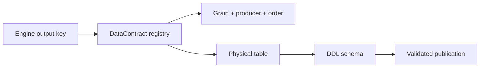

# Gold Data Contracts

Gold is the BI-facing presentation layer. Its contracts expose tax, wealth, cashflow, FIRE, and investment analytical views at deliberately consumable grains while keeping reconstruction mechanics in Silver and the engines that produce it.

## Registry authority

The current registry contains **22 Gold contracts**. Publication order is explicit metadata, not an accidental consequence of dictionary iteration or filename sorting. The ETL validates the registry before publication and rejects missing or unregistered analytical outputs.

## Contract catalog

| Order | Contract ID | Physical table | Domain | Grain | Producer |
|---:|---|---|---|---|---|
| 110 | `df_p_tf_wealth_monthly_totals` | `gold.Core_Monthly_Fact` | Wealth | Month | `WealthPresentationEngine` |
| 110 | `df_p_tf_net_worth_monthly_summary` | `gold.Wealth_Asset_Breakdown` | Wealth | Month-Asset | `WealthPresentationEngine` |
| 120 | `df_p_tf_category_spend_analytics` | `gold.Cashflow_Expense_Breakdown` | Wealth | Month-ExpenseCategory | `WealthPresentationEngine` |
| 130 | `df_p_tf_income_streams_monthly` | `gold.Cashflow_Income_Breakdown` | Wealth | Month-IncomeCategory | `WealthPresentationEngine` |
| 140 | `df_p_tf_wealth_risk_analytics` | `gold.Wealth_FIRE_Analytics` | Wealth | Month | `WealthPresentationEngine` |
| 160 | `df_p_tf_budget_forecast_monthly` | `gold.Forecast_Budget_Variance` | Wealth | Month | `WealthPresentationEngine` |
| 170 | `df_p_tf_investment_analytics` | `gold.Investment_Portfolio_Summary` | Investments | Month-ISIN | `InvestmentQuantEngine` |
| 180 | `df_p_tf_monthly_cashflow_summary` | `gold.Cashflow_Efficiency_Analytics` | Wealth | Month | `WealthPresentationEngine` |
| 190 | `df_p_tf_cashflow_activity_summary` | `gold.Cashflow_Activity_Summary` | Wealth | Month | `WealthPresentationEngine` |
| 200 | `df_f_investment_analytics_isin` | `gold.Investment_By_ISIN` | Investments | Date-ISIN | `InvestmentQuantEngine` |
| 210 | `df_f_investment_analytics_subtype` | `gold.Investment_By_Subtype` | Investments | Date-Subtype | `InvestmentQuantEngine` |
| 220 | `df_f_investment_analytics_class` | `gold.Investment_By_Class` | Investments | Date-Class | `InvestmentQuantEngine` |
| 230 | `df_f_investment_analytics_instrument_type` | `gold.Investment_By_Instrument_Type` | Investments | Date-InstrumentType | `InvestmentQuantEngine` |
| 240 | `df_f_investment_analytics_sector` | `gold.Investment_By_Sector` | Investments | Date-Sector | `InvestmentQuantEngine` |
| 250 | `df_f_investment_analytics_industry` | `gold.Investment_By_Industry` | Investments | Date-Industry | `InvestmentQuantEngine` |
| 260 | `df_f_investment_analytics_portfolio` | `gold.Investment_By_Portfolio` | Investments | Date | `InvestmentQuantEngine` |
| 270 | `df_f_investment_analytics_geo` | `gold.Investment_By_Geo` | Investments | Date-Geo | `InvestmentQuantEngine` |
| 280 | `df_f_investment_analytics_country` | `gold.Investment_By_Country` | Investments | Date-Country | `InvestmentQuantEngine` |
| 290 | `df_f_investment_analytics_currency` | `gold.Investment_By_Currency` | Investments | Date-Currency | `InvestmentQuantEngine` |
| 302 | `df_p_tax_year_summary` | `gold.Tax_Year_Summary` | Taxes | FY | `TaxEngine` |
| 303 | `df_p_tax_income_breakdown` | `gold.Tax_Income_Breakdown` | Taxes | FY-Head-SubHead-Source | `TaxEngine` |
| 304 | `df_p_tax_reconciliation` | `gold.Tax_Reconciliation` | Taxes | FY-SubHead | `TaxEngine` |

## Physical schemas

### `gold.Core_Monthly_Fact`

**Contract ID:** `df_p_tf_wealth_monthly_totals`  
**Domain:** Wealth  
**Registry grain:** **Month**  
**Producer:** `WealthPresentationEngine`  
**Publication order:** `110`

| Column | Physical type / constraint |
|---|---|
| `MONTH_START_DATE` | `DATE` |
| `MONTH_END_DATE` | `DATE` |
| `Months_Elapsed` | `BIGINT` |
| `Total_Income` | `DOUBLE` |
| `Total_Cash_Income` | `DOUBLE` |
| `Total_Non_Cash_Income` | `DOUBLE` |
| `Total_Expense` | `DOUBLE` |
| `Total_Core_Expense` | `DOUBLE` |
| `Total_Cash_Expense` | `DOUBLE` |
| `Total_Non_Cash_Expense` | `DOUBLE` |
| `Net_Cashflow_Month` | `DOUBLE` |
| `Opening_Balance_Asset` | `DOUBLE` |
| `Opening_Balance_Asset_Market` | `DOUBLE` |
| `Closing_Balance_Asset` | `DOUBLE` |
| `Closing_Balance_Asset_Market` | `DOUBLE` |
| `Asset_Delta` | `DOUBLE` |
| `Asset_Market_Delta` | `DOUBLE` |
| `Total_Assets` | `DOUBLE` |
| `Total_Assets_Market` | `DOUBLE` |
| `Opening_Investment_Book_Value` | `DOUBLE` |
| `Closing_Investment_Book_Value` | `DOUBLE` |
| `Investment_Book_Value_Delta` | `DOUBLE` |
| `Opening_Investment_Market_Value` | `DOUBLE` |
| `Closing_Investment_Market_Value` | `DOUBLE` |
| `Investment_Market_Value_Delta` | `DOUBLE` |
| `Liquid_Assets` | `DOUBLE` |
| `Liquid_Assets_Market` | `DOUBLE` |
| `Total_Liabilities` | `DOUBLE` |
| `Total_Net_Worth` | `DOUBLE` |
| `Total_Net_Worth_Market` | `DOUBLE` |
| `Total_Foreign_Currency_Exposure` | `DOUBLE` |
| `Opening_Unrealized_PL` | `DOUBLE` |
| `Closing_Unrealized_PL` | `DOUBLE` |
| `Closing_Asset_PnL` | `DOUBLE` |
| `Closing_Forex_PnL` | `DOUBLE` |
| `Opening_Investment_XIRR` | `DOUBLE` |
| `Closing_Investment_XIRR` | `DOUBLE` |
| `Foreign_Exposure_Pct` | `DOUBLE` |
| `CPI_INDEX` | `DOUBLE` |
| `INFLATION_YOY_PCT` | `DOUBLE` |

The physical DDL defines **40 columns** for this table. The registry grain is the semantic row contract; it should be used when reasoning about joins and uniqueness rather than assuming the first ID-looking column is automatically the grain.

### `gold.Wealth_Asset_Breakdown`

**Contract ID:** `df_p_tf_net_worth_monthly_summary`  
**Domain:** Wealth  
**Registry grain:** **Month-Asset**  
**Producer:** `WealthPresentationEngine`  
**Publication order:** `110`

| Column | Physical type / constraint |
|---|---|
| `MONTH_START_DATE` | `DATE` |
| `MONTH_END_DATE` | `DATE` |
| `ASSET_SUBCATEGORY_ID` | `TEXT` |
| `Opening_Balance` | `DOUBLE` |
| `Closing_Balance` | `DOUBLE` |
| `Closing_Balance_Market` | `DOUBLE` |
| `All_Time_High_Balance` | `DOUBLE` |
| `Liquid_Assets` | `DOUBLE` |
| `Liquid_Assets_Market` | `DOUBLE` |
| `Closing_Asset_PnL` | `DOUBLE` |
| `Closing_Forex_PnL` | `DOUBLE` |
| `Organic_Growth_Value` | `DOUBLE` |
| `Drawdown_From_Peak` | `DOUBLE` |
| `Investment_Contribution_Pct` | `DOUBLE` |
| `Savings_to_NW_Ratio` | `DOUBLE` |
| `Income_Inflow` | `DOUBLE` |
| `Cash_Income_Inflow` | `DOUBLE` |
| `Non_Cash_Income_Inflow` | `DOUBLE` |
| `Expense_Outflow` | `DOUBLE` |
| `Core_Expense_Outflow` | `DOUBLE` |
| `Cash_Expense_Outflow` | `DOUBLE` |
| `Non_Cash_Expense_Outflow` | `DOUBLE` |
| `Net_Transfers` | `DOUBLE` |
| `Net_Cashflow_Month` | `DOUBLE` |
| `Surplus_Deficit_Month` | `DOUBLE` |
| `Cumulative_Net_Savings` | `DOUBLE` |
| `Months_of_Runway` | `DOUBLE` |

The physical DDL defines **27 columns** for this table. The registry grain is the semantic row contract; it should be used when reasoning about joins and uniqueness rather than assuming the first ID-looking column is automatically the grain.

### `gold.Cashflow_Expense_Breakdown`

**Contract ID:** `df_p_tf_category_spend_analytics`  
**Domain:** Wealth  
**Registry grain:** **Month-ExpenseCategory**  
**Producer:** `WealthPresentationEngine`  
**Publication order:** `120`

| Column | Physical type / constraint |
|---|---|
| `MONTH_START_DATE` | `DATE` |
| `MONTH_END_DATE` | `DATE` |
| `YEAR_MONTH` | `TEXT` |
| `CATEGORY_ID` | `TEXT` |
| `CATEGORY_NAME` | `TEXT` |
| `CATEGORY_GROUPS` | `TEXT` |
| `Spend_Type` | `TEXT` |
| `Is_Core_Expense` | `BOOLEAN` |
| `Is_Investment` | `BOOLEAN` |
| `Is_Discretionary` | `BOOLEAN` |
| `Total_Monthly_Spend` | `DOUBLE` |
| `Cash_Spend` | `DOUBLE` |
| `Non_Cash_Spend` | `DOUBLE` |
| `Trailing_3M_Avg_Spend` | `DOUBLE` |
| `Cumulative_YTD_Spend` | `DOUBLE` |

The physical DDL defines **15 columns** for this table. The registry grain is the semantic row contract; it should be used when reasoning about joins and uniqueness rather than assuming the first ID-looking column is automatically the grain.

### `gold.Cashflow_Income_Breakdown`

**Contract ID:** `df_p_tf_income_streams_monthly`  
**Domain:** Wealth  
**Registry grain:** **Month-IncomeCategory**  
**Producer:** `WealthPresentationEngine`  
**Publication order:** `130`

| Column | Physical type / constraint |
|---|---|
| `MONTH_START_DATE` | `DATE` |
| `MONTH_END_DATE` | `DATE` |
| `YEAR_MONTH` | `TEXT` |
| `CATEGORY_ID` | `TEXT` |
| `CATEGORY_NAME` | `TEXT` |
| `CATEGORY_GROUPS` | `TEXT` |
| `Is_Active_Income` | `BOOLEAN` |
| `Is_Passive_Income` | `BOOLEAN` |
| `Is_Dividend_Income` | `BOOLEAN` |
| `Is_Interest_Income` | `BOOLEAN` |
| `Is_Non_Cash_Income` | `BOOLEAN` |
| `Total_Monthly_Income` | `DOUBLE` |
| `Trailing_3M_Avg_Income` | `DOUBLE` |
| `Cumulative_YTD_Income` | `DOUBLE` |

The physical DDL defines **14 columns** for this table. The registry grain is the semantic row contract; it should be used when reasoning about joins and uniqueness rather than assuming the first ID-looking column is automatically the grain.

### `gold.Wealth_FIRE_Analytics`

**Contract ID:** `df_p_tf_wealth_risk_analytics`  
**Domain:** Wealth  
**Registry grain:** **Month**  
**Producer:** `WealthPresentationEngine`  
**Publication order:** `140`

BI-facing wealth and FIRE analytics, including stochastic simulation outputs. Simulation provenance itself remains in the Control Plane/Meta surfaces.

| Column | Physical type / constraint |
|---|---|
| `MONTH_START_DATE` | `DATE` |
| `MONTH_END_DATE` | `DATE` |
| `YEAR_MONTH` | `TEXT` |
| `Projected_FI_Date_P50` | `DATE` |
| `Total_Income` | `DOUBLE` |
| `Total_Cash_Income` | `DOUBLE` |
| `Trailing_6M_Avg_Spend` | `DOUBLE` |
| `Trailing_12M_Avg_Spend` | `DOUBLE` |
| `Trailing_6M_Avg_Savings` | `DOUBLE` |
| `Trailing_12M_Avg_Savings` | `DOUBLE` |
| `Target_FI_Today` | `DOUBLE` |
| `Coast_FI_Today` | `DOUBLE` |
| `Lean_FI_Today` | `DOUBLE` |
| `Target_FI_Total_Future_Nominal` | `DOUBLE` |
| `FI_Gap` | `DOUBLE` |
| `FI_Gap_Monthly_Trend` | `DOUBLE` |
| `Terminal_Wealth_Nominal_P50` | `DOUBLE` |
| `Real_Return_Assumed_Pct` | `DOUBLE` |
| `Wealth_Velocity` | `DOUBLE` |
| `Wealth_Acceleration` | `DOUBLE` |
| `Real_NW_CAGR_3Y` | `DOUBLE` |
| `Current_FI_Coverage_Pct` | `DOUBLE` |
| `Estimated_Months_To_FI_Linear` | `DOUBLE` |
| `Months_To_FI_Conservative_P90` | `DOUBLE` |
| `Months_To_FI_Base_P50` | `DOUBLE` |
| `Months_To_FI_Aggressive_P10` | `DOUBLE` |
| `Probability_Of_Success_Pct` | `DOUBLE` |
| `Years_To_FI_P50` | `DOUBLE` |
| `Runway_Months_Linear` | `DOUBLE` |
| `Runway_Months_Stressed_P10` | `DOUBLE` |
| `Runway_Months_Base_P50` | `DOUBLE` |
| `Withdrawal_Rate_If_Retired_Now` | `DOUBLE` |
| `Savings_Rate_Required` | `DOUBLE` |
| `Savings_Rate_Actual` | `DOUBLE` |
| `FI_Velocity` | `DOUBLE` |

The physical DDL defines **35 columns** for this table. The registry grain is the semantic row contract; it should be used when reasoning about joins and uniqueness rather than assuming the first ID-looking column is automatically the grain.

### `gold.Forecast_Budget_Variance`

**Contract ID:** `df_p_tf_budget_forecast_monthly`  
**Domain:** Wealth  
**Registry grain:** **Month**  
**Producer:** `WealthPresentationEngine`  
**Publication order:** `160`

| Column | Physical type / constraint |
|---|---|
| `MONTH_START_DATE` | `DATE` |
| `MONTH_END_DATE` | `DATE` |
| `YEAR_MONTH` | `TEXT` |
| `Is_Core_Overspent` | `BOOLEAN` |
| `Is_NonCore_Overspent` | `BOOLEAN` |
| `Is_Investment_Underfunded` | `BOOLEAN` |
| `Is_Income_Volatile` | `BOOLEAN` |
| `Is_Budget_Month_Healthy` | `BOOLEAN` |
| `Total_Income` | `DOUBLE` |
| `Actual_Income` | `DOUBLE` |
| `Budget_Income` | `DOUBLE` |
| `Budget_Core_Expense_Target` | `DOUBLE` |
| `Budget_NonCore_Expense_Target` | `DOUBLE` |
| `Budget_Investment_Target` | `DOUBLE` |
| `Budget_Surplus_Buffer` | `DOUBLE` |
| `Budget_Total_Expense_Target` | `DOUBLE` |
| `Actual_Core_Expense` | `DOUBLE` |
| `Actual_NonCore_Expense` | `DOUBLE` |
| `Investment_Deployed` | `DOUBLE` |
| `Investment_Redeemed` | `DOUBLE` |
| `Actual_Investment` | `DOUBLE` |
| `Actual_Savings` | `DOUBLE` |
| `Emergency_Fund_Gap` | `DOUBLE` |
| `Rule_Core_Pct_Budget` | `DOUBLE` |
| `Rule_NonCore_Pct_Budget` | `DOUBLE` |
| `Rule_Investment_Pct_Budget` | `DOUBLE` |
| `Zero_Income_Runway_Months` | `DOUBLE` |

The physical DDL defines **27 columns** for this table. The registry grain is the semantic row contract; it should be used when reasoning about joins and uniqueness rather than assuming the first ID-looking column is automatically the grain.

### `gold.Investment_Portfolio_Summary`

**Contract ID:** `df_p_tf_investment_analytics`  
**Domain:** Investments  
**Registry grain:** **Month-ISIN**  
**Producer:** `InvestmentQuantEngine`  
**Publication order:** `170`

Monthly ISIN-level investment presentation output produced by the Quant Engine.

| Column | Physical type / constraint |
|---|---|
| `MONTH_START_DATE` | `DATE` |
| `Max_Closing_Date` | `DATE` |
| `ISIN` | `TEXT` |
| `CURRENCY_ID` | `TEXT` |
| `INSTRUMENT_NAME` | `TEXT` |
| `INSTRUMENT_CLASS` | `TEXT` |
| `INSTRUMENT_TYPE` | `TEXT` |
| `INSTRUMENT_SUBTYPE` | `TEXT` |
| `SECTOR` | `TEXT` |
| `Rebalance_Required` | `BOOLEAN` |
| `ISIN_Market_Value` | `DOUBLE` |
| `ISIN_Book_Value` | `DOUBLE` |
| `ISIN_Market_Value_Local` | `DOUBLE` |
| `ISIN_Book_Value_Local` | `DOUBLE` |
| `ISIN_Unrealized_PnL` | `DOUBLE` |
| `ISIN_Asset_PnL` | `DOUBLE` |
| `ISIN_Forex_PnL` | `DOUBLE` |
| `ISIN_Forex_Contribution_Pct` | `DOUBLE` |
| `ISIN_XIRR_Local` | `DOUBLE` |
| `ISIN_FX_XIRR_Impact` | `DOUBLE` |
| `ISIN_BM_XIRR` | `DOUBLE` |
| `ISIN_BM_XIRR_Local` | `DOUBLE` |
| `ISIN_Active_Return` | `DOUBLE` |
| `ISIN_Active_Return_Local` | `DOUBLE` |
| `ISIN_Weight` | `DOUBLE` |
| `Class_Weight` | `DOUBLE` |
| `Class_Target_Weight` | `DOUBLE` |
| `Class_Drift` | `DOUBLE` |
| `Sector_Weight` | `DOUBLE` |
| `Monthly_Market_Value_Change_Pct` | `DOUBLE` |
| `ISIN_Harvestable_Loss` | `DOUBLE` |
| `Tax_Harvesting_Priority_Score` | `DOUBLE` |

The physical DDL defines **32 columns** for this table. The registry grain is the semantic row contract; it should be used when reasoning about joins and uniqueness rather than assuming the first ID-looking column is automatically the grain.

### `gold.Cashflow_Efficiency_Analytics`

**Contract ID:** `df_p_tf_monthly_cashflow_summary`  
**Domain:** Wealth  
**Registry grain:** **Month**  
**Producer:** `WealthPresentationEngine`  
**Publication order:** `180`

| Column | Physical type / constraint |
|---|---|
| `MONTH_START_DATE` | `DATE` |
| `MONTH_END_DATE` | `DATE` |
| `YEAR_MONTH` | `TEXT` |
| `Is_Surplus_Month` | `BOOLEAN` |
| `Is_Investment_Target_Met` | `BOOLEAN` |
| `Total_Income` | `DOUBLE` |
| `Total_Cash_Income` | `DOUBLE` |
| `Total_Non_Cash_Income` | `DOUBLE` |
| `Total_Expense` | `DOUBLE` |
| `Active_Income` | `DOUBLE` |
| `Passive_Income` | `DOUBLE` |
| `Dividend_Income` | `DOUBLE` |
| `Interest_Income` | `DOUBLE` |
| `Core_Expense` | `DOUBLE` |
| `NonCore_Expense` | `DOUBLE` |
| `Total_Cash_Expense` | `DOUBLE` |
| `Total_Non_Cash_Expense` | `DOUBLE` |
| `Total_Investment_Deployed` | `DOUBLE` |
| `Total_Investment_Redeemed` | `DOUBLE` |
| `Redemption_Gain_Loss_Value` | `DOUBLE` |
| `Net_Investment_Flow` | `DOUBLE` |
| `Gross_Surplus` | `DOUBLE` |
| `Net_Surplus_After_Invest` | `DOUBLE` |
| `Income_MoM_Delta` | `DOUBLE` |
| `Expense_MoM_Delta` | `DOUBLE` |
| `Investment_MoM_Delta` | `DOUBLE` |
| `Trailing_3M_Avg_Income` | `DOUBLE` |
| `Trailing_3M_Avg_Expense` | `DOUBLE` |
| `Trailing_3M_Avg_Investment` | `DOUBLE` |
| `Savings_Rate_Pct` | `DOUBLE` |
| `Investment_Rate_Pct` | `DOUBLE` |
| `Active_Income_Share_Pct` | `DOUBLE` |
| `Passive_Income_Share_Pct` | `DOUBLE` |
| `Core_Expense_Share_Pct` | `DOUBLE` |
| `NonCore_Expense_Share_Pct` | `DOUBLE` |
| `Income_MoM_Pct` | `DOUBLE` |
| `Expense_MoM_Pct` | `DOUBLE` |
| `Trailing_3M_Avg_Savings_Rate` | `DOUBLE` |
| `Trailing_3M_Avg_Investment_Rate` | `DOUBLE` |
| `Liquidity_Ratio_Months` | `DOUBLE` |
| `Debt_to_Asset_Ratio_Pct` | `DOUBLE` |
| `YoY_Net_Worth_Growth_Pct` | `DOUBLE` |
| `YoY_Net_Worth_Growth_Pct_Real` | `DOUBLE` |
| `Expense_to_NW_Ratio` | `DOUBLE` |
| `Emergency_Fund_Coverage` | `DOUBLE` |

The physical DDL defines **45 columns** for this table. The registry grain is the semantic row contract; it should be used when reasoning about joins and uniqueness rather than assuming the first ID-looking column is automatically the grain.

### `gold.Cashflow_Activity_Summary`

**Contract ID:** `df_p_tf_cashflow_activity_summary`  
**Domain:** Wealth  
**Registry grain:** **Month**  
**Producer:** `WealthPresentationEngine`  
**Publication order:** `190`

| Column | Physical type / constraint |
|---|---|
| `MONTH_START_DATE` | `DATE` |
| `MONTH_END_DATE` | `DATE` |
| `YEAR_MONTH` | `TEXT` |
| `Opening_Cash_Balance` | `DOUBLE` |
| `Closing_Cash_Balance` | `DOUBLE` |
| `Net_Cash_Movement` | `DOUBLE` |
| `Cash_Inflow_Operating` | `DOUBLE` |
| `Cash_Outflow_Operating` | `DOUBLE` |
| `Net_Cashflow_Operating` | `DOUBLE` |
| `Cash_Inflow_Investing` | `DOUBLE` |
| `Cash_Outflow_Investing` | `DOUBLE` |
| `Net_Cashflow_Investing` | `DOUBLE` |
| `Cash_Inflow_Financing` | `DOUBLE` |
| `Cash_Outflow_Financing` | `DOUBLE` |
| `Net_Cashflow_Financing` | `DOUBLE` |
| `Internal_Transfer_Inflow` | `DOUBLE` |
| `Internal_Transfer_Outflow` | `DOUBLE` |
| `Net_Internal_Transfers` | `DOUBLE` |
| `Total_Cash_Expenses` | `DOUBLE` |
| `Total_Non_Cash_Expenses` | `DOUBLE` |
| `Total_Cash_Inflow` | `DOUBLE` |
| `Total_Cash_Outflow` | `DOUBLE` |
| `Calculated_Net_Cashflow` | `DOUBLE` |
| `Unreconciled_Difference` | `DOUBLE` |

The physical DDL defines **24 columns** for this table. The registry grain is the semantic row contract; it should be used when reasoning about joins and uniqueness rather than assuming the first ID-looking column is automatically the grain.

### `gold.Investment_By_ISIN`

**Contract ID:** `df_f_investment_analytics_isin`  
**Domain:** Investments  
**Registry grain:** **Date-ISIN**  
**Producer:** `InvestmentQuantEngine`  
**Publication order:** `200`

| Column | Physical type / constraint |
|---|---|
| `Closing_Date` | `DATE NOT NULL` |
| `ISIN` | `TEXT NOT NULL` |
| `CURRENCY_ID` | `TEXT` |
| `Total_Invested_Value` | `DOUBLE` |
| `Total_Current_Value` | `DOUBLE` |
| `Total_Quantity` | `DOUBLE` |
| `Total_Stocks` | `DOUBLE` |
| `Total_Invested_Value_Local` | `DOUBLE` |
| `Total_Current_Value_Local` | `DOUBLE` |
| `Current_FX_Rate` | `DOUBLE` |
| `Blended_FX_Buy_Rate` | `DOUBLE` |
| `Currency_Appreciation_Pct` | `DOUBLE` |
| `Unrealized_PL` | `DOUBLE` |
| `Asset_PnL` | `DOUBLE` |
| `Forex_PnL` | `DOUBLE` |
| `Forex_Contribution_Pct` | `DOUBLE` |
| `Absolute_Return` | `DOUBLE` |
| `CAGR` | `DOUBLE` |
| `XIRR` | `DOUBLE` |
| `XIRR_Local` | `DOUBLE` |
| `FX_XIRR_Impact` | `DOUBLE` |
| `After_Tax_XIRR` | `DOUBLE` |
| `BM_CAGR` | `DOUBLE` |
| `BM_XIRR` | `DOUBLE` |
| `BM_XIRR_Local` | `DOUBLE` |
| `Active_Return` | `DOUBLE` |
| `Active_Return_Local` | `DOUBLE` |
| `Is_Lagging_Benchmark` | `BIGINT` |
| `Outperforming_Lot_Ratio` | `DOUBLE` |
| `Max_Drawdown` | `DOUBLE` |
| `Weight` | `DOUBLE` |
| `Unrealized_LTCG` | `DOUBLE` |
| `Unrealized_STCG` | `DOUBLE` |
| `Unrealized_Gain` | `DOUBLE` |
| `Unrealized_LTCL` | `DOUBLE` |
| `Unrealized_STCL` | `DOUBLE` |
| `Unrealized_Loss` | `DOUBLE` |
| `LTCG_Tax_If_Sold` | `DOUBLE` |
| `STCG_Tax_If_Sold` | `DOUBLE` |
| `FY_Realized_LTCG` | `DOUBLE` |
| `FY_Realized_STCG` | `DOUBLE` |
| `FY_Realized_Gain` | `DOUBLE` |
| `FY_Realized_LTCL` | `DOUBLE` |
| `FY_Realized_STCL` | `DOUBLE` |
| `FY_Realized_Loss` | `DOUBLE` |
| `FY_Realized_Net_PnL` | `DOUBLE` |

The physical DDL defines **46 columns** for this table. The registry grain is the semantic row contract; it should be used when reasoning about joins and uniqueness rather than assuming the first ID-looking column is automatically the grain.

### `gold.Investment_By_Subtype`

**Contract ID:** `df_f_investment_analytics_subtype`  
**Domain:** Investments  
**Registry grain:** **Date-Subtype**  
**Producer:** `InvestmentQuantEngine`  
**Publication order:** `210`

| Column | Physical type / constraint |
|---|---|
| `Closing_Date` | `DATE NOT NULL` |
| `INSTRUMENT_SUBTYPE` | `TEXT NOT NULL` |
| `INSTRUMENT_CLASS` | `TEXT NOT NULL` |
| `Total_Invested_Value` | `DOUBLE` |
| `Total_Current_Value` | `DOUBLE` |
| `Total_Quantity` | `DOUBLE` |
| `Total_Stocks` | `DOUBLE` |
| `Unrealized_PL` | `DOUBLE` |
| `Asset_PnL` | `DOUBLE` |
| `Forex_PnL` | `DOUBLE` |
| `Forex_Contribution_Pct` | `DOUBLE` |
| `Absolute_Return` | `DOUBLE` |
| `XIRR` | `DOUBLE` |
| `After_Tax_XIRR` | `DOUBLE` |
| `BM_XIRR` | `DOUBLE` |
| `Active_Return` | `DOUBLE` |
| `Max_Drawdown` | `DOUBLE` |
| `Weight` | `DOUBLE` |
| `Unrealized_Gain` | `DOUBLE` |
| `Unrealized_Loss` | `DOUBLE` |
| `FY_Realized_Gain` | `DOUBLE` |
| `FY_Realized_Loss` | `DOUBLE` |
| `FY_Realized_Net_PnL` | `DOUBLE` |

The physical DDL defines **23 columns** for this table. The registry grain is the semantic row contract; it should be used when reasoning about joins and uniqueness rather than assuming the first ID-looking column is automatically the grain.

### `gold.Investment_By_Class`

**Contract ID:** `df_f_investment_analytics_class`  
**Domain:** Investments  
**Registry grain:** **Date-Class**  
**Producer:** `InvestmentQuantEngine`  
**Publication order:** `220`

| Column | Physical type / constraint |
|---|---|
| `Closing_Date` | `DATE NOT NULL` |
| `INSTRUMENT_CLASS` | `TEXT NOT NULL` |
| `Total_Invested_Value` | `DOUBLE` |
| `Total_Current_Value` | `DOUBLE` |
| `Total_Quantity` | `DOUBLE` |
| `Total_Stocks` | `DOUBLE` |
| `Unrealized_PL` | `DOUBLE` |
| `Asset_PnL` | `DOUBLE` |
| `Forex_PnL` | `DOUBLE` |
| `Forex_Contribution_Pct` | `DOUBLE` |
| `Absolute_Return` | `DOUBLE` |
| `XIRR` | `DOUBLE` |
| `After_Tax_XIRR` | `DOUBLE` |
| `BM_XIRR` | `DOUBLE` |
| `Active_Return` | `DOUBLE` |
| `Max_Drawdown` | `DOUBLE` |
| `Weight` | `DOUBLE` |
| `Unrealized_Gain` | `DOUBLE` |
| `Unrealized_Loss` | `DOUBLE` |
| `FY_Realized_Gain` | `DOUBLE` |
| `FY_Realized_Loss` | `DOUBLE` |
| `FY_Realized_Net_PnL` | `DOUBLE` |

The physical DDL defines **22 columns** for this table. The registry grain is the semantic row contract; it should be used when reasoning about joins and uniqueness rather than assuming the first ID-looking column is automatically the grain.

### `gold.Investment_By_Instrument_Type`

**Contract ID:** `df_f_investment_analytics_instrument_type`  
**Domain:** Investments  
**Registry grain:** **Date-InstrumentType**  
**Producer:** `InvestmentQuantEngine`  
**Publication order:** `230`

| Column | Physical type / constraint |
|---|---|
| `Closing_Date` | `DATE NOT NULL` |
| `INSTRUMENT_TYPE` | `TEXT NOT NULL` |
| `Total_Invested_Value` | `DOUBLE` |
| `Total_Current_Value` | `DOUBLE` |
| `Total_Quantity` | `DOUBLE` |
| `Total_Stocks` | `DOUBLE` |
| `Unrealized_PL` | `DOUBLE` |
| `Asset_PnL` | `DOUBLE` |
| `Forex_PnL` | `DOUBLE` |
| `Forex_Contribution_Pct` | `DOUBLE` |
| `Absolute_Return` | `DOUBLE` |
| `XIRR` | `DOUBLE` |
| `After_Tax_XIRR` | `DOUBLE` |
| `BM_XIRR` | `DOUBLE` |
| `Active_Return` | `DOUBLE` |
| `Max_Drawdown` | `DOUBLE` |
| `Weight` | `DOUBLE` |
| `Unrealized_Gain` | `DOUBLE` |
| `Unrealized_Loss` | `DOUBLE` |
| `FY_Realized_Gain` | `DOUBLE` |
| `FY_Realized_Loss` | `DOUBLE` |
| `FY_Realized_Net_PnL` | `DOUBLE` |

The physical DDL defines **22 columns** for this table. The registry grain is the semantic row contract; it should be used when reasoning about joins and uniqueness rather than assuming the first ID-looking column is automatically the grain.

### `gold.Investment_By_Sector`

**Contract ID:** `df_f_investment_analytics_sector`  
**Domain:** Investments  
**Registry grain:** **Date-Sector**  
**Producer:** `InvestmentQuantEngine`  
**Publication order:** `240`

| Column | Physical type / constraint |
|---|---|
| `Closing_Date` | `DATE NOT NULL` |
| `SECTOR` | `TEXT NOT NULL` |
| `Total_Invested_Value` | `DOUBLE` |
| `Total_Current_Value` | `DOUBLE` |
| `Total_Quantity` | `DOUBLE` |
| `Total_Stocks` | `DOUBLE` |
| `Unrealized_PL` | `DOUBLE` |
| `Asset_PnL` | `DOUBLE` |
| `Forex_PnL` | `DOUBLE` |
| `Forex_Contribution_Pct` | `DOUBLE` |
| `Absolute_Return` | `DOUBLE` |
| `XIRR` | `DOUBLE` |
| `After_Tax_XIRR` | `DOUBLE` |
| `BM_XIRR` | `DOUBLE` |
| `Active_Return` | `DOUBLE` |
| `Max_Drawdown` | `DOUBLE` |
| `Weight` | `DOUBLE` |
| `Unrealized_Gain` | `DOUBLE` |
| `Unrealized_Loss` | `DOUBLE` |
| `FY_Realized_Gain` | `DOUBLE` |
| `FY_Realized_Loss` | `DOUBLE` |
| `FY_Realized_Net_PnL` | `DOUBLE` |

The physical DDL defines **22 columns** for this table. The registry grain is the semantic row contract; it should be used when reasoning about joins and uniqueness rather than assuming the first ID-looking column is automatically the grain.

### `gold.Investment_By_Industry`

**Contract ID:** `df_f_investment_analytics_industry`  
**Domain:** Investments  
**Registry grain:** **Date-Industry**  
**Producer:** `InvestmentQuantEngine`  
**Publication order:** `250`

| Column | Physical type / constraint |
|---|---|
| `Closing_Date` | `DATE NOT NULL` |
| `INDUSTRY` | `TEXT NOT NULL` |
| `Total_Invested_Value` | `DOUBLE` |
| `Total_Current_Value` | `DOUBLE` |
| `Total_Quantity` | `DOUBLE` |
| `Total_Stocks` | `DOUBLE` |
| `Unrealized_PL` | `DOUBLE` |
| `Asset_PnL` | `DOUBLE` |
| `Forex_PnL` | `DOUBLE` |
| `Forex_Contribution_Pct` | `DOUBLE` |
| `Absolute_Return` | `DOUBLE` |
| `XIRR` | `DOUBLE` |
| `After_Tax_XIRR` | `DOUBLE` |
| `BM_XIRR` | `DOUBLE` |
| `Active_Return` | `DOUBLE` |
| `Max_Drawdown` | `DOUBLE` |
| `Weight` | `DOUBLE` |
| `Unrealized_Gain` | `DOUBLE` |
| `Unrealized_Loss` | `DOUBLE` |
| `FY_Realized_Gain` | `DOUBLE` |
| `FY_Realized_Loss` | `DOUBLE` |
| `FY_Realized_Net_PnL` | `DOUBLE` |

The physical DDL defines **22 columns** for this table. The registry grain is the semantic row contract; it should be used when reasoning about joins and uniqueness rather than assuming the first ID-looking column is automatically the grain.

### `gold.Investment_By_Portfolio`

**Contract ID:** `df_f_investment_analytics_portfolio`  
**Domain:** Investments  
**Registry grain:** **Date**  
**Producer:** `InvestmentQuantEngine`  
**Publication order:** `260`

| Column | Physical type / constraint |
|---|---|
| `Closing_Date` | `DATE NOT NULL` |
| `Total_Invested_Value` | `DOUBLE` |
| `Total_Current_Value` | `DOUBLE` |
| `Total_Quantity` | `DOUBLE` |
| `Total_Stocks` | `DOUBLE` |
| `Unrealized_PL` | `DOUBLE` |
| `Asset_PnL` | `DOUBLE` |
| `Forex_PnL` | `DOUBLE` |
| `Forex_Contribution_Pct` | `DOUBLE` |
| `Absolute_Return` | `DOUBLE` |
| `XIRR` | `DOUBLE` |
| `After_Tax_XIRR` | `DOUBLE` |
| `BM_XIRR` | `DOUBLE` |
| `Active_Return` | `DOUBLE` |
| `Max_Drawdown` | `DOUBLE` |
| `Weight` | `DOUBLE` |
| `Unrealized_Gain` | `DOUBLE` |
| `Unrealized_Loss` | `DOUBLE` |
| `FY_Realized_Gain` | `DOUBLE` |
| `FY_Realized_Loss` | `DOUBLE` |
| `FY_Realized_Net_PnL` | `DOUBLE` |

The physical DDL defines **21 columns** for this table. The registry grain is the semantic row contract; it should be used when reasoning about joins and uniqueness rather than assuming the first ID-looking column is automatically the grain.

### `gold.Investment_By_Geo`

**Contract ID:** `df_f_investment_analytics_geo`  
**Domain:** Investments  
**Registry grain:** **Date-Geo**  
**Producer:** `InvestmentQuantEngine`  
**Publication order:** `270`

| Column | Physical type / constraint |
|---|---|
| `Closing_Date` | `DATE NOT NULL` |
| `GEO` | `TEXT NOT NULL` |
| `Total_Invested_Value` | `DOUBLE` |
| `Total_Current_Value` | `DOUBLE` |
| `Total_Quantity` | `DOUBLE` |
| `Total_Stocks` | `DOUBLE` |
| `Unrealized_PL` | `DOUBLE` |
| `Asset_PnL` | `DOUBLE` |
| `Forex_PnL` | `DOUBLE` |
| `Forex_Contribution_Pct` | `DOUBLE` |
| `Absolute_Return` | `DOUBLE` |
| `XIRR` | `DOUBLE` |
| `After_Tax_XIRR` | `DOUBLE` |
| `BM_XIRR` | `DOUBLE` |
| `Active_Return` | `DOUBLE` |
| `Max_Drawdown` | `DOUBLE` |
| `Weight` | `DOUBLE` |
| `Unrealized_Gain` | `DOUBLE` |
| `Unrealized_Loss` | `DOUBLE` |
| `FY_Realized_Gain` | `DOUBLE` |
| `FY_Realized_Loss` | `DOUBLE` |
| `FY_Realized_Net_PnL` | `DOUBLE` |

The physical DDL defines **22 columns** for this table. The registry grain is the semantic row contract; it should be used when reasoning about joins and uniqueness rather than assuming the first ID-looking column is automatically the grain.

### `gold.Investment_By_Country`

**Contract ID:** `df_f_investment_analytics_country`  
**Domain:** Investments  
**Registry grain:** **Date-Country**  
**Producer:** `InvestmentQuantEngine`  
**Publication order:** `280`

| Column | Physical type / constraint |
|---|---|
| `Closing_Date` | `DATE NOT NULL` |
| `COUNTRY` | `TEXT NOT NULL` |
| `Total_Invested_Value` | `DOUBLE` |
| `Total_Current_Value` | `DOUBLE` |
| `Total_Quantity` | `DOUBLE` |
| `Total_Stocks` | `DOUBLE` |
| `Total_Invested_Value_Local` | `DOUBLE` |
| `Total_Current_Value_Local` | `DOUBLE` |
| `Current_FX_Rate` | `DOUBLE` |
| `Blended_FX_Buy_Rate` | `DOUBLE` |
| `Currency_Appreciation_Pct` | `DOUBLE` |
| `Unrealized_PL` | `DOUBLE` |
| `Asset_PnL` | `DOUBLE` |
| `Forex_PnL` | `DOUBLE` |
| `Forex_Contribution_Pct` | `DOUBLE` |
| `Absolute_Return` | `DOUBLE` |
| `XIRR` | `DOUBLE` |
| `After_Tax_XIRR` | `DOUBLE` |
| `BM_XIRR` | `DOUBLE` |
| `Active_Return` | `DOUBLE` |
| `XIRR_Local` | `DOUBLE` |
| `BM_XIRR_Local` | `DOUBLE` |
| `Active_Return_Local` | `DOUBLE` |
| `FX_XIRR_Impact` | `DOUBLE` |
| `Max_Drawdown` | `DOUBLE` |
| `Weight` | `DOUBLE` |
| `Unrealized_Gain` | `DOUBLE` |
| `Unrealized_Loss` | `DOUBLE` |
| `FY_Realized_Gain` | `DOUBLE` |
| `FY_Realized_Loss` | `DOUBLE` |
| `FY_Realized_Net_PnL` | `DOUBLE` |

The physical DDL defines **31 columns** for this table. The registry grain is the semantic row contract; it should be used when reasoning about joins and uniqueness rather than assuming the first ID-looking column is automatically the grain.

### `gold.Investment_By_Currency`

**Contract ID:** `df_f_investment_analytics_currency`  
**Domain:** Investments  
**Registry grain:** **Date-Currency**  
**Producer:** `InvestmentQuantEngine`  
**Publication order:** `290`

| Column | Physical type / constraint |
|---|---|
| `Closing_Date` | `DATE NOT NULL` |
| `CURRENCY_ID` | `TEXT NOT NULL` |
| `Total_Invested_Value` | `DOUBLE` |
| `Total_Current_Value` | `DOUBLE` |
| `Total_Quantity` | `DOUBLE` |
| `Total_Stocks` | `DOUBLE` |
| `Total_Invested_Value_Local` | `DOUBLE` |
| `Total_Current_Value_Local` | `DOUBLE` |
| `Current_FX_Rate` | `DOUBLE` |
| `Blended_FX_Buy_Rate` | `DOUBLE` |
| `Currency_Appreciation_Pct` | `DOUBLE` |
| `Unrealized_PL` | `DOUBLE` |
| `Asset_PnL` | `DOUBLE` |
| `Forex_PnL` | `DOUBLE` |
| `Forex_Contribution_Pct` | `DOUBLE` |
| `Absolute_Return` | `DOUBLE` |
| `XIRR` | `DOUBLE` |
| `XIRR_Local` | `DOUBLE` |
| `FX_XIRR_Impact` | `DOUBLE` |
| `After_Tax_XIRR` | `DOUBLE` |
| `BM_XIRR` | `DOUBLE` |
| `BM_XIRR_Local` | `DOUBLE` |
| `Active_Return` | `DOUBLE` |
| `Active_Return_Local` | `DOUBLE` |
| `Max_Drawdown` | `DOUBLE` |
| `Weight` | `DOUBLE` |
| `Unrealized_Gain` | `DOUBLE` |
| `Unrealized_Loss` | `DOUBLE` |
| `FY_Realized_Gain` | `DOUBLE` |
| `FY_Realized_Loss` | `DOUBLE` |
| `FY_Realized_Net_PnL` | `DOUBLE` |

The physical DDL defines **31 columns** for this table. The registry grain is the semantic row contract; it should be used when reasoning about joins and uniqueness rather than assuming the first ID-looking column is automatically the grain.

### `gold.Tax_Year_Summary`

**Contract ID:** `df_p_tax_year_summary`  
**Domain:** Taxes  
**Registry grain:** **FY**  
**Producer:** `TaxEngine`  
**Publication order:** `302`

| Column | Physical type / constraint |
|---|---|
| `FY` | `TEXT PRIMARY KEY` |
| `Total_Ledger_Income` | `DOUBLE` |
| `Total_Investment_Gain_Loss` | `DOUBLE` |
| `Total_Tax_Credits` | `DOUBLE` |
| `Total_Estimated_Investment_Tax` | `DOUBLE` |
| `Investment_Tax_Estimate_Count` | `BIGINT` |
| `Investment_Tax_Estimate_Missing_Count` | `BIGINT` |
| `Investment_Tax_Estimate_Complete` | `BOOLEAN` |
| `Total_Estimated_Ledger_Tax` | `DOUBLE` |
| `Ledger_Tax_Estimate_Count` | `BIGINT` |
| `Ledger_Tax_Estimate_Missing_Count` | `BIGINT` |
| `Ledger_Tax_Estimate_Complete` | `BOOLEAN` |
| `Total_Event_Count` | `BIGINT` |
| `Ready_Count` | `BIGINT` |
| `Check_Required_Count` | `BIGINT` |

The physical DDL defines **15 columns** for this table. The registry grain is the semantic row contract; it should be used when reasoning about joins and uniqueness rather than assuming the first ID-looking column is automatically the grain.

### `gold.Tax_Income_Breakdown`

**Contract ID:** `df_p_tax_income_breakdown`  
**Domain:** Taxes  
**Registry grain:** **FY-Head-SubHead-Source**  
**Producer:** `TaxEngine`  
**Publication order:** `303`

| Column | Physical type / constraint |
|---|---|
| `FY` | `TEXT` |
| `Income_Head` | `TEXT` |
| `Tax_Sub_Head` | `TEXT` |
| `Source_Type` | `TEXT` |
| `Event_Amount_INR` | `DOUBLE` |
| `Estimated_Tax_INR` | `DOUBLE` |
| `Estimated_Tax_Event_Count` | `BIGINT` |
| `Estimated_Tax_Missing_Count` | `BIGINT` |
| `Estimated_Tax_Complete` | `BOOLEAN` |
| `Event_Count` | `BIGINT` |
| `Ready_Count` | `BIGINT` |
| `Check_Required_Count` | `BIGINT` |

The physical DDL defines **12 columns** for this table. The registry grain is the semantic row contract; it should be used when reasoning about joins and uniqueness rather than assuming the first ID-looking column is automatically the grain.

### `gold.Tax_Reconciliation`

**Contract ID:** `df_p_tax_reconciliation`  
**Domain:** Taxes  
**Registry grain:** **FY-SubHead**  
**Producer:** `TaxEngine`  
**Publication order:** `304`

| Column | Physical type / constraint |
|---|---|
| `FY` | `TEXT` |
| `Tax_Sub_Head` | `TEXT` |
| `Ledger_Tax_Event_Amount` | `DOUBLE` |
| `Excluded_Non_Taxable_Amount` | `DOUBLE` |
| `Excluded_Non_Taxable_Event_Count` | `BIGINT` |
| `Excluded_Investment_Ledger_Amount` | `DOUBLE` |
| `Excluded_Investment_Ledger_Event_Count` | `BIGINT` |
| `Quant_Realized_Gain_Loss` | `DOUBLE` |
| `Estimated_Investment_Tax` | `DOUBLE` |
| `Estimated_Tax_Event_Count` | `BIGINT` |
| `Estimated_Tax_Missing_Count` | `BIGINT` |
| `Estimated_Investment_Tax_Complete` | `BOOLEAN` |
| `Estimated_Ledger_Tax` | `DOUBLE` |
| `Ledger_Tax_Estimate_Count` | `BIGINT` |
| `Ledger_Tax_Estimate_Missing_Count` | `BIGINT` |
| `Estimated_Ledger_Tax_Complete` | `BOOLEAN` |
| `Tax_Credit_Amount` | `DOUBLE` |
| `Tax_Event_Amount` | `DOUBLE` |
| `Investment_Source_Difference_INR` | `DOUBLE` |
| `Ledger_Event_Count` | `BIGINT` |
| `Quant_Event_Count` | `BIGINT` |
| `Tax_Credit_Event_Count` | `BIGINT` |
| `Check_Required_Count` | `BIGINT` |

The physical DDL defines **23 columns** for this table. The registry grain is the semantic row contract; it should be used when reasoning about joins and uniqueness rather than assuming the first ID-looking column is automatically the grain.

## Publication invariants

- Every registered contract has a non-empty ID, physical table, grain, producer, and supported layer.
- Contract IDs and physical table mappings are unique.
- Engine output keys must match registered contract IDs.
- Registered outputs must be produced before publication; unregistered outputs are rejected.
- Physical DDL and producer output must remain compatible with `INSERT ... BY NAME`/loader behavior.
- Schema changes are contract changes even when the database engine can technically coerce them.

## Ownership boundary

Reference specifies the physical contract, not the full financial derivation. Financial formulas and interpretation live in the Finance specifications; orchestration and persistence behavior live in Architecture. This separation keeps the contract pages useful during implementation work instead of turning them into duplicate textbooks.

## Related specifications

- [Warehouse Architecture](../architecture/warehouse-architecture.md)
- [Data Model](../architecture/data-model.md)
- [Identity and Grain Contracts](identity-and-grain-contracts.md)
- [Data Contract and Schema Evolution](../developer/data-contract-and-schema-evolution.md)
