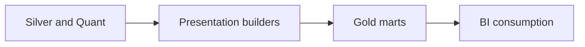

# Gold Data Contracts

I use Gold as the presentation and decision-support layer. Gold does not independently reconstruct FIFO or invent statutory tax liability.



## How to read a physical contract

Each entry below comes from the registered output contract and the matching physical SQL DDL. A declared grain describes intent; it is not necessarily enforced by a SQL primary key.

### Implementation anchor: DataContract model

Source: `src/personal_finance_etl/backend/load/registry.py`

```python

@dataclass
class DataContract:
    contract_id: str
    layer: str
    physical_table: str
    domain: str
    grain: str
    producer: str
    publication_order: int


@dataclass
class BronzeDataContract:
```

## Complete registry catalog

| Physical table | Domain | Grain | Producer | Output key |
| --- | --- | --- | --- | --- |
| `gold.Tax_Year_Summary` | Taxes | `FY` | `TaxEngine` | `df_p_tax_year_summary` |
| `gold.Tax_Income_Breakdown` | Taxes | `FY-Head-SubHead-Source` | `TaxEngine` | `df_p_tax_income_breakdown` |
| `gold.Tax_Reconciliation` | Taxes | `FY-SubHead` | `TaxEngine` | `df_p_tax_reconciliation` |
| `gold.Core_Monthly_Fact` | Wealth | `Month` | `WealthPresentationEngine` | `df_p_tf_wealth_monthly_totals` |
| `gold.Wealth_Asset_Breakdown` | Wealth | `Month-Asset` | `WealthPresentationEngine` | `df_p_tf_net_worth_monthly_summary` |
| `gold.Cashflow_Expense_Breakdown` | Wealth | `Month-ExpenseCategory` | `WealthPresentationEngine` | `df_p_tf_category_spend_analytics` |
| `gold.Cashflow_Income_Breakdown` | Wealth | `Month-IncomeCategory` | `WealthPresentationEngine` | `df_p_tf_income_streams_monthly` |
| `gold.Wealth_FIRE_Analytics` | Wealth | `Month` | `WealthPresentationEngine` | `df_p_tf_wealth_risk_analytics` |
| `gold.Forecast_Budget_Variance` | Wealth | `Month` | `WealthPresentationEngine` | `df_p_tf_budget_forecast_monthly` |
| `gold.Investment_Portfolio_Summary` | Investments | `Month-ISIN` | `InvestmentQuantEngine` | `df_p_tf_investment_analytics` |
| `gold.Cashflow_Efficiency_Analytics` | Wealth | `Month` | `WealthPresentationEngine` | `df_p_tf_monthly_cashflow_summary` |
| `gold.Cashflow_Activity_Summary` | Wealth | `Month` | `WealthPresentationEngine` | `df_p_tf_cashflow_activity_summary` |
| `gold.Investment_By_ISIN` | Investments | `Date-ISIN` | `InvestmentQuantEngine` | `df_f_investment_analytics_isin` |
| `gold.Investment_By_Subtype` | Investments | `Date-Subtype` | `InvestmentQuantEngine` | `df_f_investment_analytics_subtype` |
| `gold.Investment_By_Class` | Investments | `Date-Class` | `InvestmentQuantEngine` | `df_f_investment_analytics_class` |
| `gold.Investment_By_Instrument_Type` | Investments | `Date-InstrumentType` | `InvestmentQuantEngine` | `df_f_investment_analytics_instrument_type` |
| `gold.Investment_By_Sector` | Investments | `Date-Sector` | `InvestmentQuantEngine` | `df_f_investment_analytics_sector` |
| `gold.Investment_By_Industry` | Investments | `Date-Industry` | `InvestmentQuantEngine` | `df_f_investment_analytics_industry` |
| `gold.Investment_By_Portfolio` | Investments | `Date` | `InvestmentQuantEngine` | `df_f_investment_analytics_portfolio` |
| `gold.Investment_By_Geo` | Investments | `Date-Geo` | `InvestmentQuantEngine` | `df_f_investment_analytics_geo` |
| `gold.Investment_By_Country` | Investments | `Date-Country` | `InvestmentQuantEngine` | `df_f_investment_analytics_country` |
| `gold.Investment_By_Currency` | Investments | `Date-Currency` | `InvestmentQuantEngine` | `df_f_investment_analytics_currency` |

## Producer ownership and publication order

### Implementation anchor: Registered publication

Source: `src/personal_finance_etl/backend/load/registry.py`

```python

# A lightweight registry for Silver and Gold analytical layers
DATA_CONTRACT_REGISTRY: list[DataContract] = [
    # --- Silver Dimensions ---
    DataContract("df_d_calendar", "silver", "silver.d_Calendar", "Common", "Day", "CoreEngine", 10),
    DataContract(
        "df_d_income_category",
        "silver",
        "silver.d_Income_Category",
        "Wealth",
        "Category",
        "CoreEngine",
        20,
    ),
    DataContract(
        "df_d_income_subcategory",
        "silver",
        "silver.d_Income_Subcategory",
        "Wealth",
```

The registry provides a single inventory for physical identity, declared grain, producer ownership and publication order. A table existing in the SQL schema does not alone prove that its producer ran successfully.

## Taxes: physical contracts

### `gold.Tax_Year_Summary`

**Domain:** Taxes  
**Declared grain:** `FY`  
**Producer:** `TaxEngine`  
**Registry key:** `df_p_tax_year_summary`  
**Publication order:** `302`

**Physical columns** (from the SQL schema, not inferred from the DataFrame):

| Column | SQL type |
| --- | --- |
| `FY` | `TEXT` |
| `Total_Ledger_Income` | `DOUBLE` |
| `Total_Investment_Gain_Loss` | `DOUBLE` |
| `Total_Tax_Credits` | `DOUBLE` |
| `Total_Estimated_Investment_Tax` | `DOUBLE` |
| `Investment_Tax_Estimate_Count` | `BIGINT` |
| `Investment_Tax_Estimate_Missing_Count` | `BIGINT` |
| `Investment_Tax_Estimate_Complete` | `BOOLEAN` |
| `Total_Estimated_Ledger_Tax` | `DOUBLE` |
| `Ledger_Tax_Estimate_Count` | `BIGINT` |
| `Ledger_Tax_Estimate_Missing_Count` | `BIGINT` |
| `Ledger_Tax_Estimate_Complete` | `BOOLEAN` |
| `Total_Event_Count` | `BIGINT` |
| `Ready_Count` | `BIGINT` |
| `Check_Required_Count` | `BIGINT` |

**Representative schema excerpt:**

```sql
CREATE TABLE IF NOT EXISTS gold.Tax_Year_Summary (
    FY TEXT PRIMARY KEY,
    Total_Ledger_Income DOUBLE,
    Total_Investment_Gain_Loss DOUBLE,
    Total_Tax_Credits DOUBLE,
    Total_Estimated_Investment_Tax DOUBLE,
    Investment_Tax_Estimate_Count BIGINT,
    Investment_Tax_Estimate_Missing_Count BIGINT,
    Investment_Tax_Estimate_Complete BOOLEAN,
    Total_Estimated_Ledger_Tax DOUBLE,
    Ledger_Tax_Estimate_Count BIGINT,
    Ledger_Tax_Estimate_Missing_Count BIGINT,
    Ledger_Tax_Estimate_Complete BOOLEAN,
    Total_Event_Count BIGINT,
    Ready_Count BIGINT,
    Check_Required_Count BIGINT
```

**Contract reading:** The registry grain is the declared analytical unit. Physical uniqueness is determined by actual keys and producer behavior; do not infer a database primary key merely from this label. The producer must emit this contract under its registered output ID.

### `gold.Tax_Income_Breakdown`

**Domain:** Taxes  
**Declared grain:** `FY-Head-SubHead-Source`  
**Producer:** `TaxEngine`  
**Registry key:** `df_p_tax_income_breakdown`  
**Publication order:** `303`

**Physical columns** (from the SQL schema, not inferred from the DataFrame):

| Column | SQL type |
| --- | --- |
| `FY` | `TEXT` |
| `Income_Head` | `TEXT` |
| `Tax_Sub_Head` | `TEXT` |
| `Source_Type` | `TEXT` |
| `Event_Amount_INR` | `DOUBLE` |
| `Estimated_Tax_INR` | `DOUBLE` |
| `Estimated_Tax_Event_Count` | `BIGINT` |
| `Estimated_Tax_Missing_Count` | `BIGINT` |
| `Estimated_Tax_Complete` | `BOOLEAN` |
| `Event_Count` | `BIGINT` |
| `Ready_Count` | `BIGINT` |
| `Check_Required_Count` | `BIGINT` |

**Representative schema excerpt:**

```sql
CREATE TABLE IF NOT EXISTS gold.Tax_Income_Breakdown (
    FY TEXT,
    Income_Head TEXT,
    Tax_Sub_Head TEXT,
    Source_Type TEXT,
    Event_Amount_INR DOUBLE,
    Estimated_Tax_INR DOUBLE,
    Estimated_Tax_Event_Count BIGINT,
    Estimated_Tax_Missing_Count BIGINT,
    Estimated_Tax_Complete BOOLEAN,
    Event_Count BIGINT,
    Ready_Count BIGINT,
    Check_Required_Count BIGINT
);
```

**Contract reading:** The registry grain is the declared analytical unit. Physical uniqueness is determined by actual keys and producer behavior; do not infer a database primary key merely from this label. The producer must emit this contract under its registered output ID.

### `gold.Tax_Reconciliation`

**Domain:** Taxes  
**Declared grain:** `FY-SubHead`  
**Producer:** `TaxEngine`  
**Registry key:** `df_p_tax_reconciliation`  
**Publication order:** `304`

**Physical columns** (from the SQL schema, not inferred from the DataFrame):

| Column | SQL type |
| --- | --- |
| `FY` | `TEXT` |
| `Tax_Sub_Head` | `TEXT` |
| `Ledger_Tax_Event_Amount` | `DOUBLE` |
| `Excluded_Non_Taxable_Amount` | `DOUBLE` |
| `Excluded_Non_Taxable_Event_Count` | `BIGINT` |
| `Excluded_Investment_Ledger_Amount` | `DOUBLE` |
| `Excluded_Investment_Ledger_Event_Count` | `BIGINT` |
| `Quant_Realized_Gain_Loss` | `DOUBLE` |
| `Estimated_Investment_Tax` | `DOUBLE` |
| `Estimated_Tax_Event_Count` | `BIGINT` |
| `Estimated_Tax_Missing_Count` | `BIGINT` |
| `Estimated_Investment_Tax_Complete` | `BOOLEAN` |
| `Estimated_Ledger_Tax` | `DOUBLE` |
| `Ledger_Tax_Estimate_Count` | `BIGINT` |
| `Ledger_Tax_Estimate_Missing_Count` | `BIGINT` |
| `Estimated_Ledger_Tax_Complete` | `BOOLEAN` |
| `Tax_Credit_Amount` | `DOUBLE` |
| `Tax_Event_Amount` | `DOUBLE` |
| `Investment_Source_Difference_INR` | `DOUBLE` |
| `Ledger_Event_Count` | `BIGINT` |
| `Quant_Event_Count` | `BIGINT` |
| `Tax_Credit_Event_Count` | `BIGINT` |
| `Check_Required_Count` | `BIGINT` |

**Representative schema excerpt:**

```sql
CREATE TABLE IF NOT EXISTS gold.Tax_Reconciliation (
    FY TEXT,
    Tax_Sub_Head TEXT,
    Ledger_Tax_Event_Amount DOUBLE,
    Excluded_Non_Taxable_Amount DOUBLE,
    Excluded_Non_Taxable_Event_Count BIGINT,
    Excluded_Investment_Ledger_Amount DOUBLE,
    Excluded_Investment_Ledger_Event_Count BIGINT,
    Quant_Realized_Gain_Loss DOUBLE,
    Estimated_Investment_Tax DOUBLE,
    Estimated_Tax_Event_Count BIGINT,
    Estimated_Tax_Missing_Count BIGINT,
    Estimated_Investment_Tax_Complete BOOLEAN,
    Estimated_Ledger_Tax DOUBLE,
    Ledger_Tax_Estimate_Count BIGINT,
    Ledger_Tax_Estimate_Missing_Count BIGINT,
```

**Contract reading:** The registry grain is the declared analytical unit. Physical uniqueness is determined by actual keys and producer behavior; do not infer a database primary key merely from this label. The producer must emit this contract under its registered output ID.

## Wealth: physical contracts

### `gold.Core_Monthly_Fact`

**Domain:** Wealth  
**Declared grain:** `Month`  
**Producer:** `WealthPresentationEngine`  
**Registry key:** `df_p_tf_wealth_monthly_totals`  
**Publication order:** `110`

**Physical columns** (from the SQL schema, not inferred from the DataFrame):

| Column | SQL type |
| --- | --- |
| `MONTH_START_DATE` | `DATE` |
| `MONTH_END_DATE` | `DATE` |
| `Months_Elapsed` | `BIGINT` |
| `Total_Income` | `DOUBLE` |
| `Total_Cash_Income` | `DOUBLE` |
| `Total_Non_Cash_Income` | `DOUBLE` |
| `Total_Expense` | `DOUBLE` |
| `Total_Core_Expense` | `DOUBLE` |
| `Total_Cash_Expense` | `DOUBLE` |
| `Total_Non_Cash_Expense` | `DOUBLE` |
| `Net_Cashflow_Month` | `DOUBLE` |
| `Opening_Balance_Asset` | `DOUBLE` |
| `Opening_Balance_Asset_Market` | `DOUBLE` |
| `Closing_Balance_Asset` | `DOUBLE` |
| `Closing_Balance_Asset_Market` | `DOUBLE` |
| `Asset_Delta` | `DOUBLE` |
| `Asset_Market_Delta` | `DOUBLE` |
| `Total_Assets` | `DOUBLE` |
| `Total_Assets_Market` | `DOUBLE` |
| `Opening_Investment_Book_Value` | `DOUBLE` |
| `Closing_Investment_Book_Value` | `DOUBLE` |
| `Investment_Book_Value_Delta` | `DOUBLE` |
| `Opening_Investment_Market_Value` | `DOUBLE` |
| `Closing_Investment_Market_Value` | `DOUBLE` |
| `Investment_Market_Value_Delta` | `DOUBLE` |
| `Liquid_Assets` | `DOUBLE` |
| `Liquid_Assets_Market` | `DOUBLE` |
| `Total_Liabilities` | `DOUBLE` |
| `Total_Net_Worth` | `DOUBLE` |
| `Total_Net_Worth_Market` | `DOUBLE` |
| `Total_Foreign_Currency_Exposure` | `DOUBLE` |
| `Opening_Unrealized_PL` | `DOUBLE` |
| `Closing_Unrealized_PL` | `DOUBLE` |
| `Closing_Asset_PnL` | `DOUBLE` |
| `Closing_Forex_PnL` | `DOUBLE` |
| `Opening_Investment_XIRR` | `DOUBLE` |
| `Closing_Investment_XIRR` | `DOUBLE` |
| `Foreign_Exposure_Pct` | `DOUBLE` |
| `CPI_INDEX` | `DOUBLE` |
| `INFLATION_YOY_PCT` | `DOUBLE` |

**Representative schema excerpt:**

```sql
CREATE TABLE IF NOT EXISTS gold.Core_Monthly_Fact (
    -- Identifiers
    MONTH_START_DATE DATE,
    MONTH_END_DATE DATE,
    -- Descriptors/Classifications
    Months_Elapsed BIGINT,
    -- Position Values
    Total_Income DOUBLE,
    Total_Cash_Income DOUBLE,
    Total_Non_Cash_Income DOUBLE,
    Total_Expense DOUBLE,
    Total_Core_Expense DOUBLE,
    Total_Cash_Expense DOUBLE,
    Total_Non_Cash_Expense DOUBLE,
    Net_Cashflow_Month DOUBLE,
    Opening_Balance_Asset DOUBLE,
```

**Contract reading:** The registry grain is the declared analytical unit. Physical uniqueness is determined by actual keys and producer behavior; do not infer a database primary key merely from this label. The producer must emit this contract under its registered output ID.

### `gold.Wealth_Asset_Breakdown`

**Domain:** Wealth  
**Declared grain:** `Month-Asset`  
**Producer:** `WealthPresentationEngine`  
**Registry key:** `df_p_tf_net_worth_monthly_summary`  
**Publication order:** `110`

**Physical columns** (from the SQL schema, not inferred from the DataFrame):

| Column | SQL type |
| --- | --- |
| `MONTH_START_DATE` | `DATE` |
| `MONTH_END_DATE` | `DATE` |
| `ASSET_SUBCATEGORY_ID` | `TEXT` |
| `Opening_Balance` | `DOUBLE` |
| `Closing_Balance` | `DOUBLE` |
| `Closing_Balance_Market` | `DOUBLE` |
| `All_Time_High_Balance` | `DOUBLE` |
| `Liquid_Assets` | `DOUBLE` |
| `Liquid_Assets_Market` | `DOUBLE` |
| `Closing_Asset_PnL` | `DOUBLE` |
| `Closing_Forex_PnL` | `DOUBLE` |
| `Organic_Growth_Value` | `DOUBLE` |
| `Drawdown_From_Peak` | `DOUBLE` |
| `Investment_Contribution_Pct` | `DOUBLE` |
| `Savings_to_NW_Ratio` | `DOUBLE` |
| `Income_Inflow` | `DOUBLE` |
| `Cash_Income_Inflow` | `DOUBLE` |
| `Non_Cash_Income_Inflow` | `DOUBLE` |
| `Expense_Outflow` | `DOUBLE` |
| `Core_Expense_Outflow` | `DOUBLE` |
| `Cash_Expense_Outflow` | `DOUBLE` |
| `Non_Cash_Expense_Outflow` | `DOUBLE` |
| `Net_Transfers` | `DOUBLE` |
| `Net_Cashflow_Month` | `DOUBLE` |
| `Surplus_Deficit_Month` | `DOUBLE` |
| `Cumulative_Net_Savings` | `DOUBLE` |
| `Months_of_Runway` | `DOUBLE` |

**Representative schema excerpt:**

```sql
CREATE TABLE IF NOT EXISTS gold.Wealth_Asset_Breakdown (
    -- Identifiers
    MONTH_START_DATE DATE,
    MONTH_END_DATE DATE,
    ASSET_SUBCATEGORY_ID TEXT,
    -- Position Values
    Opening_Balance DOUBLE,
    Closing_Balance DOUBLE,
    Closing_Balance_Market DOUBLE,
    All_Time_High_Balance DOUBLE,
    Liquid_Assets DOUBLE,
    Liquid_Assets_Market DOUBLE,
    -- Absolute Returns
    Closing_Asset_PnL DOUBLE,
    Closing_Forex_PnL DOUBLE,
    -- Performance Returns
```

**Contract reading:** The registry grain is the declared analytical unit. Physical uniqueness is determined by actual keys and producer behavior; do not infer a database primary key merely from this label. The producer must emit this contract under its registered output ID.

### `gold.Cashflow_Expense_Breakdown`

**Domain:** Wealth  
**Declared grain:** `Month-ExpenseCategory`  
**Producer:** `WealthPresentationEngine`  
**Registry key:** `df_p_tf_category_spend_analytics`  
**Publication order:** `120`

**Physical columns** (from the SQL schema, not inferred from the DataFrame):

| Column | SQL type |
| --- | --- |
| `MONTH_START_DATE` | `DATE` |
| `MONTH_END_DATE` | `DATE` |
| `YEAR_MONTH` | `TEXT` |
| `CATEGORY_ID` | `TEXT` |
| `CATEGORY_NAME` | `TEXT` |
| `CATEGORY_GROUPS` | `TEXT` |
| `Spend_Type` | `TEXT` |
| `Is_Core_Expense` | `BOOLEAN` |
| `Is_Investment` | `BOOLEAN` |
| `Is_Discretionary` | `BOOLEAN` |
| `Total_Monthly_Spend` | `DOUBLE` |
| `Cash_Spend` | `DOUBLE` |
| `Non_Cash_Spend` | `DOUBLE` |
| `Trailing_3M_Avg_Spend` | `DOUBLE` |
| `Cumulative_YTD_Spend` | `DOUBLE` |

**Representative schema excerpt:**

```sql
CREATE TABLE IF NOT EXISTS gold.Cashflow_Expense_Breakdown (
    -- Identifiers
    MONTH_START_DATE DATE,
    MONTH_END_DATE DATE,
    YEAR_MONTH TEXT,
    CATEGORY_ID TEXT,
    -- Descriptors/Classifications
    CATEGORY_NAME TEXT,
    CATEGORY_GROUPS TEXT,
    Spend_Type TEXT,
    Is_Core_Expense BOOLEAN,
    Is_Investment BOOLEAN,
    Is_Discretionary BOOLEAN,
    -- Position Values
    Total_Monthly_Spend DOUBLE,
    Cash_Spend DOUBLE,
```

**Contract reading:** The registry grain is the declared analytical unit. Physical uniqueness is determined by actual keys and producer behavior; do not infer a database primary key merely from this label. The producer must emit this contract under its registered output ID.

### `gold.Cashflow_Income_Breakdown`

**Domain:** Wealth  
**Declared grain:** `Month-IncomeCategory`  
**Producer:** `WealthPresentationEngine`  
**Registry key:** `df_p_tf_income_streams_monthly`  
**Publication order:** `130`

**Physical columns** (from the SQL schema, not inferred from the DataFrame):

| Column | SQL type |
| --- | --- |
| `MONTH_START_DATE` | `DATE` |
| `MONTH_END_DATE` | `DATE` |
| `YEAR_MONTH` | `TEXT` |
| `CATEGORY_ID` | `TEXT` |
| `CATEGORY_NAME` | `TEXT` |
| `CATEGORY_GROUPS` | `TEXT` |
| `Is_Active_Income` | `BOOLEAN` |
| `Is_Passive_Income` | `BOOLEAN` |
| `Is_Dividend_Income` | `BOOLEAN` |
| `Is_Interest_Income` | `BOOLEAN` |
| `Is_Non_Cash_Income` | `BOOLEAN` |
| `Total_Monthly_Income` | `DOUBLE` |
| `Trailing_3M_Avg_Income` | `DOUBLE` |
| `Cumulative_YTD_Income` | `DOUBLE` |

**Representative schema excerpt:**

```sql
CREATE TABLE IF NOT EXISTS gold.Cashflow_Income_Breakdown (
    -- Identifiers
    MONTH_START_DATE DATE,
    MONTH_END_DATE DATE,
    YEAR_MONTH TEXT,
    CATEGORY_ID TEXT,
    -- Descriptors/Classifications
    CATEGORY_NAME TEXT,
    CATEGORY_GROUPS TEXT,
    Is_Active_Income BOOLEAN,
    Is_Passive_Income BOOLEAN,
    Is_Dividend_Income BOOLEAN,
    Is_Interest_Income BOOLEAN,
    Is_Non_Cash_Income BOOLEAN,
    -- Position Values
    Total_Monthly_Income DOUBLE,
```

**Contract reading:** The registry grain is the declared analytical unit. Physical uniqueness is determined by actual keys and producer behavior; do not infer a database primary key merely from this label. The producer must emit this contract under its registered output ID.

### `gold.Wealth_FIRE_Analytics`

**Domain:** Wealth  
**Declared grain:** `Month`  
**Producer:** `WealthPresentationEngine`  
**Registry key:** `df_p_tf_wealth_risk_analytics`  
**Publication order:** `140`

**Physical columns** (from the SQL schema, not inferred from the DataFrame):

| Column | SQL type |
| --- | --- |
| `MONTH_START_DATE` | `DATE` |
| `MONTH_END_DATE` | `DATE` |
| `YEAR_MONTH` | `TEXT` |
| `Projected_FI_Date_P50` | `DATE` |
| `Total_Income` | `DOUBLE` |
| `Total_Cash_Income` | `DOUBLE` |
| `Trailing_6M_Avg_Spend` | `DOUBLE` |
| `Trailing_12M_Avg_Spend` | `DOUBLE` |
| `Trailing_6M_Avg_Savings` | `DOUBLE` |
| `Trailing_12M_Avg_Savings` | `DOUBLE` |
| `Target_FI_Today` | `DOUBLE` |
| `Coast_FI_Today` | `DOUBLE` |
| `Lean_FI_Today` | `DOUBLE` |
| `Target_FI_Total_Future_Nominal` | `DOUBLE` |
| `FI_Gap` | `DOUBLE` |
| `FI_Gap_Monthly_Trend` | `DOUBLE` |
| `Terminal_Wealth_Nominal_P50` | `DOUBLE` |
| `Real_Return_Assumed_Pct` | `DOUBLE` |
| `Wealth_Velocity` | `DOUBLE` |
| `Wealth_Acceleration` | `DOUBLE` |
| `Real_NW_CAGR_3Y` | `DOUBLE` |
| `Current_FI_Coverage_Pct` | `DOUBLE` |
| `Estimated_Months_To_FI_Linear` | `DOUBLE` |
| `Months_To_FI_Conservative_P90` | `DOUBLE` |
| `Months_To_FI_Base_P50` | `DOUBLE` |
| `Months_To_FI_Aggressive_P10` | `DOUBLE` |
| `Probability_Of_Success_Pct` | `DOUBLE` |
| `Years_To_FI_P50` | `DOUBLE` |
| `Runway_Months_Linear` | `DOUBLE` |
| `Runway_Months_Stressed_P10` | `DOUBLE` |
| `Runway_Months_Base_P50` | `DOUBLE` |
| `Withdrawal_Rate_If_Retired_Now` | `DOUBLE` |
| `Savings_Rate_Required` | `DOUBLE` |
| `Savings_Rate_Actual` | `DOUBLE` |
| `FI_Velocity` | `DOUBLE` |

**Representative schema excerpt:**

```sql
CREATE TABLE IF NOT EXISTS gold.Wealth_FIRE_Analytics (
    -- Identifiers
    MONTH_START_DATE DATE,
    MONTH_END_DATE DATE,
    YEAR_MONTH TEXT,
    -- Descriptors/Classifications
    Projected_FI_Date_P50 DATE,
    -- Position Values
    Total_Income DOUBLE,
    Total_Cash_Income DOUBLE,
    Trailing_6M_Avg_Spend DOUBLE,
    Trailing_12M_Avg_Spend DOUBLE,
    Trailing_6M_Avg_Savings DOUBLE,
    Trailing_12M_Avg_Savings DOUBLE,
    Target_FI_Today DOUBLE,
    Coast_FI_Today DOUBLE,
```

**Contract reading:** The registry grain is the declared analytical unit. Physical uniqueness is determined by actual keys and producer behavior; do not infer a database primary key merely from this label. The producer must emit this contract under its registered output ID.

### `gold.Forecast_Budget_Variance`

**Domain:** Wealth  
**Declared grain:** `Month`  
**Producer:** `WealthPresentationEngine`  
**Registry key:** `df_p_tf_budget_forecast_monthly`  
**Publication order:** `160`

**Physical columns** (from the SQL schema, not inferred from the DataFrame):

| Column | SQL type |
| --- | --- |
| `MONTH_START_DATE` | `DATE` |
| `MONTH_END_DATE` | `DATE` |
| `YEAR_MONTH` | `TEXT` |
| `Is_Core_Overspent` | `BOOLEAN` |
| `Is_NonCore_Overspent` | `BOOLEAN` |
| `Is_Investment_Underfunded` | `BOOLEAN` |
| `Is_Income_Volatile` | `BOOLEAN` |
| `Is_Budget_Month_Healthy` | `BOOLEAN` |
| `Total_Income` | `DOUBLE` |
| `Actual_Income` | `DOUBLE` |
| `Budget_Income` | `DOUBLE` |
| `Budget_Core_Expense_Target` | `DOUBLE` |
| `Budget_NonCore_Expense_Target` | `DOUBLE` |
| `Budget_Investment_Target` | `DOUBLE` |
| `Budget_Surplus_Buffer` | `DOUBLE` |
| `Budget_Total_Expense_Target` | `DOUBLE` |
| `Actual_Core_Expense` | `DOUBLE` |
| `Actual_NonCore_Expense` | `DOUBLE` |
| `Investment_Deployed` | `DOUBLE` |
| `Investment_Redeemed` | `DOUBLE` |
| `Actual_Investment` | `DOUBLE` |
| `Actual_Savings` | `DOUBLE` |
| `Emergency_Fund_Gap` | `DOUBLE` |
| `Rule_Core_Pct_Budget` | `DOUBLE` |
| `Rule_NonCore_Pct_Budget` | `DOUBLE` |
| `Rule_Investment_Pct_Budget` | `DOUBLE` |
| `Zero_Income_Runway_Months` | `DOUBLE` |

**Representative schema excerpt:**

```sql
CREATE TABLE IF NOT EXISTS gold.Forecast_Budget_Variance (
    -- Identifiers
    MONTH_START_DATE DATE,
    MONTH_END_DATE DATE,
    YEAR_MONTH TEXT,
    -- Descriptors/Classifications
    Is_Core_Overspent BOOLEAN,
    Is_NonCore_Overspent BOOLEAN,
    Is_Investment_Underfunded BOOLEAN,
    Is_Income_Volatile BOOLEAN,
    Is_Budget_Month_Healthy BOOLEAN,
    -- Position Values
    Total_Income DOUBLE,
    Actual_Income DOUBLE,
    Budget_Income DOUBLE,
    Budget_Core_Expense_Target DOUBLE,
```

**Contract reading:** The registry grain is the declared analytical unit. Physical uniqueness is determined by actual keys and producer behavior; do not infer a database primary key merely from this label. The producer must emit this contract under its registered output ID.

### `gold.Cashflow_Efficiency_Analytics`

**Domain:** Wealth  
**Declared grain:** `Month`  
**Producer:** `WealthPresentationEngine`  
**Registry key:** `df_p_tf_monthly_cashflow_summary`  
**Publication order:** `180`

**Physical columns** (from the SQL schema, not inferred from the DataFrame):

| Column | SQL type |
| --- | --- |
| `MONTH_START_DATE` | `DATE` |
| `MONTH_END_DATE` | `DATE` |
| `YEAR_MONTH` | `TEXT` |
| `Is_Surplus_Month` | `BOOLEAN` |
| `Is_Investment_Target_Met` | `BOOLEAN` |
| `Total_Income` | `DOUBLE` |
| `Total_Cash_Income` | `DOUBLE` |
| `Total_Non_Cash_Income` | `DOUBLE` |
| `Total_Expense` | `DOUBLE` |
| `Active_Income` | `DOUBLE` |
| `Passive_Income` | `DOUBLE` |
| `Dividend_Income` | `DOUBLE` |
| `Interest_Income` | `DOUBLE` |
| `Core_Expense` | `DOUBLE` |
| `NonCore_Expense` | `DOUBLE` |
| `Total_Cash_Expense` | `DOUBLE` |
| `Total_Non_Cash_Expense` | `DOUBLE` |
| `Total_Investment_Deployed` | `DOUBLE` |
| `Total_Investment_Redeemed` | `DOUBLE` |
| `Redemption_Gain_Loss_Value` | `DOUBLE` |
| `Net_Investment_Flow` | `DOUBLE` |
| `Gross_Surplus` | `DOUBLE` |
| `Net_Surplus_After_Invest` | `DOUBLE` |
| `Income_MoM_Delta` | `DOUBLE` |
| `Expense_MoM_Delta` | `DOUBLE` |
| `Investment_MoM_Delta` | `DOUBLE` |
| `Trailing_3M_Avg_Income` | `DOUBLE` |
| `Trailing_3M_Avg_Expense` | `DOUBLE` |
| `Trailing_3M_Avg_Investment` | `DOUBLE` |
| `Savings_Rate_Pct` | `DOUBLE` |
| `Investment_Rate_Pct` | `DOUBLE` |
| `Active_Income_Share_Pct` | `DOUBLE` |
| `Passive_Income_Share_Pct` | `DOUBLE` |
| `Core_Expense_Share_Pct` | `DOUBLE` |
| `NonCore_Expense_Share_Pct` | `DOUBLE` |
| `Income_MoM_Pct` | `DOUBLE` |
| `Expense_MoM_Pct` | `DOUBLE` |
| `Trailing_3M_Avg_Savings_Rate` | `DOUBLE` |
| `Trailing_3M_Avg_Investment_Rate` | `DOUBLE` |
| `Liquidity_Ratio_Months` | `DOUBLE` |
| `Debt_to_Asset_Ratio_Pct` | `DOUBLE` |
| `YoY_Net_Worth_Growth_Pct` | `DOUBLE` |
| `YoY_Net_Worth_Growth_Pct_Real` | `DOUBLE` |
| `Expense_to_NW_Ratio` | `DOUBLE` |
| `Emergency_Fund_Coverage` | `DOUBLE` |

**Representative schema excerpt:**

```sql
CREATE TABLE IF NOT EXISTS gold.Cashflow_Efficiency_Analytics (
    -- Identifiers
    MONTH_START_DATE DATE,
    MONTH_END_DATE DATE,
    YEAR_MONTH TEXT,
    -- Descriptors/Classifications
    Is_Surplus_Month BOOLEAN,
    Is_Investment_Target_Met BOOLEAN,
    -- Position Values
    Total_Income DOUBLE,
    Total_Cash_Income DOUBLE,
    Total_Non_Cash_Income DOUBLE,
    Total_Expense DOUBLE,
    Active_Income DOUBLE,
    Passive_Income DOUBLE,
    Dividend_Income DOUBLE,
```

**Contract reading:** The registry grain is the declared analytical unit. Physical uniqueness is determined by actual keys and producer behavior; do not infer a database primary key merely from this label. The producer must emit this contract under its registered output ID.

### `gold.Cashflow_Activity_Summary`

**Domain:** Wealth  
**Declared grain:** `Month`  
**Producer:** `WealthPresentationEngine`  
**Registry key:** `df_p_tf_cashflow_activity_summary`  
**Publication order:** `190`

**Physical columns** (from the SQL schema, not inferred from the DataFrame):

| Column | SQL type |
| --- | --- |
| `MONTH_START_DATE` | `DATE` |
| `MONTH_END_DATE` | `DATE` |
| `YEAR_MONTH` | `TEXT` |
| `Opening_Cash_Balance` | `DOUBLE` |
| `Closing_Cash_Balance` | `DOUBLE` |
| `Net_Cash_Movement` | `DOUBLE` |
| `Cash_Inflow_Operating` | `DOUBLE` |
| `Cash_Outflow_Operating` | `DOUBLE` |
| `Net_Cashflow_Operating` | `DOUBLE` |
| `Cash_Inflow_Investing` | `DOUBLE` |
| `Cash_Outflow_Investing` | `DOUBLE` |
| `Net_Cashflow_Investing` | `DOUBLE` |
| `Cash_Inflow_Financing` | `DOUBLE` |
| `Cash_Outflow_Financing` | `DOUBLE` |
| `Net_Cashflow_Financing` | `DOUBLE` |
| `Internal_Transfer_Inflow` | `DOUBLE` |
| `Internal_Transfer_Outflow` | `DOUBLE` |
| `Net_Internal_Transfers` | `DOUBLE` |
| `Total_Cash_Expenses` | `DOUBLE` |
| `Total_Non_Cash_Expenses` | `DOUBLE` |
| `Total_Cash_Inflow` | `DOUBLE` |
| `Total_Cash_Outflow` | `DOUBLE` |
| `Calculated_Net_Cashflow` | `DOUBLE` |
| `Unreconciled_Difference` | `DOUBLE` |

**Representative schema excerpt:**

```sql
CREATE TABLE IF NOT EXISTS gold.Cashflow_Activity_Summary (
    -- Identifiers
    MONTH_START_DATE DATE,
    MONTH_END_DATE DATE,
    YEAR_MONTH TEXT,
    -- Position Values
    Opening_Cash_Balance DOUBLE,
    Closing_Cash_Balance DOUBLE,
    Net_Cash_Movement DOUBLE,
    Cash_Inflow_Operating DOUBLE,
    Cash_Outflow_Operating DOUBLE,
    Net_Cashflow_Operating DOUBLE,
    Cash_Inflow_Investing DOUBLE,
    Cash_Outflow_Investing DOUBLE,
    Net_Cashflow_Investing DOUBLE,
    Cash_Inflow_Financing DOUBLE,
```

**Contract reading:** The registry grain is the declared analytical unit. Physical uniqueness is determined by actual keys and producer behavior; do not infer a database primary key merely from this label. The producer must emit this contract under its registered output ID.

## Investments: physical contracts

### `gold.Investment_Portfolio_Summary`

**Domain:** Investments  
**Declared grain:** `Month-ISIN`  
**Producer:** `InvestmentQuantEngine`  
**Registry key:** `df_p_tf_investment_analytics`  
**Publication order:** `170`

**Physical columns** (from the SQL schema, not inferred from the DataFrame):

| Column | SQL type |
| --- | --- |
| `MONTH_START_DATE` | `DATE` |
| `Max_Closing_Date` | `DATE` |
| `ISIN` | `TEXT` |
| `CURRENCY_ID` | `TEXT` |
| `INSTRUMENT_NAME` | `TEXT` |
| `INSTRUMENT_CLASS` | `TEXT` |
| `INSTRUMENT_TYPE` | `TEXT` |
| `INSTRUMENT_SUBTYPE` | `TEXT` |
| `SECTOR` | `TEXT` |
| `Rebalance_Required` | `BOOLEAN` |
| `ISIN_Market_Value` | `DOUBLE` |
| `ISIN_Book_Value` | `DOUBLE` |
| `ISIN_Market_Value_Local` | `DOUBLE` |
| `ISIN_Book_Value_Local` | `DOUBLE` |
| `ISIN_Unrealized_PnL` | `DOUBLE` |
| `ISIN_Asset_PnL` | `DOUBLE` |
| `ISIN_Forex_PnL` | `DOUBLE` |
| `ISIN_Forex_Contribution_Pct` | `DOUBLE` |
| `ISIN_XIRR_Local` | `DOUBLE` |
| `ISIN_FX_XIRR_Impact` | `DOUBLE` |
| `ISIN_BM_XIRR` | `DOUBLE` |
| `ISIN_BM_XIRR_Local` | `DOUBLE` |
| `ISIN_Active_Return` | `DOUBLE` |
| `ISIN_Active_Return_Local` | `DOUBLE` |
| `ISIN_Weight` | `DOUBLE` |
| `Class_Weight` | `DOUBLE` |
| `Class_Target_Weight` | `DOUBLE` |
| `Class_Drift` | `DOUBLE` |
| `Sector_Weight` | `DOUBLE` |
| `Monthly_Market_Value_Change_Pct` | `DOUBLE` |
| `ISIN_Harvestable_Loss` | `DOUBLE` |
| `Tax_Harvesting_Priority_Score` | `DOUBLE` |

**Representative schema excerpt:**

```sql
CREATE TABLE IF NOT EXISTS gold.Investment_Portfolio_Summary (
    -- Identifiers
    MONTH_START_DATE DATE,
    Max_Closing_Date DATE,
    ISIN TEXT,
    CURRENCY_ID TEXT,
    -- Descriptors/Classifications
    INSTRUMENT_NAME TEXT,
    INSTRUMENT_CLASS TEXT,
    INSTRUMENT_TYPE TEXT,
    INSTRUMENT_SUBTYPE TEXT,
    SECTOR TEXT,
    Rebalance_Required BOOLEAN,
    -- Position Values
    ISIN_Market_Value DOUBLE,
    ISIN_Book_Value DOUBLE,
```

**Contract reading:** The registry grain is the declared analytical unit. Physical uniqueness is determined by actual keys and producer behavior; do not infer a database primary key merely from this label. The producer must emit this contract under its registered output ID.

### `gold.Investment_By_ISIN`

**Domain:** Investments  
**Declared grain:** `Date-ISIN`  
**Producer:** `InvestmentQuantEngine`  
**Registry key:** `df_f_investment_analytics_isin`  
**Publication order:** `200`

**Physical columns** (from the SQL schema, not inferred from the DataFrame):

| Column | SQL type |
| --- | --- |
| `Closing_Date` | `DATE` |
| `ISIN` | `TEXT` |
| `CURRENCY_ID` | `TEXT` |
| `Total_Invested_Value` | `DOUBLE` |
| `Total_Current_Value` | `DOUBLE` |
| `Total_Quantity` | `DOUBLE` |
| `Total_Stocks` | `DOUBLE` |
| `Total_Invested_Value_Local` | `DOUBLE` |
| `Total_Current_Value_Local` | `DOUBLE` |
| `Current_FX_Rate` | `DOUBLE` |
| `Blended_FX_Buy_Rate` | `DOUBLE` |
| `Currency_Appreciation_Pct` | `DOUBLE` |
| `Unrealized_PL` | `DOUBLE` |
| `Asset_PnL` | `DOUBLE` |
| `Forex_PnL` | `DOUBLE` |
| `Forex_Contribution_Pct` | `DOUBLE` |
| `Absolute_Return` | `DOUBLE` |
| `CAGR` | `DOUBLE` |
| `XIRR` | `DOUBLE` |
| `XIRR_Local` | `DOUBLE` |
| `FX_XIRR_Impact` | `DOUBLE` |
| `After_Tax_XIRR` | `DOUBLE` |
| `BM_CAGR` | `DOUBLE` |
| `BM_XIRR` | `DOUBLE` |
| `BM_XIRR_Local` | `DOUBLE` |
| `Active_Return` | `DOUBLE` |
| `Active_Return_Local` | `DOUBLE` |
| `Is_Lagging_Benchmark` | `BIGINT` |
| `Outperforming_Lot_Ratio` | `DOUBLE` |
| `Max_Drawdown` | `DOUBLE` |
| `Weight` | `DOUBLE` |
| `Unrealized_LTCG` | `DOUBLE` |
| `Unrealized_STCG` | `DOUBLE` |
| `Unrealized_Gain` | `DOUBLE` |
| `Unrealized_LTCL` | `DOUBLE` |
| `Unrealized_STCL` | `DOUBLE` |
| `Unrealized_Loss` | `DOUBLE` |
| `LTCG_Tax_If_Sold` | `DOUBLE` |
| `STCG_Tax_If_Sold` | `DOUBLE` |
| `FY_Realized_LTCG` | `DOUBLE` |
| `FY_Realized_STCG` | `DOUBLE` |
| `FY_Realized_Gain` | `DOUBLE` |
| `FY_Realized_LTCL` | `DOUBLE` |
| `FY_Realized_STCL` | `DOUBLE` |
| `FY_Realized_Loss` | `DOUBLE` |
| `FY_Realized_Net_PnL` | `DOUBLE` |

**Representative schema excerpt:**

```sql
CREATE TABLE IF NOT EXISTS gold.Investment_By_ISIN (
    -- Identifiers
    Closing_Date DATE NOT NULL,
    ISIN TEXT NOT NULL,
    CURRENCY_ID TEXT,
    -- Position Values
    Total_Invested_Value DOUBLE,
    Total_Current_Value DOUBLE,
    Total_Quantity DOUBLE,
    Total_Stocks DOUBLE,
    -- Local/FX Values
    Total_Invested_Value_Local DOUBLE,
    Total_Current_Value_Local DOUBLE,
    Current_FX_Rate DOUBLE,
    Blended_FX_Buy_Rate DOUBLE,
    Currency_Appreciation_Pct DOUBLE,
```

**Contract reading:** The registry grain is the declared analytical unit. Physical uniqueness is determined by actual keys and producer behavior; do not infer a database primary key merely from this label. The producer must emit this contract under its registered output ID.

### `gold.Investment_By_Subtype`

**Domain:** Investments  
**Declared grain:** `Date-Subtype`  
**Producer:** `InvestmentQuantEngine`  
**Registry key:** `df_f_investment_analytics_subtype`  
**Publication order:** `210`

**Physical columns** (from the SQL schema, not inferred from the DataFrame):

| Column | SQL type |
| --- | --- |
| `Closing_Date` | `DATE` |
| `INSTRUMENT_SUBTYPE` | `TEXT` |
| `INSTRUMENT_CLASS` | `TEXT` |
| `Total_Invested_Value` | `DOUBLE` |
| `Total_Current_Value` | `DOUBLE` |
| `Total_Quantity` | `DOUBLE` |
| `Total_Stocks` | `DOUBLE` |
| `Unrealized_PL` | `DOUBLE` |
| `Asset_PnL` | `DOUBLE` |
| `Forex_PnL` | `DOUBLE` |
| `Forex_Contribution_Pct` | `DOUBLE` |
| `Absolute_Return` | `DOUBLE` |
| `XIRR` | `DOUBLE` |
| `After_Tax_XIRR` | `DOUBLE` |
| `BM_XIRR` | `DOUBLE` |
| `Active_Return` | `DOUBLE` |
| `Max_Drawdown` | `DOUBLE` |
| `Weight` | `DOUBLE` |
| `Unrealized_Gain` | `DOUBLE` |
| `Unrealized_Loss` | `DOUBLE` |
| `FY_Realized_Gain` | `DOUBLE` |
| `FY_Realized_Loss` | `DOUBLE` |
| `FY_Realized_Net_PnL` | `DOUBLE` |

**Representative schema excerpt:**

```sql
CREATE TABLE IF NOT EXISTS gold.Investment_By_Subtype (
    -- Identifiers
    Closing_Date DATE NOT NULL,
    INSTRUMENT_SUBTYPE TEXT NOT NULL,
    -- Descriptors/Classifications
    INSTRUMENT_CLASS TEXT NOT NULL,
    -- Position Values
    Total_Invested_Value DOUBLE,
    Total_Current_Value DOUBLE,
    Total_Quantity DOUBLE,
    Total_Stocks DOUBLE,
    -- Absolute Returns
    Unrealized_PL DOUBLE,
    Asset_PnL DOUBLE,
    Forex_PnL DOUBLE,
    Forex_Contribution_Pct DOUBLE,
```

**Contract reading:** The registry grain is the declared analytical unit. Physical uniqueness is determined by actual keys and producer behavior; do not infer a database primary key merely from this label. The producer must emit this contract under its registered output ID.

### `gold.Investment_By_Class`

**Domain:** Investments  
**Declared grain:** `Date-Class`  
**Producer:** `InvestmentQuantEngine`  
**Registry key:** `df_f_investment_analytics_class`  
**Publication order:** `220`

**Physical columns** (from the SQL schema, not inferred from the DataFrame):

| Column | SQL type |
| --- | --- |
| `Closing_Date` | `DATE` |
| `INSTRUMENT_CLASS` | `TEXT` |
| `Total_Invested_Value` | `DOUBLE` |
| `Total_Current_Value` | `DOUBLE` |
| `Total_Quantity` | `DOUBLE` |
| `Total_Stocks` | `DOUBLE` |
| `Unrealized_PL` | `DOUBLE` |
| `Asset_PnL` | `DOUBLE` |
| `Forex_PnL` | `DOUBLE` |
| `Forex_Contribution_Pct` | `DOUBLE` |
| `Absolute_Return` | `DOUBLE` |
| `XIRR` | `DOUBLE` |
| `After_Tax_XIRR` | `DOUBLE` |
| `BM_XIRR` | `DOUBLE` |
| `Active_Return` | `DOUBLE` |
| `Max_Drawdown` | `DOUBLE` |
| `Weight` | `DOUBLE` |
| `Unrealized_Gain` | `DOUBLE` |
| `Unrealized_Loss` | `DOUBLE` |
| `FY_Realized_Gain` | `DOUBLE` |
| `FY_Realized_Loss` | `DOUBLE` |
| `FY_Realized_Net_PnL` | `DOUBLE` |

**Representative schema excerpt:**

```sql
CREATE TABLE IF NOT EXISTS gold.Investment_By_Class (
    -- Identifiers
    Closing_Date DATE NOT NULL,
    INSTRUMENT_CLASS TEXT NOT NULL,
    -- Position Values
    Total_Invested_Value DOUBLE,
    Total_Current_Value DOUBLE,
    Total_Quantity DOUBLE,
    Total_Stocks DOUBLE,
    -- Absolute Returns
    Unrealized_PL DOUBLE,
    Asset_PnL DOUBLE,
    Forex_PnL DOUBLE,
    Forex_Contribution_Pct DOUBLE,
    Absolute_Return DOUBLE,
    -- Performance Returns
```

**Contract reading:** The registry grain is the declared analytical unit. Physical uniqueness is determined by actual keys and producer behavior; do not infer a database primary key merely from this label. The producer must emit this contract under its registered output ID.

### `gold.Investment_By_Instrument_Type`

**Domain:** Investments  
**Declared grain:** `Date-InstrumentType`  
**Producer:** `InvestmentQuantEngine`  
**Registry key:** `df_f_investment_analytics_instrument_type`  
**Publication order:** `230`

**Physical columns** (from the SQL schema, not inferred from the DataFrame):

| Column | SQL type |
| --- | --- |
| `Closing_Date` | `DATE` |
| `INSTRUMENT_TYPE` | `TEXT` |
| `Total_Invested_Value` | `DOUBLE` |
| `Total_Current_Value` | `DOUBLE` |
| `Total_Quantity` | `DOUBLE` |
| `Total_Stocks` | `DOUBLE` |
| `Unrealized_PL` | `DOUBLE` |
| `Asset_PnL` | `DOUBLE` |
| `Forex_PnL` | `DOUBLE` |
| `Forex_Contribution_Pct` | `DOUBLE` |
| `Absolute_Return` | `DOUBLE` |
| `XIRR` | `DOUBLE` |
| `After_Tax_XIRR` | `DOUBLE` |
| `BM_XIRR` | `DOUBLE` |
| `Active_Return` | `DOUBLE` |
| `Max_Drawdown` | `DOUBLE` |
| `Weight` | `DOUBLE` |
| `Unrealized_Gain` | `DOUBLE` |
| `Unrealized_Loss` | `DOUBLE` |
| `FY_Realized_Gain` | `DOUBLE` |
| `FY_Realized_Loss` | `DOUBLE` |
| `FY_Realized_Net_PnL` | `DOUBLE` |

**Representative schema excerpt:**

```sql
CREATE TABLE IF NOT EXISTS gold.Investment_By_Instrument_Type (
    -- Identifiers
    Closing_Date DATE NOT NULL,
    INSTRUMENT_TYPE TEXT NOT NULL,
    -- Position Values
    Total_Invested_Value DOUBLE,
    Total_Current_Value DOUBLE,
    Total_Quantity DOUBLE,
    Total_Stocks DOUBLE,
    -- Absolute Returns
    Unrealized_PL DOUBLE,
    Asset_PnL DOUBLE,
    Forex_PnL DOUBLE,
    Forex_Contribution_Pct DOUBLE,
    Absolute_Return DOUBLE,
    -- Performance Returns
```

**Contract reading:** The registry grain is the declared analytical unit. Physical uniqueness is determined by actual keys and producer behavior; do not infer a database primary key merely from this label. The producer must emit this contract under its registered output ID.

### `gold.Investment_By_Sector`

**Domain:** Investments  
**Declared grain:** `Date-Sector`  
**Producer:** `InvestmentQuantEngine`  
**Registry key:** `df_f_investment_analytics_sector`  
**Publication order:** `240`

**Physical columns** (from the SQL schema, not inferred from the DataFrame):

| Column | SQL type |
| --- | --- |
| `Closing_Date` | `DATE` |
| `SECTOR` | `TEXT` |
| `Total_Invested_Value` | `DOUBLE` |
| `Total_Current_Value` | `DOUBLE` |
| `Total_Quantity` | `DOUBLE` |
| `Total_Stocks` | `DOUBLE` |
| `Unrealized_PL` | `DOUBLE` |
| `Asset_PnL` | `DOUBLE` |
| `Forex_PnL` | `DOUBLE` |
| `Forex_Contribution_Pct` | `DOUBLE` |
| `Absolute_Return` | `DOUBLE` |
| `XIRR` | `DOUBLE` |
| `After_Tax_XIRR` | `DOUBLE` |
| `BM_XIRR` | `DOUBLE` |
| `Active_Return` | `DOUBLE` |
| `Max_Drawdown` | `DOUBLE` |
| `Weight` | `DOUBLE` |
| `Unrealized_Gain` | `DOUBLE` |
| `Unrealized_Loss` | `DOUBLE` |
| `FY_Realized_Gain` | `DOUBLE` |
| `FY_Realized_Loss` | `DOUBLE` |
| `FY_Realized_Net_PnL` | `DOUBLE` |

**Representative schema excerpt:**

```sql
CREATE TABLE IF NOT EXISTS gold.Investment_By_Sector (
    -- Identifiers
    Closing_Date DATE NOT NULL,
    SECTOR TEXT NOT NULL,
    -- Position Values
    Total_Invested_Value DOUBLE,
    Total_Current_Value DOUBLE,
    Total_Quantity DOUBLE,
    Total_Stocks DOUBLE,
    -- Absolute Returns
    Unrealized_PL DOUBLE,
    Asset_PnL DOUBLE,
    Forex_PnL DOUBLE,
    Forex_Contribution_Pct DOUBLE,
    Absolute_Return DOUBLE,
    -- Performance Returns
```

**Contract reading:** The registry grain is the declared analytical unit. Physical uniqueness is determined by actual keys and producer behavior; do not infer a database primary key merely from this label. The producer must emit this contract under its registered output ID.

### `gold.Investment_By_Industry`

**Domain:** Investments  
**Declared grain:** `Date-Industry`  
**Producer:** `InvestmentQuantEngine`  
**Registry key:** `df_f_investment_analytics_industry`  
**Publication order:** `250`

**Physical columns** (from the SQL schema, not inferred from the DataFrame):

| Column | SQL type |
| --- | --- |
| `Closing_Date` | `DATE` |
| `INDUSTRY` | `TEXT` |
| `Total_Invested_Value` | `DOUBLE` |
| `Total_Current_Value` | `DOUBLE` |
| `Total_Quantity` | `DOUBLE` |
| `Total_Stocks` | `DOUBLE` |
| `Unrealized_PL` | `DOUBLE` |
| `Asset_PnL` | `DOUBLE` |
| `Forex_PnL` | `DOUBLE` |
| `Forex_Contribution_Pct` | `DOUBLE` |
| `Absolute_Return` | `DOUBLE` |
| `XIRR` | `DOUBLE` |
| `After_Tax_XIRR` | `DOUBLE` |
| `BM_XIRR` | `DOUBLE` |
| `Active_Return` | `DOUBLE` |
| `Max_Drawdown` | `DOUBLE` |
| `Weight` | `DOUBLE` |
| `Unrealized_Gain` | `DOUBLE` |
| `Unrealized_Loss` | `DOUBLE` |
| `FY_Realized_Gain` | `DOUBLE` |
| `FY_Realized_Loss` | `DOUBLE` |
| `FY_Realized_Net_PnL` | `DOUBLE` |

**Representative schema excerpt:**

```sql
CREATE TABLE IF NOT EXISTS gold.Investment_By_Industry (
    -- Identifiers
    Closing_Date DATE NOT NULL,
    INDUSTRY TEXT NOT NULL,
    -- Position Values
    Total_Invested_Value DOUBLE,
    Total_Current_Value DOUBLE,
    Total_Quantity DOUBLE,
    Total_Stocks DOUBLE,
    -- Absolute Returns
    Unrealized_PL DOUBLE,
    Asset_PnL DOUBLE,
    Forex_PnL DOUBLE,
    Forex_Contribution_Pct DOUBLE,
    Absolute_Return DOUBLE,
    -- Performance Returns
```

**Contract reading:** The registry grain is the declared analytical unit. Physical uniqueness is determined by actual keys and producer behavior; do not infer a database primary key merely from this label. The producer must emit this contract under its registered output ID.

### `gold.Investment_By_Portfolio`

**Domain:** Investments  
**Declared grain:** `Date`  
**Producer:** `InvestmentQuantEngine`  
**Registry key:** `df_f_investment_analytics_portfolio`  
**Publication order:** `260`

**Physical columns** (from the SQL schema, not inferred from the DataFrame):

| Column | SQL type |
| --- | --- |
| `Closing_Date` | `DATE` |
| `Total_Invested_Value` | `DOUBLE` |
| `Total_Current_Value` | `DOUBLE` |
| `Total_Quantity` | `DOUBLE` |
| `Total_Stocks` | `DOUBLE` |
| `Unrealized_PL` | `DOUBLE` |
| `Asset_PnL` | `DOUBLE` |
| `Forex_PnL` | `DOUBLE` |
| `Forex_Contribution_Pct` | `DOUBLE` |
| `Absolute_Return` | `DOUBLE` |
| `XIRR` | `DOUBLE` |
| `After_Tax_XIRR` | `DOUBLE` |
| `BM_XIRR` | `DOUBLE` |
| `Active_Return` | `DOUBLE` |
| `Max_Drawdown` | `DOUBLE` |
| `Weight` | `DOUBLE` |
| `Unrealized_Gain` | `DOUBLE` |
| `Unrealized_Loss` | `DOUBLE` |
| `FY_Realized_Gain` | `DOUBLE` |
| `FY_Realized_Loss` | `DOUBLE` |
| `FY_Realized_Net_PnL` | `DOUBLE` |

**Representative schema excerpt:**

```sql
CREATE TABLE IF NOT EXISTS gold.Investment_By_Portfolio (
    -- Identifiers
    Closing_Date DATE NOT NULL,
    -- Position Values
    Total_Invested_Value DOUBLE,
    Total_Current_Value DOUBLE,
    Total_Quantity DOUBLE,
    Total_Stocks DOUBLE,
    -- Absolute Returns
    Unrealized_PL DOUBLE,
    Asset_PnL DOUBLE,
    Forex_PnL DOUBLE,
    Forex_Contribution_Pct DOUBLE,
    Absolute_Return DOUBLE,
    -- Performance Returns
    XIRR DOUBLE,
```

**Contract reading:** The registry grain is the declared analytical unit. Physical uniqueness is determined by actual keys and producer behavior; do not infer a database primary key merely from this label. The producer must emit this contract under its registered output ID.

### `gold.Investment_By_Geo`

**Domain:** Investments  
**Declared grain:** `Date-Geo`  
**Producer:** `InvestmentQuantEngine`  
**Registry key:** `df_f_investment_analytics_geo`  
**Publication order:** `270`

**Physical columns** (from the SQL schema, not inferred from the DataFrame):

| Column | SQL type |
| --- | --- |
| `Closing_Date` | `DATE` |
| `GEO` | `TEXT` |
| `Total_Invested_Value` | `DOUBLE` |
| `Total_Current_Value` | `DOUBLE` |
| `Total_Quantity` | `DOUBLE` |
| `Total_Stocks` | `DOUBLE` |
| `Unrealized_PL` | `DOUBLE` |
| `Asset_PnL` | `DOUBLE` |
| `Forex_PnL` | `DOUBLE` |
| `Forex_Contribution_Pct` | `DOUBLE` |
| `Absolute_Return` | `DOUBLE` |
| `XIRR` | `DOUBLE` |
| `After_Tax_XIRR` | `DOUBLE` |
| `BM_XIRR` | `DOUBLE` |
| `Active_Return` | `DOUBLE` |
| `Max_Drawdown` | `DOUBLE` |
| `Weight` | `DOUBLE` |
| `Unrealized_Gain` | `DOUBLE` |
| `Unrealized_Loss` | `DOUBLE` |
| `FY_Realized_Gain` | `DOUBLE` |
| `FY_Realized_Loss` | `DOUBLE` |
| `FY_Realized_Net_PnL` | `DOUBLE` |

**Representative schema excerpt:**

```sql
CREATE TABLE IF NOT EXISTS gold.Investment_By_Geo (
    -- Identifiers
    Closing_Date DATE NOT NULL,
    GEO TEXT NOT NULL,
    -- Position Values
    Total_Invested_Value DOUBLE,
    Total_Current_Value DOUBLE,
    Total_Quantity DOUBLE,
    Total_Stocks DOUBLE,
    -- Absolute Returns
    Unrealized_PL DOUBLE,
    Asset_PnL DOUBLE,
    Forex_PnL DOUBLE,
    Forex_Contribution_Pct DOUBLE,
    Absolute_Return DOUBLE,
    -- Performance Returns
```

**Contract reading:** The registry grain is the declared analytical unit. Physical uniqueness is determined by actual keys and producer behavior; do not infer a database primary key merely from this label. The producer must emit this contract under its registered output ID.

### `gold.Investment_By_Country`

**Domain:** Investments  
**Declared grain:** `Date-Country`  
**Producer:** `InvestmentQuantEngine`  
**Registry key:** `df_f_investment_analytics_country`  
**Publication order:** `280`

**Physical columns** (from the SQL schema, not inferred from the DataFrame):

| Column | SQL type |
| --- | --- |
| `Closing_Date` | `DATE` |
| `COUNTRY` | `TEXT` |
| `Total_Invested_Value` | `DOUBLE` |
| `Total_Current_Value` | `DOUBLE` |
| `Total_Quantity` | `DOUBLE` |
| `Total_Stocks` | `DOUBLE` |
| `Total_Invested_Value_Local` | `DOUBLE` |
| `Total_Current_Value_Local` | `DOUBLE` |
| `Current_FX_Rate` | `DOUBLE` |
| `Blended_FX_Buy_Rate` | `DOUBLE` |
| `Currency_Appreciation_Pct` | `DOUBLE` |
| `Unrealized_PL` | `DOUBLE` |
| `Asset_PnL` | `DOUBLE` |
| `Forex_PnL` | `DOUBLE` |
| `Forex_Contribution_Pct` | `DOUBLE` |
| `Absolute_Return` | `DOUBLE` |
| `XIRR` | `DOUBLE` |
| `After_Tax_XIRR` | `DOUBLE` |
| `BM_XIRR` | `DOUBLE` |
| `Active_Return` | `DOUBLE` |
| `XIRR_Local` | `DOUBLE` |
| `BM_XIRR_Local` | `DOUBLE` |
| `Active_Return_Local` | `DOUBLE` |
| `FX_XIRR_Impact` | `DOUBLE` |
| `Max_Drawdown` | `DOUBLE` |
| `Weight` | `DOUBLE` |
| `Unrealized_Gain` | `DOUBLE` |
| `Unrealized_Loss` | `DOUBLE` |
| `FY_Realized_Gain` | `DOUBLE` |
| `FY_Realized_Loss` | `DOUBLE` |
| `FY_Realized_Net_PnL` | `DOUBLE` |

**Representative schema excerpt:**

```sql
CREATE TABLE IF NOT EXISTS gold.Investment_By_Country (
    -- Identifiers
    Closing_Date DATE NOT NULL,
    COUNTRY TEXT NOT NULL,
    -- Position Values
    Total_Invested_Value DOUBLE,
    Total_Current_Value DOUBLE,
    Total_Quantity DOUBLE,
    Total_Stocks DOUBLE,
    -- Local/FX Values
    Total_Invested_Value_Local DOUBLE,
    Total_Current_Value_Local DOUBLE,
    Current_FX_Rate DOUBLE,
    Blended_FX_Buy_Rate DOUBLE,
    Currency_Appreciation_Pct DOUBLE,
    -- Absolute Returns
```

**Contract reading:** The registry grain is the declared analytical unit. Physical uniqueness is determined by actual keys and producer behavior; do not infer a database primary key merely from this label. The producer must emit this contract under its registered output ID.

### `gold.Investment_By_Currency`

**Domain:** Investments  
**Declared grain:** `Date-Currency`  
**Producer:** `InvestmentQuantEngine`  
**Registry key:** `df_f_investment_analytics_currency`  
**Publication order:** `290`

**Physical columns** (from the SQL schema, not inferred from the DataFrame):

| Column | SQL type |
| --- | --- |
| `Closing_Date` | `DATE` |
| `CURRENCY_ID` | `TEXT` |
| `Total_Invested_Value` | `DOUBLE` |
| `Total_Current_Value` | `DOUBLE` |
| `Total_Quantity` | `DOUBLE` |
| `Total_Stocks` | `DOUBLE` |
| `Total_Invested_Value_Local` | `DOUBLE` |
| `Total_Current_Value_Local` | `DOUBLE` |
| `Current_FX_Rate` | `DOUBLE` |
| `Blended_FX_Buy_Rate` | `DOUBLE` |
| `Currency_Appreciation_Pct` | `DOUBLE` |
| `Unrealized_PL` | `DOUBLE` |
| `Asset_PnL` | `DOUBLE` |
| `Forex_PnL` | `DOUBLE` |
| `Forex_Contribution_Pct` | `DOUBLE` |
| `Absolute_Return` | `DOUBLE` |
| `XIRR` | `DOUBLE` |
| `XIRR_Local` | `DOUBLE` |
| `FX_XIRR_Impact` | `DOUBLE` |
| `After_Tax_XIRR` | `DOUBLE` |
| `BM_XIRR` | `DOUBLE` |
| `BM_XIRR_Local` | `DOUBLE` |
| `Active_Return` | `DOUBLE` |
| `Active_Return_Local` | `DOUBLE` |
| `Max_Drawdown` | `DOUBLE` |
| `Weight` | `DOUBLE` |
| `Unrealized_Gain` | `DOUBLE` |
| `Unrealized_Loss` | `DOUBLE` |
| `FY_Realized_Gain` | `DOUBLE` |
| `FY_Realized_Loss` | `DOUBLE` |
| `FY_Realized_Net_PnL` | `DOUBLE` |

**Representative schema excerpt:**

```sql
CREATE TABLE IF NOT EXISTS gold.Investment_By_Currency (
    -- Identifiers
    Closing_Date DATE NOT NULL,
    CURRENCY_ID TEXT NOT NULL,
    -- Position Values
    Total_Invested_Value DOUBLE,
    Total_Current_Value DOUBLE,
    Total_Quantity DOUBLE,
    Total_Stocks DOUBLE,
    -- Local/FX Values
    Total_Invested_Value_Local DOUBLE,
    Total_Current_Value_Local DOUBLE,
    Current_FX_Rate DOUBLE,
    Blended_FX_Buy_Rate DOUBLE,
    Currency_Appreciation_Pct DOUBLE,
    -- Absolute Returns
```

**Contract reading:** The registry grain is the declared analytical unit. Physical uniqueness is determined by actual keys and producer behavior; do not infer a database primary key merely from this label. The producer must emit this contract under its registered output ID.

## Interpretation and downstream invariants

### Additivity and grain

Annual and monthly values are not interchangeable. Flows such as realized gains are additive across compatible dimensions; stock measures such as month-end wealth are not additive across dates. Return rates, XIRR and percentiles must never be summed.

### Tax reporting

`Tax_Year_Summary`, `Tax_Income_Breakdown` and `Tax_Reconciliation` are reporting views over tax-relevant evidence. The tax pipeline does not implement final statutory loss set-off or ITR liability.

### Quantitative presentation

Gold may aggregate lot-level financial results, but the Quant Engine remains the authority for FIFO and reconciliation. An undefined return must remain distinguishable from a valid zero.

## Failure and publication boundaries

Publication is coordinated by the analytical loader and database transaction. The SQLite Control Plane maintains a separate historical transaction boundary. See [warehouse architecture](../architecture/warehouse-architecture.md) and [reliability](../architecture/reliability-and-recovery.md).

## Safe extension procedure

1. Define the intended analytical grain and authoritative source.
2. Implement the producer with a stable output contract key.
3. Add the physical DDL and registry declaration.
4. Ensure downstream consumers use the correct grain and null semantics.
5. Verify registry uniqueness and publication ordering before exposing the mart.

[← Reference index](README.md)
