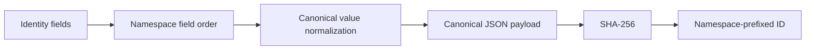

# Identity and Grain Contracts

Identity answers **which logical thing is this?** Grain answers **what does one row represent?** Personal Finance ETL treats both as explicit contracts because financial pipelines become surprisingly creative when those questions are left to intuition.

## Analytical grain catalog

| Layer | Physical table | Grain | Producer | Contract ID |
|---|---|---|---|---|
| Gold | `gold.Core_Monthly_Fact` | **Month** | `WealthPresentationEngine` | `df_p_tf_wealth_monthly_totals` |
| Gold | `gold.Wealth_Asset_Breakdown` | **Month-Asset** | `WealthPresentationEngine` | `df_p_tf_net_worth_monthly_summary` |
| Gold | `gold.Cashflow_Expense_Breakdown` | **Month-ExpenseCategory** | `WealthPresentationEngine` | `df_p_tf_category_spend_analytics` |
| Gold | `gold.Cashflow_Income_Breakdown` | **Month-IncomeCategory** | `WealthPresentationEngine` | `df_p_tf_income_streams_monthly` |
| Gold | `gold.Wealth_FIRE_Analytics` | **Month** | `WealthPresentationEngine` | `df_p_tf_wealth_risk_analytics` |
| Gold | `gold.Forecast_Budget_Variance` | **Month** | `WealthPresentationEngine` | `df_p_tf_budget_forecast_monthly` |
| Gold | `gold.Investment_Portfolio_Summary` | **Month-ISIN** | `InvestmentQuantEngine` | `df_p_tf_investment_analytics` |
| Gold | `gold.Cashflow_Efficiency_Analytics` | **Month** | `WealthPresentationEngine` | `df_p_tf_monthly_cashflow_summary` |
| Gold | `gold.Cashflow_Activity_Summary` | **Month** | `WealthPresentationEngine` | `df_p_tf_cashflow_activity_summary` |
| Gold | `gold.Investment_By_ISIN` | **Date-ISIN** | `InvestmentQuantEngine` | `df_f_investment_analytics_isin` |
| Gold | `gold.Investment_By_Subtype` | **Date-Subtype** | `InvestmentQuantEngine` | `df_f_investment_analytics_subtype` |
| Gold | `gold.Investment_By_Class` | **Date-Class** | `InvestmentQuantEngine` | `df_f_investment_analytics_class` |
| Gold | `gold.Investment_By_Instrument_Type` | **Date-InstrumentType** | `InvestmentQuantEngine` | `df_f_investment_analytics_instrument_type` |
| Gold | `gold.Investment_By_Sector` | **Date-Sector** | `InvestmentQuantEngine` | `df_f_investment_analytics_sector` |
| Gold | `gold.Investment_By_Industry` | **Date-Industry** | `InvestmentQuantEngine` | `df_f_investment_analytics_industry` |
| Gold | `gold.Investment_By_Portfolio` | **Date** | `InvestmentQuantEngine` | `df_f_investment_analytics_portfolio` |
| Gold | `gold.Investment_By_Geo` | **Date-Geo** | `InvestmentQuantEngine` | `df_f_investment_analytics_geo` |
| Gold | `gold.Investment_By_Country` | **Date-Country** | `InvestmentQuantEngine` | `df_f_investment_analytics_country` |
| Gold | `gold.Investment_By_Currency` | **Date-Currency** | `InvestmentQuantEngine` | `df_f_investment_analytics_currency` |
| Gold | `gold.Tax_Year_Summary` | **FY** | `TaxEngine` | `df_p_tax_year_summary` |
| Gold | `gold.Tax_Income_Breakdown` | **FY-Head-SubHead-Source** | `TaxEngine` | `df_p_tax_income_breakdown` |
| Gold | `gold.Tax_Reconciliation` | **FY-SubHead** | `TaxEngine` | `df_p_tax_reconciliation` |
| Silver | `silver.d_Calendar` | **Day** | `CoreEngine` | `df_d_calendar` |
| Silver | `silver.d_Income_Category` | **Category** | `CoreEngine` | `df_d_income_category` |
| Silver | `silver.d_Income_Subcategory` | **Subcategory** | `CoreEngine` | `df_d_income_subcategory` |
| Silver | `silver.d_Expense_Category` | **Category** | `CoreEngine` | `df_d_expense_category` |
| Silver | `silver.d_Expense_Subcategory` | **Subcategory** | `CoreEngine` | `df_d_expense_subcategory` |
| Silver | `silver.d_Asset_Category` | **Category** | `CoreEngine` | `df_d_asset_category` |
| Silver | `silver.d_Asset_SubCategory` | **Subcategory** | `CoreEngine` | `df_d_asset_subcategory` |
| Silver | `silver.d_Currency` | **Currency** | `CoreEngine` | `df_d_currency` |
| Silver | `silver.d_Investment_Benchmark_Master` | **Benchmark** | `CoreEngine` | `df_d_benchmark_master` |
| Silver | `silver.f_Currency_FX_Rates` | **Date-Currency** | `CoreEngine` | `df_f_currency_fx_rates` |
| Silver | `silver.d_Investment_Master` | **ISIN** | `CoreEngine` | `df_d_investment_master` |
| Silver | `silver.d_Macro_Parameters` | **FinancialYear** | `CoreEngine` | `df_d_macro_parameters` |
| Silver | `silver.f_Income_Transactions` | **Transaction** | `CoreEngine` | `df_f_income_transactions` |
| Silver | `silver.f_Expense_Transactions` | **Transaction** | `CoreEngine` | `df_f_expense_transactions` |
| Silver | `silver.f_Transfer_Transactions` | **Transaction** | `CoreEngine` | `df_f_transfer_transactions` |
| Silver | `silver.f_Opening_Balances` | **Balance** | `CoreEngine` | `df_f_opening_balances` |
| Silver | `silver.f_Investment_Market_Data` | **Quote** | `CoreEngine` | `df_f_investment_market_data` |
| Silver | `silver.f_Investment_Purchase_Data` | **Trade** | `CoreEngine` | `df_f_tf_inv_purchase` |
| Silver | `silver.f_Investment_Sale_Data` | **Trade** | `CoreEngine` | `df_f_tf_inv_sale` |
| Silver | `silver.f_Investment_Benchmark_Data` | **Quote** | `CoreEngine` | `df_f_investment_benchmark_data` |
| Silver | `silver.f_Investment_Analytics_Lot` | **ISIN-Lot** | `InvestmentQuantEngine` | `df_f_investment_analytics_lot` |
| Silver | `silver.f_Investment_Realized_Events` | **RealizedEvent** | `InvestmentQuantEngine` | `df_f_investment_realized_events` |
| Silver | `silver.f_Investment_Reconciliation_Events` | **ReconEvent** | `InvestmentQuantEngine` | `df_f_investment_reconciliation_events` |
| Silver | `silver.f_Tax_Events` | **TaxEvent** | `TaxEngine` | `df_f_tax_events` |

## Deterministic identity namespaces

The canonical identity utility defines explicit field order for financial namespaces. Values are normalized before hashing so semantically equivalent values do not acquire different identities merely because Python/JSON felt expressive that day.

| Namespace | Ordered identity fields | Typical meaning |
|---|---|---|
| `PURCHASE` | `ISIN` + `Date` + `Price` + `Quantity` + `CURRENCY_ID` | Canonical purchase transaction |
| `SALE` | `ISIN` + `Date` + `Sell_Price` + `Quantity` + `CURRENCY_ID` | Canonical sale transaction |
| `LOT` | `ISIN` + `Purchase_ID` + `Quantity` + `Date` `ISIN` + `Date` + `Quantity` + `Price` + `Currency` + `Event` `ISIN` + `Date` + `Quantity` + `Price` + `Currency` + `Event` + `Recon_Group` `ISIN` + `Event` + `Recon_Group` | Acquisition or synthetic/reconciled lot; multiple accepted field signatures |
| `REALIZED` | `Sale_ID` + `Lot_ID` | Realized sale-lot component |
| `RECON_GROUP` | `ISIN` + `Reconciliation_Date` + `Adjustment_Type` + `Broker_Quantity` + `Reconstructed_Quantity` + `Broker_Cost_Basis` + `Reconstructed_Cost_Basis` | Reconciliation group |
| `RECON_EVENT` | `Reconciliation_Group_ID` + `Lot_ID` + `Adjustment_Type` | Reconciliation event |
| `RECON_LOT_GROUP` | `ISIN` + `Reconciliation_Date` + `Adjustment_Type` + `Quantity` | Synthetic/reconciled lot group |
| `TAX` | `Source_Type` + `Source_ID` + `Tax_Sub_Head` | Tax event |

## Canonical serialization

Canonical identity serialization uses a version marker (`v2`), namespace-specific field order where defined, and type-aware normalization before SHA-256 hashing. The public deterministic identifier uses a namespace prefix plus a truncated hexadecimal digest.

## Grain is not primary-key syntax

Registry grain is semantic. Some physical tables expose deterministic IDs, some are naturally unique across a compound business grain, and some presentation tables are intended for grouped analytical consumption rather than OLTP-style primary-key enforcement. The absence of a SQL `PRIMARY KEY` declaration in DuckDB therefore does not erase the documented grain.

## Join discipline

- Join canonical facts using stable domain identifiers (`ISIN`, transaction IDs, lot/event IDs, category IDs) appropriate to the contract.
- Do not join reconstructed state to observed evidence merely by row position or display label.
- Respect Date-Currency and Date-ISIN style grains when attaching time-varying observations.
- Treat reconciliation and realized-event identities as provenance-bearing facts, not presentation labels.
- Use Control Plane `file_id` for artifact lineage; a filesystem path is location, not financial identity.

## Identity continuity through rebuilds

Silver and Gold are rebuilt, but deterministic identities allow canonical financial facts to retain continuity when their semantic identity fields remain unchanged. This is one of the reasons full analytical rebuilds do not imply that every fact becomes a brand-new conceptual object on every run.

## Related specifications

- [Deterministic Identity and Replay](../architecture/deterministic-identity-and-replay.md)
- [Data Model](../architecture/data-model.md)
- [Silver Data Contracts](silver-data-contracts.md)
- [Gold Data Contracts](gold-data-contracts.md)
- [Data Contract and Schema Evolution](../developer/data-contract-and-schema-evolution.md)
