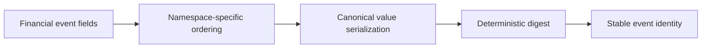

# Deterministic identity contracts

I generate deterministic identifiers for financial facts using namespace-aware field ordering and canonical value serialization. Stable identity depends on the namespace and fields supplied by the caller; it is not a universal deduplication guarantee for arbitrary economic events.



## Namespace and ordering

Source: `src/personal_finance_etl/backend/utils/identity.py`

```python
def canonicalize_value(val: Any) -> str:
    if val is None:
        return "<NULL>"
    elif isinstance(val, bool):
        return "true" if val else "false"
    elif isinstance(val, datetime):
        return val.isoformat()
    elif isinstance(val, date):
        return val.strftime("%Y-%m-%d")
    elif isinstance(val, (int, float, Decimal)):
        try:
            d = Decimal(str(val)).normalize()
            if d.is_zero():
                return "0"
            return format(d, "f")
```

Source: `src/personal_finance_etl/backend/utils/identity.py`

```python
def _ordered_identity_fields(namespace: str, fields: dict[str, Any]) -> list[tuple[str, Any]]:
    """Return identity fields in a contract-defined, caller-order-independent order."""
    keys = set(fields)
    for field_order in _IDENTITY_FIELD_ORDERS.get(namespace, ()):
        if keys == set(field_order):
            return [(key, fields[key]) for key in field_order]

    # Unknown/new contracts remain deterministic rather than inheriting insertion
    # order. Add a namespace contract above if its field order must be semantic.
    return [(key, fields[key]) for key in sorted(fields)]


def generate_deterministic_id(namespace: str, fields: dict[str, Any]) -> str:
    """Generate a stable deterministic ID using Canonical ID Serialization v2.

```

Source: `src/personal_finance_etl/backend/utils/identity.py`

```python
def generate_deterministic_id(namespace: str, fields: dict[str, Any]) -> str:
    """Generate a stable deterministic ID using Canonical ID Serialization v2.

    Known namespaces retain their established field order and hashes. New or
    changed field sets use sorted keys until an explicit order is registered.
    """
    pairs = [
        [canonicalize_value(key), canonicalize_value(value)]
        for key, value in _ordered_identity_fields(namespace, fields)
    ]
    payload = json.dumps(
        [namespace, "v2", pairs], ensure_ascii=False, separators=(",", ":")
    ).encode("utf-8")
    hash_str = hashlib.sha256(payload).hexdigest()
    return f"{namespace}_{hash_str[:16]}"
```

## Stability boundaries

I preserve canonical serialization because field ordering, number formatting, missing-value representation, and namespace changes can alter identifiers. Identity continuity should be tested with representative historical facts before changing these functions. For FIFO and tax semantics see [Finance](../finance/README.md).
