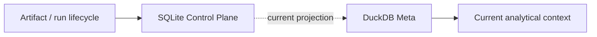
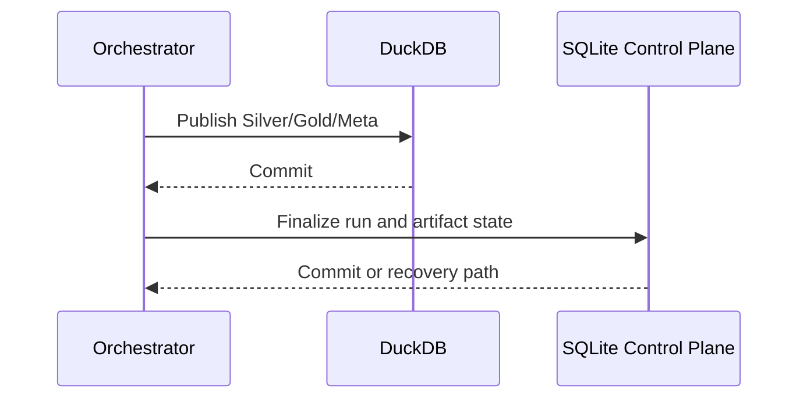

# Meta and Control Plane Data Contracts

I separate historical operational authority in SQLite from the current analytical projection in DuckDB. Their tables have different retention and transaction semantics.



## SQLite Control Plane physical inventory

Source: `src/personal_finance_etl/backend/load/schema/control_plane.py`

### `cp_file_registry`

| Column | Type |
| --- | --- |
| `file_id` | `TEXT` |
| `file_name` | `TEXT` |
| `relative_path` | `TEXT` |
| `file_category` | `TEXT` |
| `file_type` | `TEXT` |
| `file_hash` | `TEXT` |
| `file_size_bytes` | `BIGINT` |
| `sync_status` | `TEXT` |
| `first_seen_run_id` | `TEXT` |
| `first_seen_at` | `TIMESTAMP` |
| `last_seen_run_id` | `TEXT` |
| `last_seen_at` | `TIMESTAMP` |
| `last_changed_run_id` | `TEXT` |
| `last_changed_at` | `TIMESTAMP` |
| `last_synced_run_id` | `TEXT` |
| `last_synced_at` | `TIMESTAMP` |

```sql
CREATE TABLE IF NOT EXISTS cp_file_registry (
    file_id TEXT PRIMARY KEY,
    file_name TEXT NOT NULL,
    relative_path TEXT NOT NULL UNIQUE,
    file_category TEXT NOT NULL,
    file_type TEXT,
    file_hash TEXT NOT NULL,
    file_size_bytes BIGINT,
    sync_status TEXT DEFAULT 'PENDING_BRONZE',
    first_seen_run_id TEXT,
    first_seen_at TIMESTAMP NOT NULL,
    last_seen_run_id TEXT,
    last_seen_at TIMESTAMP NOT NULL,
    last_changed_run_id TEXT,
    last_changed_at TIMESTAMP,
    last_synced_run_id TEXT,
    last_synced_at TIMESTAMP,
    FOREIGN KEY(first_seen_run_id) REFERENCES cp_runs(run_id),
    FOREIGN KEY(last_seen_run_id) REFERENCES cp_runs(run_id),
    FOREIGN KEY(last_changed_run_id) REFERENCES cp_runs(run_id),
    FOREIGN KEY(last_synced_run_id) REFERENCES cp_runs(run_id)
);
```

### `cp_file_payloads`

| Column | Type |
| --- | --- |
| `file_id` | `TEXT` |
| `file_bytes` | `BLOB` |

```sql
CREATE TABLE IF NOT EXISTS cp_file_payloads (
    file_id TEXT PRIMARY KEY,
    file_bytes BLOB,
    FOREIGN KEY(file_id) REFERENCES cp_file_registry(file_id) ON DELETE CASCADE
);
```

### `cp_settings_snapshots`

| Column | Type |
| --- | --- |
| `snapshot_id` | `TEXT` |
| `content_hash` | `TEXT` |
| `canonical_payload` | `TEXT` |
| `created_at` | `TIMESTAMP` |

```sql
CREATE TABLE IF NOT EXISTS cp_settings_snapshots (
    snapshot_id TEXT PRIMARY KEY,
    content_hash TEXT NOT NULL,
    canonical_payload TEXT NOT NULL,
    created_at TIMESTAMP NOT NULL
);
```

### `cp_rules_snapshots`

| Column | Type |
| --- | --- |
| `snapshot_id` | `TEXT` |
| `content_hash` | `TEXT` |
| `canonical_payload` | `TEXT` |
| `created_at` | `TIMESTAMP` |

```sql
CREATE TABLE IF NOT EXISTS cp_rules_snapshots (
    snapshot_id TEXT PRIMARY KEY,
    content_hash TEXT NOT NULL,
    canonical_payload TEXT NOT NULL,
    created_at TIMESTAMP NOT NULL
);
```

### `cp_runs`

| Column | Type |
| --- | --- |
| `run_id` | `TEXT` |
| `started_at` | `TIMESTAMP` |
| `finished_at` | `TIMESTAMP` |
| `status` | `TEXT` |
| `application_version` | `TEXT` |
| `schema_version` | `TEXT` |
| `settings_snapshot_id` | `TEXT` |
| `rules_snapshot_id` | `TEXT` |
| `execution_log` | `BLOB` |

```sql
CREATE TABLE IF NOT EXISTS cp_runs (
    run_id TEXT PRIMARY KEY,
    started_at TIMESTAMP NOT NULL,
    finished_at TIMESTAMP,
    status TEXT,
    application_version TEXT,
    schema_version TEXT,
    settings_snapshot_id TEXT,
    rules_snapshot_id TEXT,
    execution_log BLOB,
    FOREIGN KEY(settings_snapshot_id) REFERENCES cp_settings_snapshots(snapshot_id),
    FOREIGN KEY(rules_snapshot_id) REFERENCES cp_rules_snapshots(snapshot_id)
);
```

### `cp_run_failures`

| Column | Type |
| --- | --- |
| `id` | `INTEGER` |
| `run_id` | `TEXT` |
| `failed_isin` | `TEXT` |
| `stage` | `TEXT` |
| `error_type` | `TEXT` |
| `error_message` | `TEXT` |
| `traceback_log` | `TEXT` |
| `created_at` | `TIMESTAMP` |

```sql
CREATE TABLE IF NOT EXISTS cp_run_failures (
    id INTEGER PRIMARY KEY AUTOINCREMENT,
    run_id TEXT NOT NULL,
    failed_isin TEXT,
    stage TEXT,
    error_type TEXT,
    error_message TEXT,
    traceback_log TEXT,
    created_at TIMESTAMP NOT NULL,
    FOREIGN KEY(run_id) REFERENCES cp_runs(run_id)
);
```

### `cp_artifact_run_events`

| Column | Type |
| --- | --- |
| `event_id` | `TEXT` |
| `run_id` | `TEXT` |
| `file_id` | `TEXT` |
| `event_type` | `TEXT` |
| `event_at` | `TIMESTAMP` |
| `observed_path` | `TEXT` |
| `content_hash` | `TEXT` |
| `previous_status` | `TEXT` |
| `new_status` | `TEXT` |
| `event_reason` | `TEXT` |

```sql
CREATE TABLE IF NOT EXISTS cp_artifact_run_events (
    event_id TEXT PRIMARY KEY,
    run_id TEXT NOT NULL,
    file_id TEXT NOT NULL,
    event_type TEXT NOT NULL,
    event_at TIMESTAMP NOT NULL,
    observed_path TEXT,
    content_hash TEXT,
    previous_status TEXT,
    new_status TEXT,
    event_reason TEXT,
    FOREIGN KEY(run_id) REFERENCES cp_runs(run_id),
    FOREIGN KEY(file_id) REFERENCES cp_file_registry(file_id)
);
```

### `cp_simulation_runs`

| Column | Type |
| --- | --- |
| `simulation_id` | `TEXT` |
| `run_id` | `TEXT` |
| `created_at` | `TIMESTAMP` |
| `root_seed` | `TEXT` |
| `iterations` | `INTEGER` |
| `horizon` | `INTEGER` |
| `input_as_of_date` | `DATE` |
| `settings_snapshot_id` | `TEXT` |
| `rules_snapshot_id` | `TEXT` |
| `input_fingerprint` | `TEXT` |
| `model_fingerprint` | `TEXT` |
| `model_implementation_version` | `TEXT` |
| `status` | `TEXT` |
| `result_fingerprint` | `TEXT` |

```sql
CREATE TABLE IF NOT EXISTS cp_simulation_runs (
    simulation_id TEXT PRIMARY KEY,
    run_id TEXT NOT NULL,
    created_at TIMESTAMP NOT NULL,
    root_seed TEXT NOT NULL,
    iterations INTEGER,
    horizon INTEGER,
    input_as_of_date DATE,
    settings_snapshot_id TEXT,
    rules_snapshot_id TEXT,
    input_fingerprint TEXT,
    model_fingerprint TEXT,
    model_implementation_version TEXT,
    status TEXT,
    result_fingerprint TEXT,
    FOREIGN KEY(run_id) REFERENCES cp_runs(run_id),
    FOREIGN KEY(settings_snapshot_id) REFERENCES cp_settings_snapshots(snapshot_id),
    FOREIGN KEY(rules_snapshot_id) REFERENCES cp_rules_snapshots(snapshot_id)
);
```

## DuckDB Meta physical inventory

Source: `src/personal_finance_etl/backend/load/schema/meta.py`

### `meta.m_File_Registry`

| Column | Type |
| --- | --- |
| `file_id` | `TEXT` |
| `file_name` | `TEXT` |
| `relative_path` | `TEXT` |
| `file_category` | `TEXT` |
| `file_type` | `TEXT` |
| `file_hash` | `TEXT` |
| `file_size_bytes` | `BIGINT` |
| `first_ingested` | `TIMESTAMP` |
| `last_ingested` | `TIMESTAMP` |
| `row_count` | `BIGINT` |

```sql
CREATE TABLE IF NOT EXISTS meta.m_File_Registry (
    file_id         TEXT PRIMARY KEY,   -- deterministic: SHA-256(relative_path)
    file_name       TEXT NOT NULL,
    relative_path   TEXT NOT NULL UNIQUE,
    file_category   TEXT NOT NULL,      -- 'mf_holdings', 'stock_pl', 'sqlite_source', etc.
    file_type       TEXT,               -- 'excel', 'csv', 'sqlite', 'parquet', 'virtual'
    file_hash       TEXT NOT NULL,      -- SHA-256 of file content
    file_size_bytes BIGINT,
    first_ingested  TIMESTAMP NOT NULL,
    last_ingested   TIMESTAMP NOT NULL,
    row_count       BIGINT
);
```

### `meta.m_Table_Row_Counts`

| Column | Type |
| --- | --- |
| `schema_name` | `TEXT` |
| `table_name` | `TEXT` |
| `row_count` | `BIGINT` |
| `generated_at` | `TIMESTAMP` |

```sql
CREATE TABLE IF NOT EXISTS meta.m_Table_Row_Counts (
    schema_name TEXT NOT NULL,
    table_name  TEXT NOT NULL,
    row_count   BIGINT,
    generated_at TIMESTAMP
);
```

### `meta.m_Financial_Rules`

| Column | Type |
| --- | --- |
| `Rule_Domain` | `TEXT` |
| `Rule_Type` | `TEXT` |
| `Target_Level` | `TEXT` |
| `Target_ID` | `TEXT` |

```sql
CREATE TABLE IF NOT EXISTS meta.m_Financial_Rules (
    Rule_Domain  TEXT NOT NULL,
    Rule_Type    TEXT NOT NULL,
    Target_Level TEXT NOT NULL,
    Target_ID    TEXT NOT NULL
);
```

### `meta.m_Settings`

| Column | Type |
| --- | --- |
| `Setting_Group` | `TEXT` |
| `Setting_Key` | `TEXT` |
| `Setting_Value` | `TEXT` |

```sql
CREATE TABLE IF NOT EXISTS meta.m_Settings (
    Setting_Group TEXT NOT NULL,
    Setting_Key   TEXT NOT NULL,
    Setting_Value TEXT NOT NULL
);
```

### `meta.m_Data_Contracts`

| Column | Type |
| --- | --- |
| `contract_id` | `TEXT` |
| `layer` | `TEXT` |
| `physical_table` | `TEXT` |
| `domain` | `TEXT` |
| `grain` | `TEXT` |
| `producer` | `TEXT` |
| `is_full_replace` | `BOOLEAN` |
| `publication_order` | `INTEGER` |

```sql
CREATE TABLE IF NOT EXISTS meta.m_Data_Contracts (
    contract_id       TEXT NOT NULL,
    layer             TEXT NOT NULL,
    physical_table    TEXT NOT NULL,
    domain            TEXT,
    grain             TEXT,
    producer          TEXT,
    is_full_replace   BOOLEAN,
    publication_order INTEGER
);
```

### `meta.m_Latest_Simulation`

| Column | Type |
| --- | --- |
| `simulation_id` | `TEXT` |
| `run_id` | `TEXT` |
| `created_at` | `TIMESTAMP` |
| `root_seed` | `TEXT` |
| `iterations` | `INTEGER` |
| `horizon` | `INTEGER` |
| `model_implementation_version` | `TEXT` |
| `model_fingerprint` | `TEXT` |
| `input_fingerprint` | `TEXT` |
| `result_fingerprint` | `TEXT` |
| `contract_registry_fingerprint` | `TEXT` |
| `settings_snapshot_id` | `TEXT` |
| `rules_snapshot_id` | `TEXT` |
| `status` | `TEXT` |

```sql
CREATE TABLE IF NOT EXISTS meta.m_Latest_Simulation (
    simulation_id              TEXT NOT NULL,
    run_id                     TEXT NOT NULL,
    created_at                 TIMESTAMP NOT NULL,
    root_seed                  TEXT NOT NULL,
    iterations                 INTEGER,
    horizon                    INTEGER,
    model_implementation_version TEXT,
    model_fingerprint          TEXT,
    input_fingerprint          TEXT,
    result_fingerprint         TEXT,
    contract_registry_fingerprint TEXT,  -- SHA-256 of sorted DATA_CONTRACT_REGISTRY structural metadata
    settings_snapshot_id       TEXT,
    rules_snapshot_id          TEXT,
    status                     TEXT
);
```

## Lifecycle and transaction semantics

### Implementation anchor: Scoped SQLite transaction

Source: `src/personal_finance_etl/backend/load/control_plane/connection.py`

```python

    @contextmanager
    def atomic(self) -> Generator[None]:
        """Atomic scope that works both standalone and nested in a pipeline transaction."""
        savepoint = f"cp_scope_{uuid.uuid4().hex}"
        self.conn.execute(f"SAVEPOINT {savepoint}")
        try:
            yield
            self.conn.execute(f"RELEASE SAVEPOINT {savepoint}")
        except Exception:
            try:
                self.conn.execute(f"ROLLBACK TO SAVEPOINT {savepoint}")
            finally:
                self.conn.execute(f"RELEASE SAVEPOINT {savepoint}")
            raise

    @property
    def is_open(self) -> bool:
        """Whether the SQLite connection is currently open."""
        return self._conn is not None

    def ensure_schema(self) -> None:
        """Create the current schema on a new database; never migrate existing data.

        Existing databases must be upgraded by the project's explicit migration
```

The Control Plane retains run and artifact history independently of the analytical warehouse. A savepoint protects scoped SQLite mutations; it does not make the SQLite and DuckDB commits a distributed atomic transaction.



## Historical identity and payload retention

Artifact-run events can preserve the history of removed files even when full-replace cleanup removes obsolete payload bytes. Historical identity, source availability and restorable binary payload are separate guarantees.

## Reproducibility context

Configuration snapshots, run provenance and simulation metadata are operational evidence. Current DuckDB Meta is a convenience projection, not a substitute for the SQLite history.

[← Reference index](README.md)
