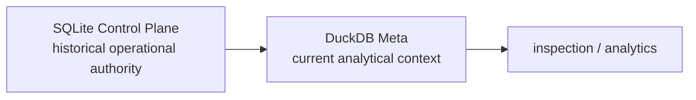

# Meta Data Contracts

DuckDB Meta is the **current analytical context** surface. It mirrors information useful to analytics and inspection without replacing the Control Plane as historical operational authority.

That distinction is the whole contract: Meta is convenient current state; SQLite Control Plane is durable operational history.

## Physical inventory

| Table | Purpose |
|---|---|
| `meta.m_File_Registry` | Current file-registry projection for analytical inspection |
| `meta.m_Table_Row_Counts` | Current publication row counts |
| `meta.m_Financial_Rules` | Current flattened financial rules snapshot |
| `meta.m_Settings` | Current flattened settings snapshot |
| `meta.m_Data_Contracts` | Current data-contract catalog projection |
| `meta.m_Latest_Simulation` | Latest simulation context/result metadata |

## `meta.m_File_Registry`

| Column | Physical type / constraint | Role |
|---|---|---|
| `file_id` | `TEXT PRIMARY KEY,   -- deterministic: SHA-256(relative_path)` | Field |
| `file_name` | `TEXT NOT NULL` | Field |
| `relative_path` | `TEXT NOT NULL UNIQUE` | Field |
| `file_category` | `TEXT NOT NULL,      -- 'mf_holdings', 'stock_pl', 'sqlite_source', etc.` | Field |
| `file_type` | `TEXT,               -- 'excel', 'csv', 'sqlite', 'parquet', 'virtual'` | Field |
| `file_hash` | `TEXT NOT NULL,      -- SHA-256 of file content` | Field |
| `file_size_bytes` | `BIGINT` | Field |
| `first_ingested` | `TIMESTAMP NOT NULL` | Field |
| `last_ingested` | `TIMESTAMP NOT NULL` | Field |
| `row_count` | `BIGINT` | Field |

## `meta.m_Table_Row_Counts`

| Column | Physical type / constraint | Role |
|---|---|---|
| `schema_name` | `TEXT NOT NULL` | Field |
| `table_name` | `TEXT NOT NULL` | Field |
| `row_count` | `BIGINT` | Field |
| `generated_at` | `TIMESTAMP` | Field |

## `meta.m_Financial_Rules`

| Column | Physical type / constraint | Role |
|---|---|---|
| `Rule_Domain` | `TEXT NOT NULL` | Field |
| `Rule_Type` | `TEXT NOT NULL` | Field |
| `Target_Level` | `TEXT NOT NULL` | Field |
| `Target_ID` | `TEXT NOT NULL` | Field |

## `meta.m_Settings`

| Column | Physical type / constraint | Role |
|---|---|---|
| `Setting_Group` | `TEXT NOT NULL` | Field |
| `Setting_Key` | `TEXT NOT NULL` | Field |
| `Setting_Value` | `TEXT NOT NULL` | Field |

## `meta.m_Data_Contracts`

| Column | Physical type / constraint | Role |
|---|---|---|
| `contract_id` | `TEXT NOT NULL` | Field |
| `layer` | `TEXT NOT NULL` | Field |
| `physical_table` | `TEXT NOT NULL` | Field |
| `domain` | `TEXT` | Field |
| `grain` | `TEXT` | Field |
| `producer` | `TEXT` | Field |
| `is_full_replace` | `BOOLEAN` | Field |
| `publication_order` | `INTEGER` | Field |

## `meta.m_Latest_Simulation`

| Column | Physical type / constraint | Role |
|---|---|---|
| `simulation_id` | `TEXT NOT NULL` | Field |
| `run_id` | `TEXT NOT NULL` | Field |
| `created_at` | `TIMESTAMP NOT NULL` | Field |
| `root_seed` | `TEXT NOT NULL` | Field |
| `iterations` | `INTEGER` | Field |
| `horizon` | `INTEGER` | Field |
| `input_as_of_date` | `DATE` | Field |
| `model_implementation_version` | `TEXT` | Field |
| `model_fingerprint` | `TEXT` | Field |
| `input_fingerprint` | `TEXT` | Field |
| `result_fingerprint` | `TEXT` | Field |
| `contract_registry_fingerprint` | `TEXT,  -- SHA-256 of sorted DATA_CONTRACT_REGISTRY structural metadata` | Field |
| `settings_snapshot_id` | `TEXT` | Field |
| `rules_snapshot_id` | `TEXT` | Field |
| `status` | `TEXT` | Field |

## Authority boundary

Meta should not be used to reconstruct historical run truth when the Control Plane retains the authoritative lifecycle/provenance history.

## Refresh semantics

Meta tables are refreshed as part of analytical publication/current-context updates. They are intentionally small, query-friendly projections rather than event history.

## Contract invariants

- Meta is current-context, not full history.
- Control Plane IDs/snapshots remain authoritative where mirrored.
- Contract rows describe the current publication registry.
- Latest simulation metadata is a pointer/context surface, not a replacement for `cp_simulation_runs` history.

## Related specifications

- [Control Plane Data Contracts](control-plane-data-contracts.md)
- [Warehouse Architecture](../architecture/warehouse-architecture.md)
- [Configuration Reference](../configuration/configuration-reference.md)
