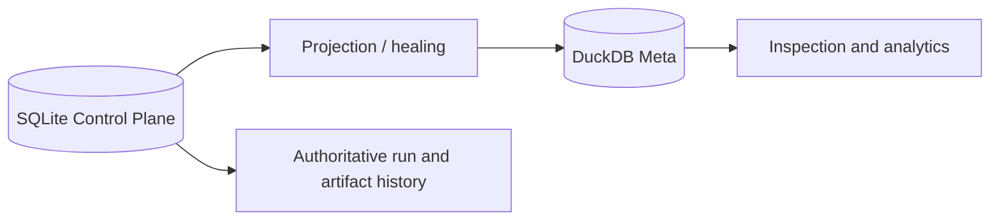

# DuckDB Meta and Control Plane reference

I keep a small DuckDB Meta projection for convenient consumption while preserving the operational authority in SQLite. A mirrored run or simulation row is not a second source of truth.



## DuckDB Meta physical tables

### `meta.m_File_Registry`

| Column | Type | Declared key |
|---|---|---|
| `file_id` | `TEXT` | PRIMARY KEY |
| `file_name` | `TEXT` |  |
| `relative_path` | `TEXT` |  |
| `file_category` | `TEXT` |  |
| `file_type` | `TEXT` |  |
| `file_hash` | `TEXT` |  |
| `file_size_bytes` | `BIGINT` |  |
| `first_ingested` | `TIMESTAMP` |  |
| `last_ingested` | `TIMESTAMP` |  |
| `row_count` | `BIGINT` |  |

### `meta.m_Table_Row_Counts`

| Column | Type | Declared key |
|---|---|---|
| `schema_name` | `TEXT` |  |
| `table_name` | `TEXT` |  |
| `row_count` | `BIGINT` |  |
| `generated_at` | `TIMESTAMP` |  |

### `meta.m_Financial_Rules`

| Column | Type | Declared key |
|---|---|---|
| `Rule_Domain` | `TEXT` |  |
| `Rule_Type` | `TEXT` |  |
| `Target_Level` | `TEXT` |  |
| `Target_ID` | `TEXT` |  |

### `meta.m_Settings`

| Column | Type | Declared key |
|---|---|---|
| `Setting_Group` | `TEXT` |  |
| `Setting_Key` | `TEXT` |  |
| `Setting_Value` | `TEXT` |  |

### `meta.m_Data_Contracts`

| Column | Type | Declared key |
|---|---|---|
| `contract_id` | `TEXT` |  |
| `layer` | `TEXT` |  |
| `physical_table` | `TEXT` |  |
| `domain` | `TEXT` |  |
| `grain` | `TEXT` |  |
| `producer` | `TEXT` |  |
| `is_full_replace` | `BOOLEAN` |  |
| `publication_order` | `INTEGER` |  |

### `meta.m_Latest_Simulation`

| Column | Type | Declared key |
|---|---|---|
| `simulation_id` | `TEXT` |  |
| `run_id` | `TEXT` |  |
| `created_at` | `TIMESTAMP` |  |
| `root_seed` | `TEXT` |  |
| `iterations` | `INTEGER` |  |
| `horizon` | `INTEGER` |  |
| `model_implementation_version` | `TEXT` |  |
| `model_fingerprint` | `TEXT` |  |
| `input_fingerprint` | `TEXT` |  |
| `result_fingerprint` | `TEXT` |  |
| `contract_registry_fingerprint` | `TEXT` |  |
| `settings_snapshot_id` | `TEXT` |  |
| `rules_snapshot_id` | `TEXT` |  |
| `status` | `TEXT` |  |

## Authority boundary

I use Control Plane repositories for durable run, artifact, snapshot, and simulation provenance. Meta is a warehouse-side convenience projection, so it must not be described as the canonical operational record.

Source: `src/personal_finance_etl/backend/load/schema/meta.py`

```python
META_DDL = """
-- Tracks the current source files present in Bronze
CREATE TABLE IF NOT EXISTS meta.m_File_Registry (
    file_id         TEXT PRIMARY KEY,   -- deterministic: SHA-256(relative_path)
    file_name       TEXT NOT NULL,
    relative_path   TEXT NOT NULL UNIQUE,
    file_category   TEXT NOT NULL,      -- 'mf_holdings', 'stock_pl', 'sqlite_source', etc.
    file_type       TEXT,               -- 'excel', 'csv', 'sqlite', 'parquet', 'virtual'
    file_hash       TEXT NOT NULL,      -- SHA-256 of file content
    file_size_bytes BIGINT,
    first_ingested  TIMESTAMP NOT NULL,
    last_ingested   TIMESTAMP NOT NULL,
    row_count       BIGINT
);

```

See [Control Plane Schema](control-plane-schema.md) for the authoritative SQLite DDL.
