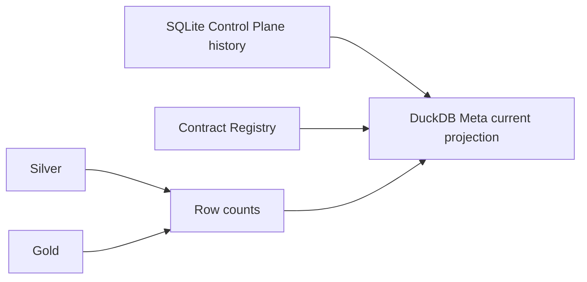

# Meta Data Contracts

DuckDB Meta is a **current-state analytical projection**, not the historical operational authority. It makes the latest file registry view, row counts, rules, settings, contract catalog, and simulation provenance queryable beside the analytical warehouse without forcing BI/developer workloads to join into SQLite.

## Physical inventory

The current Meta DDL defines **6 tables**.

## `meta.m_File_Registry`

| Column | Physical type / constraint |
|---|---|
| `file_id` | `TEXT PRIMARY KEY` |
| `file_name` | `TEXT NOT NULL` |
| `relative_path` | `TEXT NOT NULL UNIQUE` |
| `file_category` | `TEXT NOT NULL` |
| `file_type` | `TEXT` |
| `file_hash` | `TEXT NOT NULL` |
| `file_size_bytes` | `BIGINT` |
| `first_ingested` | `TIMESTAMP NOT NULL` |
| `last_ingested` | `TIMESTAMP NOT NULL` |
| `row_count` | `BIGINT` |

Current source-file projection associated with Bronze. Historical lifecycle events remain in SQLite.

## `meta.m_Table_Row_Counts`

| Column | Physical type / constraint |
|---|---|
| `schema_name` | `TEXT NOT NULL` |
| `table_name` | `TEXT NOT NULL` |
| `row_count` | `BIGINT` |
| `generated_at` | `TIMESTAMP` |

Latest generated row-count observations for analytical tables.

## `meta.m_Financial_Rules`

| Column | Physical type / constraint |
|---|---|
| `Rule_Domain` | `TEXT NOT NULL` |
| `Rule_Type` | `TEXT NOT NULL` |
| `Target_Level` | `TEXT NOT NULL` |
| `Target_ID` | `TEXT NOT NULL` |

Flattened latest-run financial-rule projection for inspection.

## `meta.m_Settings`

| Column | Physical type / constraint |
|---|---|
| `Setting_Group` | `TEXT NOT NULL` |
| `Setting_Key` | `TEXT NOT NULL` |
| `Setting_Value` | `TEXT NOT NULL` |

Flattened latest-run application-setting projection.

## `meta.m_Data_Contracts`

| Column | Physical type / constraint |
|---|---|
| `contract_id` | `TEXT NOT NULL` |
| `layer` | `TEXT NOT NULL` |
| `physical_table` | `TEXT NOT NULL` |
| `domain` | `TEXT` |
| `grain` | `TEXT` |
| `producer` | `TEXT` |
| `is_full_replace` | `BOOLEAN` |
| `publication_order` | `INTEGER` |

Latest contract-registry projection, including layer, grain, producer, replacement mode, and publication order.

## `meta.m_Latest_Simulation`

| Column | Physical type / constraint |
|---|---|
| `simulation_id` | `TEXT NOT NULL` |
| `run_id` | `TEXT NOT NULL` |
| `created_at` | `TIMESTAMP NOT NULL` |
| `root_seed` | `TEXT NOT NULL` |
| `iterations` | `INTEGER` |
| `horizon` | `INTEGER` |
| `model_implementation_version` | `TEXT` |
| `model_fingerprint` | `TEXT` |
| `input_fingerprint` | `TEXT` |
| `result_fingerprint` | `TEXT` |
| `contract_registry_fingerprint` | `TEXT` |
| `settings_snapshot_id` | `TEXT` |
| `rules_snapshot_id` | `TEXT` |
| `status` | `TEXT` |

Mirror of the most recent successful simulation provenance row, allowing fingerprints/model version to be queried without a cross-store join.

## Authority boundary

> **Control Plane history is authoritative; Meta is convenient current context.**

This boundary prevents DuckDB from becoming a second historical registry with subtly different retention rules. The architecture already has one historian. Giving the warehouse a fake moustache does not make a second historian useful.

## Refresh semantics

Meta is refreshed as part of analytical publication. Row counts and current settings/rules/contracts describe the latest successful analytical context rather than an append-only history. Simulation metadata similarly mirrors the latest successful Control Plane simulation record.

## Contract invariants

- Meta tables are query conveniences, not substitutes for Control Plane event history.
- `m_Data_Contracts` must reflect the registry used by the published analytical database.
- `m_Latest_Simulation` mirrors provenance; it does not own stochastic execution history.
- File-registry projection can be healed from Control Plane authority when the stores diverge.

## Related specifications

- [Warehouse Architecture](../architecture/warehouse-architecture.md)
- [Control Plane Data Contracts](control-plane-data-contracts.md)
- [Deterministic Identity and Replay](../architecture/deterministic-identity-and-replay.md)
- [Gold Data Contracts](gold-data-contracts.md)
