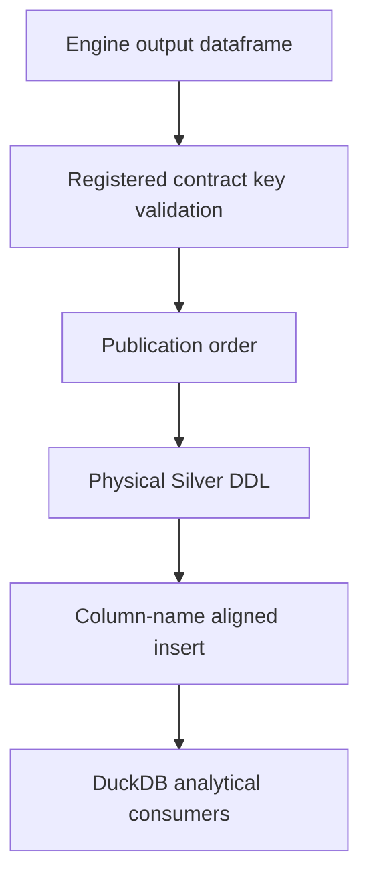

# Silver data contracts

I define the canonical Silver publication surface in the Data Contract Registry and separately declare its physical DDL. The contract registry specifies publication identity, logical grain, producer, and ordering; the schema specifies actual columns and types. These are different contracts that must agree at publication time.



## Complete analytical registry

| Contract key | Physical table | Domain | Grain | Producer | Order |
|---|---|---|---|---|---:|


Source: `src/personal_finance_etl/backend/load/registry.py`

```python
DATA_CONTRACT_REGISTRY: list[DataContract] = [
    # --- Silver Dimensions ---
    DataContract("df_d_calendar", "silver", "silver.d_Calendar", "Common", "Day", "CoreEngine", 10),
    DataContract(
        "df_d_income_category",
        "silver",
        "silver.d_Income_Category",
        "Wealth",
        "Category",
        "CoreEngine",
        20,
    ),
    DataContract(
        "df_d_income_subcategory",
        "silver",
```

## Publication boundaries

I use registry membership and column-aligned loading to constrain publication. The registry grain is descriptive; it is not automatically a physical uniqueness constraint. Only constraints actually declared in DDL are enforced by the database. The source registry and schema files are the authority for newly introduced or changed columns.

For financial meaning, I link to [Finance](../finance/README.md). For publication mechanics, I link to [Data Engineering](../data-engineering/README.md).
