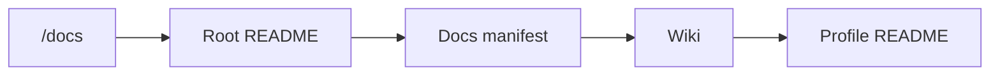
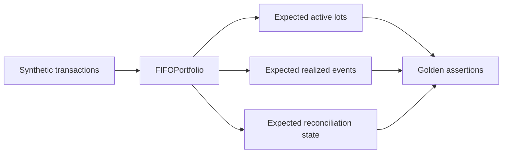
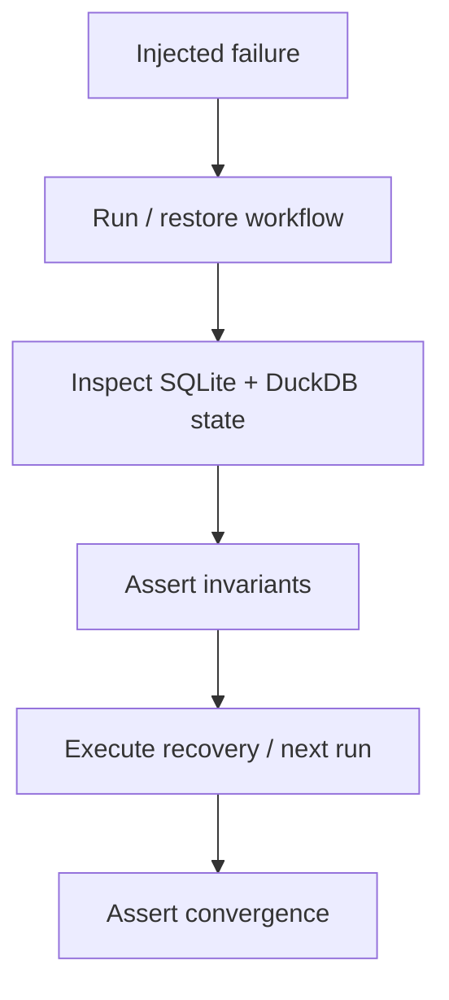
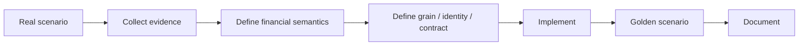
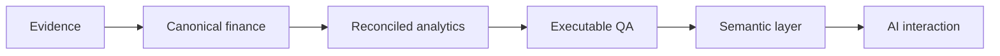
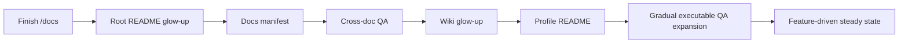

# Roadmap

Personal Finance ETL has reached an unusual and healthy point for a personal project:

> **The roadmap is intentionally smaller than the system.**

The major architectural and financial capabilities already exist. The current priority is not another feature sprint. It is to make the existing behavior easier to prove, harder to regress, safer to maintain, and clearer to future readers, including future-me, who is statistically the developer most likely to ask “why did this work this way?” six months later.


This roadmap is therefore a **maturity roadmap**, not a feature catalog.

---

## 1. Current baseline: capability is not the bottleneck

The system already contains the major capabilities required for its real workload:

```text
SQLite Control Plane
artifact identity and event history
run lifecycle and failure provenance
configuration / rule snapshots
persistent Bronze synchronization
Control Plane → Bronze healing
contract-governed Silver / Gold publication
DuckDB Meta projection

deterministic transaction identities
historical US market reconstruction
canonical FIFO lots
realized disposal events
quantity reconciliation
cost-basis reconciliation
multi-currency valuation and FX attribution
XIRR / benchmark / risk analytics

evidence-first TaxEvents
three Tax Gold views
household cashflow and wealth analytics
deterministic FI metrics
stochastic FIRE simulation
simulation provenance / replay context

CLI
desktop application
Power BI serving
offline documentation
coordinated snapshot / restore
```

That is the starting point.

The roadmap should not list existing architecture as if it were aspirational. Software has enough identity crises already.

---

## 2. Roadmap philosophy

The governing loop is now:

```text
understand current behavior
        ↓
document the contract
        ↓
protect it with executable checks
        ↓
observe real failures / new scenarios
        ↓
change only what evidence justifies
```

The project remains personal software that is actually used.

Complexity therefore has to earn its electricity bill.

---

## 3. Documentation freeze and integration

The immediate work is the documentation program already in progress.

The target is a synchronized knowledge system with deliberately different responsibilities:

```text
README = SHOW
Wiki   = TEACH
/docs  = SPECIFY
Code   = PROVE
```

### `/docs`

The technical specification layer is being rebuilt from current source with:

- implementation-grounded narratives;
- authentic code excerpts;
- Mermaid architecture and state diagrams;
- physical contracts and grains;
- financial formulas;
- explicit invariants;
- failure/recovery semantics;
- honest limitations;
- standardized cross-links.

### Root README

The repository README will be rebuilt only after `/docs` is internally coherent so it can showcase the current system without becoming another specification manual.

### Documentation manifest

The runtime documentation manifest will be updated after the final `/docs` structure is complete. Navigation should reflect the knowledge base that actually exists, not the knowledge base that existed three architectures ago.

### Wiki

The Wiki will then be reimagined as the guided learning layer, teaching the mental model without duplicating `/docs`.

### Profile README

Finally, the GitHub profile can present Personal Finance ETL as the flagship convergence project using the finished repository as evidence rather than marketing copy.



---

## 4. QA expansion is the main engineering frontier

The largest current maturity gap is conventional automated regression coverage.

The production code contains substantial runtime validation and hardening, but the repository does not yet have a broad automated unit/integration suite proportional to the sophistication of the implementation.

That is the most valuable next engineering investment.

### 4.1 Deterministic identity tests

Protect canonical identity serialization and namespace contracts.

High-value cases include:

```text
null normalization
boolean normalization
date / datetime normalization
Decimal normalization
Unicode NFC normalization
field-order stability
PURCHASE / SALE identity
LOT identity variants
REALIZED identity
reconciliation identities
TAX identity
```

A deterministic identifier is infrastructure. Silent identity drift would ripple through lineage, FIFO, Tax, and reconciliation.

### 4.2 FIFO golden scenarios

Build small deterministic portfolios that cover:

```text
single purchase
multiple purchases
partial disposal
full disposal
one sale consuming multiple lots
holding-period boundary
foreign-currency disposal
reconciliation-created lot
post-reconciliation disposal
```

Expected lot state and realized-event state should be asserted exactly.



### 4.3 Reconciliation tests

Quantity and cost-basis reconciliation deserve independent scenarios because they mutate financial state differently.

Tests should protect:

- positive quantity gaps;
- negative quantity gaps;
- zero-quantity edge cases;
- proportional cost-basis scaling;
- local/reporting basis consistency;
- deterministic reconciliation IDs;
- future FIFO behavior after correction.

### 4.4 Temporal-causality tests

Historical US valuation has a particularly valuable invariant:

> **Future market or FX observations must never leak into earlier valuation state.**

Regression tests should cover:

```text
same-day observation
prior-day observation
weekend / market closure
stale price > allowed threshold
missing FX
future-only price
future-only FX
position close / re-entry
```

### 4.5 Tax evidence tests

Protect the ownership boundary between household ledger and Quant realized events.

Scenarios should include:

- non-investment income;
- STCG/LTCG Quant events;
- investment ledger exclusions;
- tax credits with signed values;
- `CHECK_REQUIRED` evidence retaining indicative estimates;
- deterministic `TAX` identity;
- Gold aggregation/reconciliation.

### 4.6 Wealth and cashflow tests

Golden household scenarios should assert:

```text
opening balance
+ income
- expense
± transfer
= expected book state
```

Then separately validate market-value injection, savings metrics, liquidity, runway, and net-worth aggregation.

### 4.7 FIRE reproducibility tests

The stochastic layer should be tested at the contract level rather than by expecting different runs to generate identical paths.

Useful checks include:

- same recorded seed + same compatible inputs → repeatable output;
- changed rule fingerprint → changed replay envelope;
- Markov transition behavior under controlled seeds;
- percentile ordering;
- zero/edge horizons;
- human-capital shock duration boundaries;
- inflation floor/cap behavior;
- output fingerprint stability under identical context.

---

## 5. Reliability and recovery regression coverage

The operational hardening deserves permanent executable protection.

Priority scenarios include:

```text
stale run recovery
changed artifact
removed artifact
successful rename migration
ambiguous rename
PENDING_BRONZE replay
missing Bronze table
Control Plane / DuckDB divergence
worker failure propagation
DuckDB transaction rollback
SQLite transaction rollback
DuckDB-committed / SQLite-failed healing path
snapshot creation
corrupt snapshot rejection
restore validation
failed restore rollback
```



These tests matter because reliability behavior is easiest to trust immediately after writing it and hardest to trust a year later when nobody remembers the exact failure window.

---

## 6. Contract and schema regression protection

The Data Contract Registry is now central enough to deserve machine-checkable regression protection.

Useful checks include:

- registry uniqueness;
- expected contract counts as derived assertions, not magic documentation constants;
- publication-order consistency;
- producer/registry completeness;
- DDL/contract alignment;
- grain metadata presence;
- Meta contract projection;
- docs contract inventory generated/checked against source where practical.

The objective is not to make documentation executable at all costs.

It is to eliminate avoidable drift between the implementation authority and the specification layer.

---

## 7. Configuration fixture modernization

Some historical test/sample configuration material predates the current Pydantic models.

The QA phase should replace stale fixtures with intentionally current examples generated or validated against:

```text
Settings
FinancialRules
FireAssumptions
MonteCarloAssumptions
```

Fixtures should be small enough to understand and complete enough to exercise the actual validation paths.

A configuration fixture should not become an archaeological site that the tests politely avoid looking at.

---

## 8. Static quality and type discipline

The project already benefits from explicit models and typed contracts, but maturity work should keep tightening static feedback where it produces real value.

Potential focus areas:

- type-checking critical financial paths;
- linting and formatting consistency;
- dead-code detection;
- import/dependency hygiene;
- Pydantic model coverage;
- explicit enum use where strings currently encode domain states;
- documentation/source-path validation.

The goal is not a perfect score from every tool in the Python ecosystem.

The goal is shorter feedback loops for mistakes that machines can detect cheaply.

---

## 9. Performance becomes observational, not aspirational

The current workload is operationally comfortable.

Future performance work should therefore start with profiling and evidence.

The decision sequence should be:

```text
Is this computation needed?
        ↓
Is the grain correct?
        ↓
Is the algorithm appropriate?
        ↓
Is the bottleneck material?
        ↓
Optimize
        ↓
Reconcile financial outputs
```

An 8% speed improvement that changes a financial answer is not an optimization. It is a very efficient bug.

### Performance evidence worth retaining

When profiling is performed, capture:

- source-artifact count;
- instrument workload count;
- Bronze rows;
- Silver/Gold rows;
- stage timings;
- warm/cold context;
- hardware/environment;
- financial output reconciliation.

Benchmarks without workload context age badly.

---

## 10. Documentation QA becomes part of release hygiene

Once the rebase is complete, documentation should receive lightweight regression checks alongside code.

Useful automated checks include:

```text
relative links
code-fence balance
Mermaid fence syntax
manifest completeness
source-path existence
registry counts
contract names
release-label leakage
Related Specifications formatting
```

More semantic checks, such as whether a formula still matches implementation, remain review work unless a practical source-derived mechanism exists.

Documentation should be protected from obvious drift without pretending prose can be unit-tested into truth.

---

## 11. Maintainability and simplification

A mature codebase should occasionally become smaller.

Future maintenance should look for:

- duplicate transformation logic;
- stale compatibility paths;
- obsolete configuration keys;
- redundant metrics;
- dead documentation branches;
- unnecessary abstractions;
- expensive calculations with no decision consumer;
- interfaces that expose implementation detail without user value.

The test for simplification is the same as the test for refactoring:

> **Can the behavior be made easier to understand without losing required financial semantics or recovery guarantees?**

If yes, deletion is a feature.

---

## 12. Gold remains curated

Gold should continue to be decision-oriented rather than becoming a landfill for every calculated column.

Before adding a metric or mart, ask:

```text
What decision does this support?
What is its grain?
Is it additive?
Can the consumer aggregate it safely?
Does it duplicate an existing contract?
Does it justify its compute and maintenance cost?
```

If the answer is vague, the metric probably belongs upstream, in ad-hoc analysis, or nowhere.

A warehouse is not improved by collecting every number it has ever thought about.

---

## 13. Financial-domain changes require real evidence

The application should not broaden into every asset class, jurisdiction, or tax rule because those domains exist in the world.

New financial semantics should be triggered by actual evidence such as:

```text
new asset actually held
new broker actually used
new jurisdiction actually relevant
new corporate action actually encountered
new reporting requirement actually needed
```

Then the workflow becomes:



That keeps domain growth evidence-led rather than encyclopedic.

---

## 14. Portability grows only when variation appears

The architecture already contains reusable seams.

Source-specific and jurisdiction-specific assumptions should become more portable when a second real environment demonstrates the variation.

The rule remains:

> **Generalize from working behavior, not imagined universality.**

Possible future portability work may include adapters or strategies for genuinely different:

- broker formats;
- source databases;
- currency conventions;
- tax jurisdictions;
- reconciliation policies;
- investment classifications.

But none of those abstractions need to exist merely because they can be drawn.

---

## 15. Local-first remains the default

The current architecture fits the workload:

```text
financial privacy
single-user operation
embedded databases
local Power BI
CLI / desktop workflows
offline documentation
explicit backup / restore
low operating cost
```

Cloud infrastructure should enter only when a requirement changes those assumptions.

Examples that could justify reconsideration include:

- multiple concurrent users;
- remote shared access;
- server-side scheduling requirements;
- device-independent operation;
- scale that no longer fits the workstation model.

Until then, “put it in the cloud” is not a roadmap item. It is a sentence looking for a requirement.

---

## 16. Semantic and AI capabilities remain downstream

Semantic search, local agents, and richer AI interaction remain interesting possibilities across my broader work.

For Personal Finance ETL, the dependency order stays strict:



The financial model should become more trustworthy before it becomes more conversational.

There is no prize for giving an agent beautifully phrased access to an ambiguous cost basis.

---

## 17. What is intentionally not on the roadmap

Personal Finance ETL is not currently trying to become:

```text
a universal tax-return engine
a brokerage execution platform
a multi-tenant SaaS product
a cloud data platform
an institutional risk engine
a general accounting ERP
a framework for every asset class
a generic financial-data framework before a second real environment exists
```

Those are different products with different risk, compliance, operational, and architectural requirements.

Not building them is scope discipline, not missing ambition.

---

## 18. Trigger-based future evolution

After documentation and QA maturity, the default roadmap becomes intentionally event-driven.

```text
new source appears
→ add / adapt source contract

new financial scenario appears
→ formalize domain semantics

new decision question appears
→ consider analytical contract

new failure appears
→ add regression protection

new performance bottleneck appears
→ profile and optimize

new portability variation appears
→ extract abstraction
```

That is the maintenance model I want: **real event → justified change**.

---

## 19. Success criteria for the maturity phase

The current phase is successful when:

1. The rebuilt `/docs` accurately specifies the current implementation.
2. The root README showcases the system without duplicating the specifications.
3. The docs manifest matches the final catalog.
4. The Wiki teaches the current mental model with valid navigation.
5. High-value financial algorithms have deterministic golden tests.
6. Reliability and recovery paths have executable regression coverage.
7. Current configuration fixtures match the Pydantic authorities.
8. Contract/registry drift is detectable earlier.
9. Performance changes remain evidence-driven and financially reconciled.
10. Future changes are triggered by real scenarios rather than roadmap anxiety.

---

## 20. Near-term sequence

The immediate sequence is finite:



The goal is not permanent hardening.

The goal is to reach a steady state where the architecture, financial semantics, documentation, and regression protection are stable enough that future changes mostly happen because **something genuinely new happened**.

That is a good place for a personal project to arrive.

## Related specifications

- [Project](about/project.md)
- [About Me](about/about-me.md)
- [Testing and Validation](developer/testing-and-validation.md)
- [Reliability and Recovery](architecture/reliability-and-recovery.md)
- [Data Contract and Schema Evolution](developer/data-contract-and-schema-evolution.md)
- [Financial Model](finance/financial-model.md)
