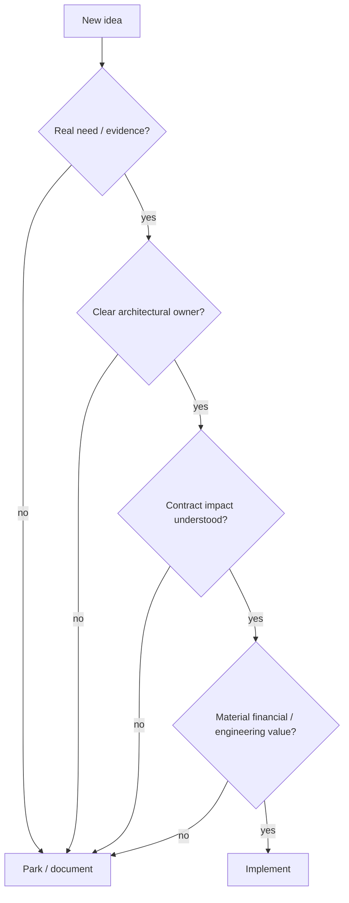

# Roadmap

The project has reached an important maturity point:

> **Capability is no longer the main bottleneck. Confidence, evidence, and selective evolution matter more.**

That changes the shape of the roadmap.

Earlier phases benefited from large architectural changes because the system was still discovering its natural boundaries. The current architecture is stable enough that another broad refactor would need a very strong reason to exist.

The roadmap is therefore **trigger-based rather than novelty-based**.



## 1. Current baseline: protect the architecture that earned its stability

The current system already has mature boundaries for:

- evidence acquisition;
- Control Plane history;
- Bronze persistence;
- canonical transformation;
- investment reconstruction;
- reconciliation;
- Tax evidence;
- wealth/FIRE;
- recovery;
- CLI/Desktop;
- quality/release engineering.

That means future work should default to **using existing boundaries**, not inventing new top-level architecture.

A new package layer, database, service, or framework should need a concrete problem that the current design cannot solve cleanly.

## 2. Roadmap philosophy

Future changes should satisfy at least one of these conditions:

```text
correctness gap
reliability gap
observed performance bottleneck
real new financial requirement
real new source/provider variation
meaningful product workflow improvement
maintainability problem backed by evidence
```

“Could be cool” is allowed in a notebook.

It is not automatically a production roadmap criterion.

## 3. Finish the documentation knowledge system

The immediate documentation work is part of the engineering roadmap, not housekeeping.

The target knowledge system is:

```text
Code = PROVE
/docs = SPECIFY
Wiki = TEACH
README = SHOW
profile README = contextualize the flagship project
```

The near-term documentation sequence is:

1. finish the canonical `/docs` rebase;
2. rebuild the Wiki ground-up against the finished docs and current source;
3. rebuild the root README with the SHOW rubric;
4. perform final cross-link/navigation integration;
5. update the GitHub profile README last.

Canonical docs remain release-agnostic so they describe the system rather than the release that introduced it.

## 4. QA expansion is the main engineering frontier

The system already has strong targeted and architectural tests, but the highest-value maturity work is broader **behavioral regression confidence**.

The goal is not “maximize test count.”

It is to protect the contracts that would hurt most if they drifted silently.

### Financial regression fixtures

Build/retain representative deterministic fixtures for:

- household cash flow;
- net worth;
- FIFO lots;
- realized events;
- reconciliation;
- multi-currency valuations;
- XIRR/CAGR validity;
- TaxEvents;
- deterministic FIRE metrics.

### Cross-domain regression

Protect flows where multiple domains interact:

```text
investment realized event
    → TaxEvent
    → Tax Gold

reconciliation
    → corrected lot state
    → future sale
    → realized event

wealth state
    → FIRE inputs
    → simulation outputs
```

These are places where locally correct modules can still produce globally wrong behavior.

## 5. Reliability and recovery regression coverage

Recovery deserves scenario-based testing because happy-path tests cannot prove failure semantics.

High-value scenarios include:

- DuckDB work fails before SQLite commit;
- SQLite work fails after DuckDB commit;
- stale run detection;
- snapshot validation failure;
- staged restore failure;
- rollback success;
- rollback failure / uncertain active state;
- missing retained Bronze payload;
- artifact rename/removal transitions.

The target is not to pretend every cross-store failure is atomic.

The target is to prove that the system **reports truthfully what state it reached and how it can converge again**.

## 6. Contract and schema regression protection

The Data Contract Registry is mature enough to support stronger automated checks around:

- complete registry coverage;
- declared vs actual schemas;
- grain uniqueness;
- deterministic identity fields;
- nullable/required semantics;
- producer ownership;
- Gold additivity metadata where useful.

Schema drift is cheaper to catch before Power BI discovers it through interpretive dance.

## 7. Configuration fixture modernization

Configuration is now a first-class policy surface.

Future QA should include representative fixtures for:

- minimal valid settings;
- invalid/missing runtime paths;
- financial-rule boundary conditions;
- Tax policy exclusivity;
- FIRE simulation combinations;
- model fingerprints;
- rules/settings snapshot stability.

Historical sample TOMLs should never become de facto contracts when the Pydantic models have moved on.

## 8. Static quality and type discipline

The current type/quality system should remain strict but pragmatic.

Priorities:

```text
keep stable shapes typed
keep dynamic-library exceptions explicit
avoid expanding Any across boundaries
preserve public APIs
keep architecture tests enforceable
```

Future typing work should reduce real ambiguity, not create abstraction noise to satisfy a metric.

## 9. Performance becomes observational, not aspirational

The system is already fast enough for its local operating model that performance work should be evidence-driven.

The approach is:


Do not optimize a 2 ms function because it offended a profiler aesthetically.

### Continue watching Polars boundaries

Materialization boundaries should remain classified and intentional.

New `.collect()`, `.to_dicts()`, `.rows()`, or Python loops in hot analytical paths deserve review.

### Preserve stateful exceptions

FIFO and selected numerical kernels are stateful/algorithmic for real reasons.

Not everything becomes better because it fits inside one heroic Polars expression.

## 10. Documentation QA becomes release hygiene

Documentation should be validated like code where practical.

Future release hygiene should include checks for:

- broken relative links;
- stale source paths;
- manifest coverage;
- unbalanced fences;
- Mermaid syntax where feasible;
- formula rendering;
- schema/table count drift;
- version/release leakage into canonical docs;
- stale Wiki links.

The docs are large enough that manual memory is not a sustainable QA strategy.

## 11. Maintainability and simplification

Future simplification should target **real cognitive load**.

Good candidates include:

- duplicated orchestration;
- repeated policy checks;
- unclear status/result vocabulary;
- private helpers that became de facto public contracts;
- unnecessary wrapper layers;
- duplicated schema declarations.

Bad candidates include:

- cohesive numerical kernels that are only “too long” by style metric;
- declarative catalogs whose size reflects legitimate domain breadth;
- stateful financial algorithms split solely to reduce line count.

The objective is fewer concepts, not merely fewer lines.

## 12. Gold remains curated

Gold should grow only when a new dataset supports a real analytical decision.

Before adding a mart, require:

```text
decision purpose
grain
canonical upstream owner
additivity semantics
currency semantics
BI use case
contract + tests
```

A table is not automatically useful because DuckDB can create it quickly.

## 13. Financial-domain changes require real evidence

Future changes to FIFO, Tax, FX, reconciliation, or FIRE should start from a concrete financial need or correctness issue.

Examples that justify change:

- a new broker/source behavior;
- a new statutory treatment relevant to actual evidence;
- a real asset type with different economic semantics;
- a known reconciliation class not currently represented;
- a material modelling limitation observed in actual planning use.

The project should resist speculative feature accumulation in financially sensitive areas.

## 14. Portability grows when variation appears

The current architecture supports extension, but portability should be earned by real examples.

A future new broker/source should first be integrated cleanly.

If multiple sources reveal a stable common capability, extract the abstraction then.

This is preferable to designing an “universal broker interface” based on imagination and vibes.

## 15. Local-first remains the default

There is currently no strong reason to replace the local architecture with cloud services.

Local-first remains appropriate because of:

- privacy;
- source locality;
- embedded database performance;
- low operational overhead;
- single-user workflows;
- Power BI adjacency.

Cloud/server architecture should appear only if a real requirement introduces:

```text
multi-user concurrency
remote access
shared service ownership
large-scale compute
cross-device synchronization
```

Until then, complexity does not get points for distance traveled over the network.

## 16. Semantic and AI capabilities remain downstream

AI/semantic features remain interesting, but they should consume the stable system rather than reshape it prematurely.

A sensible future sequence is:

```text
stable canonical contracts
    ↓
semantic metadata
    ↓
read-only retrieval / explanation
    ↓
agentic workflows only with explicit authority boundaries
```

Potential future uses include:

- natural-language explanation of financial state;
- semantic navigation of lineage/contracts;
- read-only portfolio/Tax/FIRE Q&A;
- anomaly explanation;
- documentation-aware local assistants.

The prerequisite is trustworthy structured state.

An AI layer over ambiguous data simply automates confidence.

## 17. What is intentionally not on the roadmap

Unless a real requirement emerges, the project does not need:

- microservices;
- Kubernetes;
- distributed orchestration;
- event streaming infrastructure;
- a generic plugin marketplace;
- multi-tenant cloud hosting;
- blockchain anything;
- a second warehouse because one database looked lonely.

This is not anti-technology.

It is pro-problem.

## 18. Trigger-based future evolution

The roadmap can be summarized as a set of triggers.

| Trigger | Likely response |
| --- | --- |
| recurring financial mismatch | investigate domain/reconciliation model |
| new provider/source family | add infrastructure adapter + evidence contract |
| observed hot path | benchmark and optimize targeted path |
| schema drift risk | strengthen registry/contract tests |
| repeated manual release step | automate tooling |
| real portability variation | extract common interface |
| stable AI use case | add downstream semantic capability |
| recovery ambiguity | strengthen lifecycle/recovery model |

This keeps change tied to evidence.

## 19. Success criteria for the maturity phase

The next phase is successful if:

- architecture remains stable;
- financial outputs remain explainable;
- regression confidence increases;
- releases become more boring;
- documentation stays synchronized;
- performance changes are measured;
- new features are selective;
- the project remains enjoyable to maintain.

That last criterion matters more than most roadmaps admit.

A personal flagship system should become more useful as it matures, not become a full-time unpaid platform team.

## 20. Near-term sequence

The immediate sequence is intentionally simple:

```text
finish canonical docs
    ↓
rebuild Wiki
    ↓
rebuild root README
    ↓
cross-link the knowledge system
    ↓
refresh profile README
    ↓
use the system
    ↓
let real needs determine what comes next
```

That is the roadmap’s central idea:

> **The next architecture should be discovered by the next real problem, not scheduled because the current one finally became stable.**

## Related specifications

- [Engineering Standards](developer/engineering-standards.md)
- [Testing and Validation](developer/testing-and-validation.md)
- [Reliability and Recovery](architecture/reliability-and-recovery.md)
- [Financial Model](finance/financial-model.md)
- [About the Project](about/project.md)
